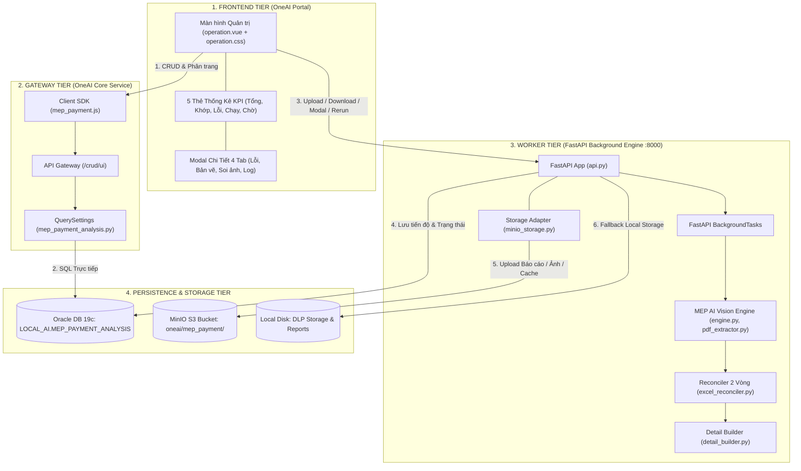
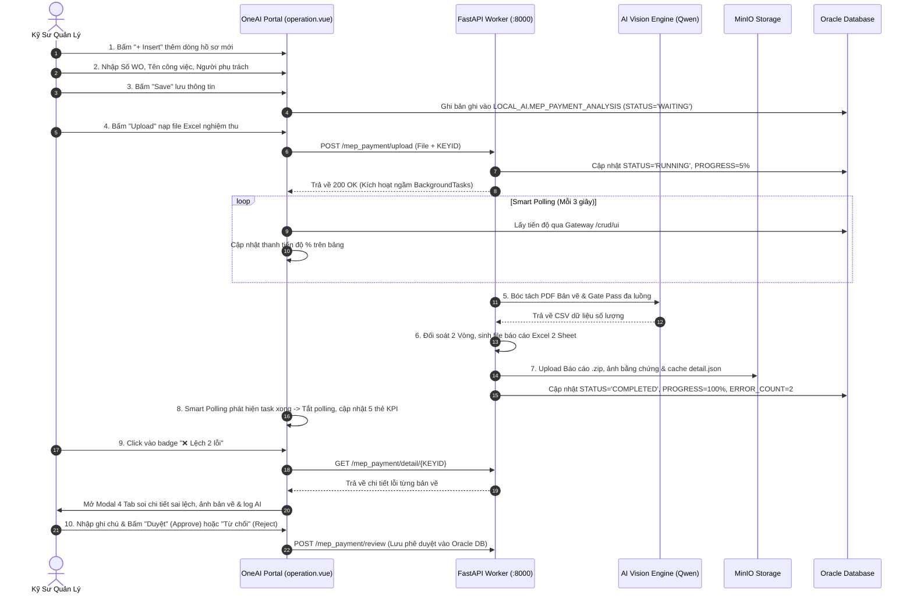

# 🏢 MEP PAYMENT AI ANALYSIS SYSTEM (ONEAI PLATFORM)

[](https://www.python.org/)
[](https://fastapi.tiangolo.com/)
[](https://vuejs.org/)
[](https://element-plus.org/)
[](https://www.oracle.com/database/)
[](https://min.io/)
[]()

> **Hệ thống AI Tự Động Bóc Tách Bản Vẽ & Đối Soát Thanh Quyết Toán Cơ Điện (MEP)** tích hợp trực tiếp vào nền tảng **OneAI Portal**.  
> Giải pháp phát hiện sai lệch khối lượng giữa bảng dự toán nhà thầu (BOM/BOQ), bản vẽ kỹ thuật CAD/PDF và biên bản vật tư mang vào xưởng (Gate Pass) với độ chính xác tuyệt đối.

---

## 🌟 ĐẶC ĐIỂM NỔI BẬT

* ⚡ **Đối soát 2 Vòng Độc Lập:**
  * **Vòng 1 (Sheet 1):** So sánh Bản vẽ kỹ thuật (AI bóc tách) với Bảng khối lượng đề nghị thanh toán của Nhà thầu theo tổ hợp khóa 3 chiều: `Mã SDAC + Phụ trội % + Ghi chú Remark`.
  * **Vòng 2 (Sheet 2):** So sánh Khối lượng chuẩn trên Bản vẽ (đã trừ vật tư kho SDV cấp) với Biên bản vật tư mang vào xưởng (Gate Pass PDF). Cảnh báo đỏ nếu mang thiếu vật tư vào công trường.
* 👁️ **Thị Giác Máy Tính Đa Luồng (AI Vision Pipeline):**
  * Tự động giải nén nhị phân OLE từ file Excel để trích xuất file PDF bản vẽ CAD và PDF Gate Pass.
  * Thuật toán **OpenCV Magic Crop** kết hợp bộ lọc hình thái học (Morphological Filter) định vị chính xác khung bảng danh mục vật tư.
  * Băm ảnh theo chiều ngang (RAM Chunking), gửi đa luồng song song lên máy chủ AI Vision (NextAI Qwen 3.8) để nhận diện mã SDAC, quy cách và số lượng.
* 📦 **Lưu Trữ Đám Mây Chuẩn Enterprise (MinIO Object Storage):**
  * Hỗ trợ **Dual-Mode**: Tự động nhận diện cấu hình `ONEAI_MINIO_*` trên OneAI Platform hoặc `MINIO_*` trong file `.env`.
  * Cơ chế **Graceful Fallback**: Tự động chuyển đổi mượt mà sang lưu đĩa cứng cục bộ khi không có MinIO, đảm bảo hệ thống không bao giờ bị dừng hoạt động đột ngột.
  * Phục vụ tải file báo cáo Excel/ZIP và hiển thị ảnh bằng chứng bằng HTTP Stream / Presigned URL tốc độ cao.
  * Tự động dọn dẹp sạch toàn bộ file trên MinIO khi người dùng xóa dòng tác vụ trong Oracle DB (Compensating Cleanup).
* 🎯 **Bóc Tách Sai Lệch Chuẩn Xác Từng Bản Vẽ:**
  * Thuật toán phân tích cú pháp `parse_dwg_segments` trích xuất chính xác số lượng Nhà thầu khai và AI đếm được cho riêng từng bản vẽ (chấm dứt tình trạng số tổng dự án gây hiểu lầm $101 = 101$ mà lại báo lỗi).
  * Cơ chế **Auto-Detect & Rebuild Cache**: Tự động nhận diện file cache cũ trên MinIO / Local Disk và tự động bóc tách lại từ file Excel sang định dạng mới chuẩn xác ngay khi mở modal.
* 🎨 **Giao Diện Vue 3 Dark Theme Hoàn Chỉnh:**
  * Tách rời toàn bộ CSS sang `operation.css` giúp tăng tốc độ render.
  * Khắc phục triệt để hiện tượng nhấp nháy/rung giật khi rê chuột xem ảnh thumbnail bằng `:preview-teleported="true"`.
  * Hệ thống **5 Thẻ KPI Thống Kê**: Tổng hồ sơ, Khớp 100%, Có sai lệch, Đang đối soát, Chờ duyệt (Click-to-filter nhanh).
  * **Smart Polling 3s Thông Minh**: Tự động cập nhật tiến độ ngầm, tự động làm biến mất dòng 100% khi lọc tab "Đang đối soát AI", dừng timer ngầm và đồng bộ ngay 5 thẻ KPI mà không cần bấm Reload.

---

## 🏛️ KIẾN TRÚC TOÀN CẢNH HỆ THỐNG (4-TIER ARCHITECTURE)

Hệ thống được thiết kế theo mô hình 4 tầng phân tách trách nhiệm chặt chẽ:



---

## 📂 CẤU TRÚC THƯ MỤC DỰ ÁN

```
MEP_OneAI_System/
├── backend/                               # FASTAPI WORKER SERVICE & AI PIPELINE
│   ├── api.py                             # API endpoints: /upload, /files, /detail, /image, /save_rows, /review
│   ├── main.py                            # Entrypoint Uvicorn khởi động Worker (:8000)
│   ├── config.py                          # Tham số cấu hình AI Model, ROI Bản vẽ, OpenCV, Đường dẫn
│   ├── sql.py                             # Thao tác Oracle DB: insert, update, save_tasks, delete_tasks, check_keyid
│   ├── minio_storage.py                   # Adapter MinIO Dual-Mode kết hợp Fallback Local Disk
│   ├── detail_builder.py                  # Module bóc tách chi tiết kết quả đối soát ra JSON Cache
│   ├── engine.py                          # Pipeline điều phối luồng xử lý toàn trình
│   ├── pdf_extractor.py                   # Trích xuất PDF từ Excel, OpenCV Magic Crop, OCR Số bản vẽ
│   ├── excel_reconciler.py                # Thuật toán đối soát chéo 2 Vòng, định dạng tô màu OpenPyXL
│   ├── requirements.txt                   # Danh sách thư viện Python phụ thuộc
│   └── .env                               # File cấu hình biến môi trường cục bộ
│
├── oneai_integration/                     # TÍCH HỢP NỀN TẢNG ONEAI PLATFORM
│   ├── backend/
│   │   ├── menu_operation/
│   │   │   └── mep_payment/
│   │   │       └── mep_payment_analysis.py # Cấu hình QuerySettings SQL phân trang và đếm KPI
│   │   └── database/
│   │       └── create_table.sql           # DDL khởi tạo bảng LOCAL_AI.MEP_PAYMENT_ANALYSIS
│   └── frontend/
│       └── operation/
│           ├── main.vue                   # Khung chứa màn hình OneAI Tab
│           ├── js/
│           │   ├── mep_payment.js         # Client API giao tiếp Gateway /crud/ui
│           │   └── mepPayment.js          # Bản tương thích cũ
│           └── tab/
│               ├── operation.vue          # Component bảng quản trị và hộp thoại chi tiết 4 Tab
│               └── operation.css          # CSS Dark Theme độc lập (đã tách rời)
│
├── docs/                                  # HỆ THỐNG TÀI LIỆU KỸ THUẬT CHUYÊN SÂU
│   ├── README.md                          # Mục lục danh mục tài liệu toàn diện
│   ├── 01_HUONG_DAN_TRIEN_KHAI_ONEAI_TOAN_DIEN.md
│   ├── 02_GIAI_MA_TOAN_DIEN_CODE_SEP_GUI.md
│   ├── 03_THUAT_TOAN_LOI_PIPELINE_ARCHITECTURE.md
│   ├── 04_KIEN_TRUC_TOAN_CANH_VA_LUONG_DU_LIEU_CHI_TIET.md
│   ├── 05_HUONG_DAN_CHI_TIET_TU_CODE_LOCAL_LEN_ONEAI_STEP_BY_STEP.md
│   ├── 06_KIEN_TRUC_STEP2_BOC_TACH_CAD_DXF_VA_DOI_SOAT_SO_DO_DI_DAY.md
│   ├── 07_KIEN_TRUC_NANG_CAP_GIAO_DIEN_TRUC_QUAN_THEO_CHUAN_SEP_GUI.md
│   └── 08_HUONG_DAN_TICH_HOP_MINIO_STORAGE_VA_XU_LY_SAI_LECH_CHI_TIET.md
│
├── preview_mep_oneai.html                 # Bản xem trước giao diện độc lập (Standalone Preview)
└── README.md                              # Tài liệu tổng quan này
```

---

## ⚙️ CẤU HÌNH HỆ THỐNG (.env)

Tạo file `backend/.env` với các thông số mẫu:

```ini
# ====================================================================
# 1. TÀI KHOẢN ORACLE DATABASE (LOCAL_AI.MEP_PAYMENT_ANALYSIS)
# ====================================================================
DB_USER_YMS_AI=LOCAL_AI
DB_PASSWORD_YMS_AI=WKEHDGHK1!
DB_SERVICE=MBLDB_SVC
ORACLE_CLIENT_LIB_DIR=C:\oracle_client

# ====================================================================
# 2. CẤU HÌNH FASTAPI WORKER SERVICE
# ====================================================================
WORKER_HOST=0.0.0.0
WORKER_PORT=8000

# ====================================================================
# 3. CẤU HÌNH MINIO OBJECT STORAGE (DUAL-MODE)
# ====================================================================
USE_MINIO=true
ONEAI_MINIO_ENDPOINT=107.126.11.129:31800
ONEAI_MINIO_ACCESS=your_access_key
ONEAI_MINIO_SECRET=your_secret_key
ONEAI_MINIO_BUCKETNAME=oneai
MINIO_PREFIX=mep_payment

# ====================================================================
# 4. CẤU HÌNH AI MODEL SERVER (QWEN VISION)
# ====================================================================
MEP_API_URL=http://107.126.11.129:32200/api/v1/chat/completions
MEP_API_KEY=sk-pEqadpi8UZjOr2RWUTdXliuxXcTFVc-dezojIsgbJ0Y
MEP_MODEL_NAME=NextAI-SDV
```

---

## 🚀 HƯỚNG DẪN CÀI ĐẶT & KHỞI CHẠY

### 1. Cài đặt môi trường Python
```bash
cd backend
python -m venv venv
venv\Scripts\activate   # Trên Windows
pip install -r requirements.txt
```

### 2. Khởi chạy FastAPI Worker Service
```bash
cd backend
python main.py
```
*Dịch vụ sẽ khởi động tại `http://0.0.0.0:8000`. Khi khởi chạy thành công, console sẽ hiển thị:*
```
🚀 [FastAPI] Khởi động Worker tại http://0.0.0.0:8000 ...
✅ Service đã sẵn sàng tiếp nhận yêu cầu từ OneAI Portal...
📦 [MinIO] Đã kết nối MinIO Server (107.126.11.129:31800, Bucket: oneai)
```

### 3. Tích hợp OneAI Portal
1. **Backend OneAI:** Copy thư mục `oneai_integration/backend/menu_operation/mep_payment/` vào thư mục chức năng của OneAI Platform.
2. **Frontend OneAI:** Copy thư mục `oneai_integration/frontend/operation/` vào menu tương ứng trong giao diện OneAI Portal.
3. **Database:** Chạy file `create_table.sql` trong DBeaver/PLSQL Developer để tạo bảng `LOCAL_AI.MEP_PAYMENT_ANALYSIS`.

---

## 📋 HƯỚNG DẪN QUY TRÌNH VẬN HÀNH THỰC TẾ



---

## 📚 HỆ THỐNG TÀI LIỆU THAM KHẢO CHUYÊN SÂU

Trong thư mục [`docs/`](./docs/), bạn có thể tra cứu toàn bộ 10 bộ tài liệu chuyên sâu:

1. [**01. Hướng Dẫn Triển Khai OneAI Toàn Diện**](./docs/01_HUONG_DAN_TRIEN_KHAI_ONEAI_TOAN_DIEN.md): Chi tiết DDL, QuerySettings, Javascript SDK và Worker.
2. [**02. Giải Mã Toàn Diện Mã Nguồn Của Sếp**](./docs/02_GIAI_MA_TOAN_DIEN_CODE_SEP_GUI.md): Phân tích chi tiết 25 file trong dự án mẫu của sếp.
3. [**03. Thuật Toán Lõi & Kiến Trúc Pipeline**](./docs/03_THUAT_TOAN_LOI_PIPELINE_ARCHITECTURE.md): Phân tích OpenCV Magic Crop, RAM Chunking và đối soát 2 Vòng.
4. [**04. Kiến Trúc Toàn Cảnh & Luồng Dữ Liệu Chi Tiết**](./docs/04_KIEN_TRUC_TOAN_CANH_VA_LUONG_DU_LIEU_CHI_TIET.md): Bức tranh 4 tầng, từ điển từng file và kịch bản bảo vệ trước sếp.
5. [**05. Cẩm Nang Thực Chiến Từng Bước (Cookbook)**](./docs/05_HUONG_DAN_CHI_TIET_TU_CODE_LOCAL_LEN_ONEAI_STEP_BY_STEP.md): Cầm tay chỉ việc từ script terminal lên màn hình OneAI.
6. [**06. Kiến Trúc & Kế Hoạch Triển Khai Step 2 (CAD Vector)**](./docs/06_KIEN_TRUC_STEP2_BOC_TACH_CAD_DXF_VA_DOI_SOAT_SO_DO_DI_DAY.md): Bóc tách CAD DXF hình học và đối soát sơ đồ đi dây.
7. [**07. Nâng Cấp Giao Diện Trực Quan 4 Tab**](./docs/07_KIEN_TRUC_NANG_CAP_GIAO_DIEN_TRUC_QUAN_THEO_CHUAN_SEP_GUI.md): Thiết kế Modal 4 tab, KPI và trải nghiệm người dùng v2.0.
8. [**08. Tích Hợp MinIO Storage, Bóc Tách Sai Lệch & Tối Ưu Giao Diện**](./docs/08_HUONG_DAN_TICH_HOP_MINIO_STORAGE_VA_XU_LY_SAI_LECH_CHI_TIET.md): Giải pháp MinIO Dual-mode, bóc tách `parse_dwg_segments` và Smart Polling v2.5.
9. [**09. Hướng Dẫn Chi Tiết Luồng Code Hiển Thị Form & Bản Đồ Ánh Xạ Dữ Liệu**](./docs/09_HUONG_DAN_CHI_TIET_LUONG_CODE_HIEN_THI_FORM_VA_DU_LIEU.md): Giải phẫu chi tiết 100% từng con số, thẻ badge, bảng và cột trên giao diện người dùng.
10. [**10. Giải Mã Toàn Diện Về minio_storage.py & detail_builder.py**](./docs/10_GIAI_MA_LUONG_MINIO_STORAGE_VA_DETAIL_BUILDER.md): Bản chất, luồng hoạt động từng bước và vị trí triển khai chuẩn xác của 2 module then chốt.

---

## 👥 THÔNG TIN TÁC GIẢ & BẢO TRÌ
* **Đơn vị phát triển:** MEP AI Solution Team - OneAI Platform
* **Công nghệ:** FastAPI + Vue 3 + Element Plus + OpenCV + Calamine + Oracle DB + MinIO Object Storage
* **Bản quyền:** © 2026 OneAI Platform. Giữ toàn quyền.

