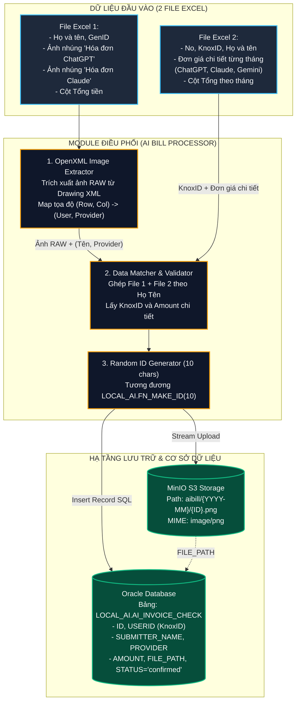

# BẢN PHÂN TÍCH THIẾT KẾ TOÀN DIỆN: HỆ THỐNG TRÍCH XUẤT HÓA ĐƠN AI TỪ EXCEL, ĐẨY LÊN MINIO & ĐỒNG BỘ CƠ SỞ DỮ LIỆU

> **Tài liệu phân tích kỹ thuật & kiến trúc giải pháp (Architecture & Workflow Analysis)**  
> **Module mới:** `AI Bill Processor & Database Synchronizer`  
> **Trạng thái:** Giai đoạn phân tích thiết kế (Chưa tạo code thực thi).

---

## 1. TỔNG QUAN BÀI TOÁN & MỤC TIÊU CỐT LÕI

Hệ thống cần tiếp nhận **2 file Excel** từ bộ phận quản lý chi phí dịch vụ AI (ChatGPT Plus, Claude Pro, Gemini Pro):
1. **File Excel 1 (Bảng nộp hồ sơ hóa đơn):** Chứa danh sách nhân sự và **ảnh chụp hóa đơn được chèn trực tiếp vào các ô (cells)** ở cột `Hóa đơn ChatGPT`, `Hóa đơn Claude`. File này chỉ có cột *Tổng số tiền thanh toán*, không có đơn giá chi tiết từng dịch vụ.
2. **File Excel 2 (Bảng chi tiết thanh toán theo tháng & KnoxID):** Chứa `KnoxID`, `Họ và Tên`, và chi tiết số tiền chi trả cho từng dịch vụ AI (`ChatGPT Plus`, `Claude Pro`, `Gemini Pro`) theo từng tháng cụ thể (`Aug-26`, `Sep-26`, `Oct-26`...).

### Nhiệm vụ của hệ sinh thái tự động:
* **Trích xuất ảnh hóa đơn nguyên bản (Raw)** từ các ô trong File Excel 1.
* **Định danh chính xác** ảnh nào thuộc về nhân sự nào, thuộc dịch vụ nào (`ChatGPT` hay `Claude`).
* **Đối chiếu với File Excel 2** theo `Họ và Tên` và `Tháng cần xử lý` để lấy đúng:
  * Mã định danh tài khoản công ty: `KnoxID` (`USERID`).
  * Số tiền chi trả chính xác cho dịch vụ đó: `AMOUNT`.
* **Tải ảnh lên hạ tầng MinIO Cloud Storage** theo chuẩn đường dẫn phân cấp: `aibill/{YYYY-MM}/{ID}.png`.
* **Lưu trữ dữ liệu vào bảng cơ sở dữ liệu** `LOCAL_AI.AI_INVOICE_CHECK` với đầy đủ các trường thông tin kiểm soát.



---

## 2. GIẢI MÃ THẮC MẮC: ẢNH LẤY TỪ EXCEL CÓ PHẢI ẢNH RAW KHÔNG? CÓ BỊ VỠ/GIẢM CHẤT LƯỢNG KHÔNG?

> [!IMPORTANT]
> **KẾT LUẬN KỸ THUẬT: ẢNH LẤY TỪ EXCEL LÀ ẢNH RAW NGUYÊN BẢN 100% (PIXEL-PERFECT), HOÀN TOÀN KHÔNG BỊ GIẢM CHẤT LƯỢNG HAY BỊ VỠ!**

### Bản chất cấu trúc định dạng file `.xlsx`:
1. File `.xlsx` thực chất là một gói nén chuẩn **ZIP** chứa các file XML và tài nguyên đa phương tiện (chuẩn Microsoft OpenXML).
2. Khi người dùng thao tác kéo-thả, paste hoặc chèn ảnh vào Excel (`Insert -> Pictures`):
   * Microsoft Excel **sao chép nguyên vẹn luồng nhị phân (binary stream)** của file ảnh gốc và lưu trữ tại thư mục nội bộ: `xl/media/image1.png`, `image2.jpeg`...
   * Độ phân giải (DPI), kích thước pixel (Width x Height), độ sâu màu (Bit depth) và định dạng gốc được giữ nguyên 100%.
3. **Tại sao nhìn trên màn hình Excel lại thấy nhỏ hoặc mờ?**
   * Excel chỉ áp dụng thẻ tọa độ hiển thị `<xdr:twoCellAnchor>` trong file `xl/drawings/drawing1.xml` để co giãn khung nhìn (viewport) cho vừa vặn với kích thước hàng và cột.
   * Đây chỉ là hiệu ứng hiển thị (visual scaling) trên màn hình, không hề nén đè vào dữ liệu ảnh gốc bên trong file.
4. **Giải pháp trích xuất:**
   * Sử dụng thư viện `openpyxl` hoặc module `zipfile` của Python mở trực tiếp gói nén, đọc thẳng mảng byte từ `xl/media/`.
   * File ảnh lấy ra đảm bảo **sắc nét từng pixel**, sẵn sàng lưu trữ lên MinIO phục vụ kiểm toán tài chính lâu dài.

---

## 3. PHÂN TÍCH CHI TIẾT 2 FILE EXCEL ĐẦU VÀO

### 3.1. Phân tích File Excel 1 (Bảng nộp hóa đơn kèm hình ảnh)
Dựa trên hình ảnh chụp màn hình thực tế ([media_1794285410000_c6178ebf.webp](file:///C:/Users/Vladimir/.gemini/antigravity/brain/e5afa407-9150-4eec-a142-6f68337eddf2/.user_uploaded/media_1794285410000_c6178ebf.webp)):

| STT | Họ và Tên | GenID | Team | Group | Part | Hóa đơn ChatGPT (Cột 7) | Hóa đơn Claude (Cột 8) | Số tiền thanh toán (Cột 9) | Tiêu chuẩn thanh toán (Cột 10) |
| :-: | :--- | :---: | :--- | :--- | :--- | :---: | :---: | :---: | :---: |
| 1 | **Nguyễn Thị Kim Ngân** | 24420206 | DTM Team(SDV) | DTM Phone Process Architect Group(SDV) | | **[ẢNH CHATGPT]** | *(Trống)* | 499,000 | 1,200,000 |
| 2 | **Chu Thị Thảo Nga** | 16425218 | DTM Team(SDV) | DTM Technology Group(SDV) | DTM Equipment Innovation Part(SDV) | *(Trống)* | *(Trống)* | 0 | 1,200,000 |
| 3 | **Nguyễn Hữu Đồng** | 17439982 | Infra/EHS Team(SDV) | EHS Group(SDV) | Safety Part(SDV) | **[ẢNH CHATGPT]** | **[ẢNH CLAUDE]** | 1,082,222 | 1,200,000 |

#### Đặc điểm nghiệp vụ quan trọng:
* **Trường hợp 1 (1 Hóa đơn):** Người như *Nguyễn Thị Kim Ngân* chỉ nộp ảnh ChatGPT $\rightarrow$ Sinh **1 bản ghi DB** (Provider = ChatGPT).
* **Trường hợp 2 (Không nộp hóa đơn):** Người như *Chu Thị Thảo Nga* số tiền = 0, không có ảnh $\rightarrow$ **Bỏ qua (Skip)**, không tạo bản ghi rác.
* **Trường hợp 3 (Đa hóa đơn - Multi Invoices):** Người như *Nguyễn Hữu Đồng* nộp cả ảnh ChatGPT lẫn Claude, tổng tiền = 1,082,222.
  * Trong File 1 không có giá riêng cho từng ảnh.
  * Phải sinh ra **2 bản ghi DB riêng biệt** (1 bản ghi ChatGPT và 1 bản ghi Claude). Do đó bắt buộc phải có File Excel 2 để tách số tiền!

---

### 3.2. Phân tích File Excel 2 (Bảng chi tiết số tiền theo tháng & KnoxID)
Dựa trên hình ảnh chụp màn hình thực tế ([media_1794285410045_3ac3cd7f.jpg](file:///C:/Users/Vladimir/.gemini/antigravity/brain/e5afa407-9150-4eec-a142-6f68337eddf2/.user_uploaded/media_1794285410045_3ac3cd7f.jpg)):

* **Cột định danh:**
  * `No.`: Số thứ tự.
  * `KnoxID`: Tên tài khoản định danh người dùng trong tập đoàn (ví dụ: `kimngan.nguyen`, `dong.nh`, `thaonga.chu`).
  * `Name`: Họ và tên đầy đủ (khớp với cột *Họ và Tên* của File 1).
* **Cột theo dõi theo từng tháng:**
  * Cấu trúc Header đa tầng (Multi-level header) chia theo các khối tháng: `Aug-26`, `Sep-26`, `Oct-26`...
  * Mỗi tháng gồm các cột thành phần:
    * `ChatGPT Plus` (Số tiền)
    * `Claude Pro` (Số tiền)
    * `Gemini Pro` (Số tiền - nếu có)
    * `Total` (Tổng tiền tháng đó)

#### Sự đối chiếu hoàn hảo giữa 2 File:
* Nhân sự **Nguyễn Thị Kim Ngân** (`kimngan.nguyen`):
  * Cột `Oct-26`: ChatGPT Plus = **`499,000`**, Claude Pro = `0`, Total = `499,000` $\rightarrow$ Khớp 100% với số tiền File 1!
* Nhân sự **Nguyễn Hữu Đồng** (`dong.nh`):
  * Cột `Sep-26`: ChatGPT Plus = **`527,778`**, Claude Pro = **`554,444`**, Total = **`1,082,222`** $\rightarrow$ Khớp 100% với số tiền File 1!
  * Nhờ File 2, ta lấy được chính xác:
    * Tiền cho ảnh ChatGPT = `527,778` VNĐ.
    * Tiền cho ảnh Claude = `554,444` VNĐ.

---

## 4. BẢN ĐỒ ÁNH XẠ DỮ LIỆU CƠ SỞ DỮ LIỆU (DATABASE SCHEMA MAPPING)

Bảng đích trong Oracle Database: **`LOCAL_AI.AI_INVOICE_CHECK`** (Chi tiết từ ảnh cấu trúc DBeaver [media_1794285410031_1e9fa2cc.jpg](file:///C:/Users/Vladimir/.gemini/antigravity/brain/e5afa407-9150-4eec-a142-6f68337eddf2/.user_uploaded/media_1794285410031_1e9fa2cc.jpg)):

| STT | Tên Cột Trong DB | Kiểu Dữ Liệu | Ràng Buộc / Default | Nguồn Dữ Liệu & Quy Tắc Sinh | Ví Dụ Giá Trị Mẫu |
| :-: | :--- | :--- | :--- | :--- | :--- |
| 1 | **ID** | `VARCHAR2(10)` | `NOT NULL` (PK) | Sinh ngẫu nhiên 10 ký tự bằng thuật toán tương đương hàm `LOCAL_AI.FN_MAKE_ID(10)` | `62a87c311d` |
| 2 | **CREATED_AT** | `DATE` | `DEFAULT SYSDATE` | Thời gian tạo bản ghi trong hệ thống | `2026-11-10 12:52:11` |
| 3 | **MONTH** | `VARCHAR2(20)` | Nullable | Tháng thanh toán định dạng `YYYY-MM` (Tự động bóc tách từ tên file Excel: `2026.10` -> `2026-10`) | `2026-10` |
| 4 | **SUBMITTER_NAME** | `VARCHAR2(100)` | Nullable | Lấy từ cột *Họ và Tên* (File 1 / File 2) | `Nguyễn Thị Kim Ngân` |
| 5 | **SUBMITTER_EMAIL** | `VARCHAR2(100)` | Nullable | Lấy từ cột *Thanh toán* (sheet 'Thanh toán' File 2): giữ nguyên nếu có đuôi `@yahoo.com.vn`, tự động điền `@gmail.com` nếu chưa có | `nguyenthikimngan269@gmail.com` |
| 6 | **FILE_NAME** | `VARCHAR2(100)` | Nullable | Tên file ảnh gốc (đặt theo dịch vụ: `chatGpt.png` hoặc `claude.png`) | `chatGpt.png` |
| 7 | **FILE_PATH** | `VARCHAR2(100)` | Nullable | Đường dẫn Object Key trên MinIO | `aibill/2026-11/62a87c311d.png` |
| 8 | **MIME** | `VARCHAR2(100)` | Nullable | Phân loại mime của file ảnh (cố định) | `image/png` |
| 9 | **DELETE_TOKEN** | `VARCHAR2(100)` | Nullable | Token xóa (theo yêu cầu: gán `NULL`) | `NULL` |
| 10 | **PROVIDER** | `VARCHAR2(100)` | Nullable | Nhà cung cấp dịch vụ: `ChatGPT` hoặc `Claude` (hoặc `Gemini`) | `ChatGPT` |
| 11 | **INVOICE_NUMBER** | `VARCHAR2(100)` | Nullable | Số hóa đơn (để `NULL`, hoặc sau này AI Vision đọc) | `NULL` |
| 12 | **INVOICE_DATE** | `VARCHAR2(100)` | Nullable | Ngày hóa đơn (để `NULL`, hoặc sau này AI Vision đọc) | `NULL` |
| 13 | **BILLING_EMAIL** | `VARCHAR2(100)` | Nullable | Mail nhận hóa đơn (tạm lấy theo `SUBMITTER_EMAIL`) | `nguyenthikimngan269@gmail.com` |
| 14 | **AMOUNT** | `NUMBER` | Nullable | Giá tiền dịch vụ lấy từ File 2 tương ứng theo cột dịch vụ và tháng | `499000` |
| 15 | **PLAN** | `VARCHAR2(100)` | Nullable | Tên gói dịch vụ (để `NULL`, hoặc gán theo Provider: `ChatGPT Plus` / `Claude Pro`) | `NULL` (hoặc `ChatGPT Plus`) |
| 16 | **EMAIL_MATCH** | `NUMBER(1,0)` | `DEFAULT 0` | 1 nếu `SUBMITTER_EMAIL == BILLING_EMAIL`, 0 nếu khác (mặc định = 1) | `1` |
| 17 | **WARNINGS** | `CLOB` | Nullable | Danh sách cảnh báo AI (để `NULL` hoặc `[]`) | `NULL` |
| 18 | **AI_RAW** | `CLOB` | Nullable | Kết quả JSON raw từ AI (để `NULL` hoặc JSON mẫu metadata) | `NULL` |
| 19 | **STATUS** | `VARCHAR2(20)` | `DEFAULT 'pending'` | Trạng thái phê duyệt (theo yêu cầu: cố định `'confirmed'`) | `confirmed` |
| 20 | **ADMIN_NOTE** | `VARCHAR2(2000)`| Nullable | Nhận xét của Admin (gán `NULL`) | `NULL` |
| 21 | **REVIEWED_AT** | `VARCHAR2(32)` | Nullable | Thời gian duyệt (gán `NULL`) | `NULL` |
| 22 | **USERID** | `VARCHAR2(100)` | Nullable | Knox ID của người dùng lấy từ cột `KnoxID` của File 2 | `kimngan.nguyen` |

---

## 5. THUẬT TOÁN KỸ THUẬT LÕI (TECHNICAL PIPELINE)

### 5.1. Thuật toán trích xuất ảnh chuẩn Cell Anchor từ OpenXML
Để biết ảnh nào nằm đúng ở dòng nào và cột nào (`Hóa đơn ChatGPT` hay `Hóa đơn Claude`), ta không dùng cách đọc thông thường mà truy cập trực tiếp vào cấu trúc bản vẽ OpenXML của Excel:

1. **Phân tích file `xl/drawings/drawing1.xml`:**
   * Mỗi ảnh được bao bọc trong một thẻ `<xdr:twoCellAnchor>`:
     ```xml
     <xdr:twoCellAnchor>
       <xdr:from>
         <xdr:col>6</xdr:col> <!-- Cột 6: Hóa đơn ChatGPT -->
         <xdr:row>1</xdr:row> <!-- Dòng 1: Nguyễn Thị Kim Ngân -->
       </xdr:from>
       <a:blip r:embed="rId1"/> <!-- Liên kết tài nguyên ảnh rId1 -->
     </xdr:twoCellAnchor>
     ```
2. **Ánh xạ qua `xl/drawings/_rels/drawing1.xml.rels`:**
   * Thẻ `rId1` trỏ trực tiếp đến file media: `../media/image1.png`.
3. **Kết luận ánh xạ:**
   * Ta biết chắc chắn 100%: File ảnh `image1.png` thuộc về **Dòng 1** (Nguyễn Thị Kim Ngân), và nằm ở **Cột ChatGPT**!

### 5.2. Thuật toán sinh ID 10 ký tự tương đương Oracle Function
Hàm Oracle trong cơ sở dữ liệu:
```sql
CREATE OR REPLACE function LOCAL_AI.fn_make_id(LEN NUMBER) return VARCHAR2 IS
begin
  return translate(DBMS_RANDOM.string('o', LEN), 'GHIJKLMNOPQRSTUVWXYZ', '0123456789ABCDEF0123');
end fn_make_id;
```
Trong Python, ta tái tạo chính xác cơ chế sinh chuỗi ngẫu nhiên 10 ký tự Hexadecimal bằng thư viện `secrets` đạt chuẩn bảo mật mã hóa:
```python
import secrets

def generate_invoice_id(length: int = 10) -> str:
    """Sinh chuỗi ID ngẫu nhiên 10 ký tự tương đương LOCAL_AI.FN_MAKE_ID(10)."""
    return secrets.token_hex(length // 2).lower()  # Sinh đúng 10 ký tự hex như '62a87c311d'
```

### 5.3. Chuẩn hóa đường dẫn lưu trữ MinIO
* **Cấu hình Bucket:** `oneai`.
* **Cấu trúc đường dẫn Object Key:** `aibill/{YYYY-MM}/{ID}.png`
  * Ví dụ: `aibill/2026-11/26a2dba1a5.png`
* **Xử lý luồng:** Đọc bytes ảnh trực tiếp từ Excel $\rightarrow$ Đảm bảo chuẩn PNG bằng PIL $\rightarrow$ Upload lên MinIO qua `put_object(..., content_type="image/png")`.

### 5.4. Tự động bóc tách Tháng thanh toán từ Tên File Excel
* File Excel đầu vào có định dạng tên: `(AI Crew) thanh toán hóa đơn tháng 2026.10.xlsx`, `(AI Crew) thanh toán hóa đơn tháng 2026.09.xlsx`...
* Biểu thức chính quy (Regex): `re.search(r'(\d{4})[._](\d{2})', filename)`:
  * Trích xuất: Năm `2026`, Tháng `10` $\rightarrow$ Định dạng DB: `MONTH = '2026-10'`.
  * Đường dẫn MinIO: `aibill/2026-10/{ID}.png`.
  * Tự động ánh xạ sang tên cột của File Excel 2: `2026-10` $\rightarrow$ `Oct-26` (hoặc `2026-09` $\rightarrow$ `Sep-26`, `2026-08` $\rightarrow$ `Aug-26`) để định vị chính xác cụm cột đơn giá cần lấy.

### 5.5. Thuật toán chuẩn hóa Email người nộp (`SUBMITTER_EMAIL`)
* Lấy giá trị từ cột `Thanh toán` trong sheet `Thanh toán` của File Excel 2.
* Quy tắc định dạng:
  * Nếu đã có đuôi `@yahoo.com.vn` hoặc `@gmail.com` $\rightarrow$ Giữ nguyên.
  * Nếu chỉ có username (ví dụ `nguyenthikimngan269`) $\rightarrow$ Tự động ghép: `nguyenthikimngan269@gmail.com`.
  * Đồng thời gán `BILLING_EMAIL = SUBMITTER_EMAIL` và `EMAIL_MATCH = 1`.

---

## 6. CÁC THÁCH THỨC KỸ THUẬT & TRƯỜNG HỢP BIÊN ĐÃ ĐƯỢC LÀM RÕ (EDGE CASES)

| STT | Tình Huống Kỹ Thuật (Edge Case) | Xử Lý Chuẩn Xác |
| :---: | :--- | :--- |
| **1** | **Khác biệt về Họ và Tên giữa 2 file** | Chuẩn hóa: loại bỏ khoảng trắng thừa, đưa về chữ thường (`re.sub(r'\s+', ' ', name.strip()).lower()`). |
| **2** | **Một người mua cả ChatGPT và Claude** | Tách thành **2 bản ghi DB độc lập**, mỗi bản ghi mang 1 `ID` 10 ký tự riêng, link ảnh MinIO riêng, Provider riêng (`ChatGPT` vs `Claude`) và đơn giá riêng. |
| **3** | **Người dùng không có ảnh hóa đơn** | Ví dụ *Chu Thị Thảo Nga* số tiền = 0, không có ảnh $\rightarrow$ **Bỏ qua (Skip)**, không ghi bản ghi rác vào DB. |
| **4** | **Nguồn lấy Email** | Đã xác nhận: Lấy từ cột *Thanh toán* của sheet *Thanh toán* File 2, tự động bổ sung `@gmail.com` hoặc giữ nguyên `@yahoo.com.vn`. |
| **5** | **Cơ sở dữ liệu đích & MinIO** | Đã xác nhận: Test trước trên `MBLDB` (tài khoản `LOCAL_AI`), MinIO bucket `oneai`, path `aibill/{YYYY-MM}/{ID}.png`. |

---

## 7. CẤU TRÚC THƯ MỤC DỰ ÁN & HẠ TẦNG PRIVATE LOCAL

Module được thiết kế độc lập, có thể chạy tại `D:\Project\ai_bill_processor\`, `D:\Project\AI_BILL_CHECK\` hoặc trong `MEP_OneAI_System\ai_bill_processor\`:

```text
ai_bill_processor/
├── config.py             # Cấu hình dịch vụ AI, thư mục Private, MinIO, Oracle DB
├── id_generator.py       # Thuật toán sinh ID 10 ký tự tương thích Oracle FN_MAKE_ID
├── excel_extractor.py    # Bóc tách ảnh RAW từ OpenXML, hỗ trợ Header đa tầng & Fallback
├── excel_matcher.py      # Đối soát File 2 (KnoxID, Email, Đơn giá an toàn qua parse_currency_amount)
├── excel_reporter.py     # Xuất Báo cáo đối soát Excel 2 sheet & lưu ảnh bóc tách vào Private
├── minio_client.py       # Upload ảnh lên MinIO S3 (aibill/{YYYY-MM}/{ID}.png)
├── db_sync.py            # Đồng bộ Oracle DB (LOCAL_AI.AI_INVOICE_CHECK), hỗ trợ dọn tháng cũ
├── main_sync.py          # CLI Runner chính điều phối toàn bộ quy trình (Mặc định: TEST)
├── test_pipeline.py      # Bộ kiểm thử tự động 7 bước
├── input/                # Thư mục dự phòng
├── output_debug/         # Báo cáo CSV, JSON và ảnh preview nội bộ
└── test_data/            # Dữ liệu giả lập unit test
```

### Cấu trúc thư mục Private trên máy cá nhân:
Mặc định tại: `D:\Private_Documents\Doc\AI-Bill\`
* File 1: `(AI Crew) thanh toán hóa đơn tháng 2026.08.xlsx` (chứa ảnh hóa đơn)
* File 2: `[AI Crew] member share.xlsx` (chứa thông tin KnoxID, đơn giá)
* Thư mục đầu ra tự sinh: `output_reports/`
  * File báo cáo Excel: `Bao_cao_doi_soat_hoa_don_AI_2026-08_TEST.xlsx`
  * Thư mục ảnh bóc tách: `extracted_images_2026-08/`

---

## 8. HƯỚNG DẪN VẬN HÀNH: CHẠY TEST & CHẠY THẬT

### 8.1. Chế độ TEST (Kiểm thử đối soát an toàn)
* **Đặc điểm:** Đọc file thật từ thư mục Private, bóc tách ảnh thật, đối soát khớp giá, **KHÔNG ghi vào Database**, **KHÔNG upload MinIO**.
* **Kết quả:** Sinh file Excel báo cáo đối soát 2 sheet chuyên nghiệp và thư mục ảnh bóc tách ngay tại `D:\Private_Documents\Doc\AI-Bill\output_reports\` để người dùng mở lên kiểm tra đối chiếu.
* **Câu lệnh thực thi:**
  ```bash
  python main_sync.py
  # hoặc: python main_sync.py --test
  ```

### 8.2. Chế độ CHẠY THẬT (Đồng bộ MinIO S3 & Oracle DB)
* **Đặc điểm:** Sau khi đã xem file Excel báo cáo và xác nhận số liệu chuẩn 100%, tiến hành tải toàn bộ ảnh lên MinIO S3, insert bản ghi vào bảng Oracle `LOCAL_AI.AI_INVOICE_CHECK` và xuất file Excel báo cáo hoàn tất `..._SYNCED.xlsx`. Dữ liệu sẽ ngay lập tức xuất hiện trên giao diện OneAI.
* **Câu lệnh thực thi:**
  ```bash
  python main_sync.py --sync
  ```
* **Nếu muốn dọn dẹp tháng cũ trước khi nạp lại (tránh trùng lặp khi chạy lại cùng 1 tháng):**
  ```bash
  python main_sync.py --sync --clear-month
  ```


