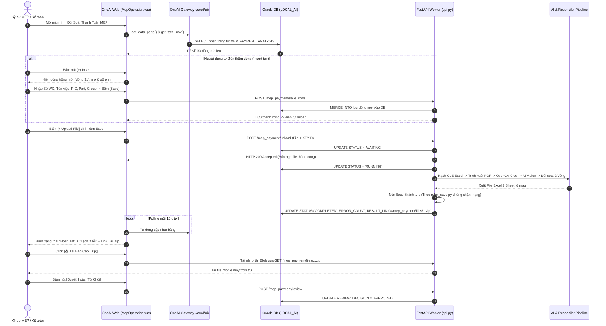

# TÀI LIỆU THI CÔNG & TRIỂN KHAI HOÀN CHỈNH HỆ THỐNG MEP AI LÊN NỀN TẢNG ONEAI
## (ALL-IN-ONE MASTER DEPLOYMENT & OPERATIONS BLUEPRINT)

> **Tài liệu tổng hợp toàn diện (Consolidated Master Guide):** Hợp nhất đầy đủ từ các bản kế hoạch thi công, hướng dẫn triển khai OneAI, thiết kế thanh công cụ Toolbar (Delete, Insert, Save) theo mẫu OneAI thực tế, cơ chế tải file Blob nén `.zip` chống chặn mạng doanh nghiệp, và hướng dẫn vận hành End-to-End.

> [!IMPORTANT]
> **TÓM TẮT THAO TÁC THỰC THI (QUICK START - MỚI NHẤT):**
> 1. Bạn **chỉ việc lấy code mới nhất hiện tại** trong thư mục `MEP_OneAI_System`. Toàn bộ code đã được đồng bộ, fix sạch lỗi và sẵn sàng chạy!
> 2. Bạn chỉ cần thực hiện đúng **2 việc duy nhất**:
>    * **Việc 1:** Trong file `.env`, đảm bảo dòng `ORACLE_CLIENT_LIB_DIR` trỏ đúng vào thư mục chứa file `oci.dll` trên máy bạn (ví dụ: `ORACLE_CLIENT_LIB_DIR=C:\oracle_client`).
>    * **Việc 2:** Chạy lệnh `python init_oracle_table.py` để tạo bảng `LOCAL_AI.MEP_PAYMENT_ANALYSIS` trên Oracle DB của công ty (hoặc copy SQL ở Bước 1 dán vào DBeaver rồi ấn F5).
> 3. Khởi động Worker: `python backend/main.py` $\rightarrow$ Mở Web kiểm tra: Insert, Save, Delete, Upload file, AI bóc tách đối soát chạy trực tiếp trên Oracle DB công ty!

---

## MỤC LỤC TỔNG QUAN

1. [KIẾN TRÚC HỆ THỐNG & LUỒNG DỮ LIỆU END-TO-END](#1-kiến-trúc-hệ-thống--luồng-dữ-liệu-end-to-end)
2. [BẢNG PHÂN BỔ CÁC FILE TRONG TOÀN BỘ HỆ THỐNG](#2-bảng-phân-bổ-các-file-trong-toàn-bộ-hệ-thống)
3. [BƯỚC 1: THIẾT LẬP DATABASE TRÊN ORACLE (DBEAVER)](#3-bước-1-thiết-lập-database-trên-oracle-dbeaver)
4. [BƯỚC 2: CẤU HÌNH BACKEND ONEAI PORTAL (`mep_payment_analysis.py`)](#4-bước-2-cấu-hình-backend-oneai-portal-mep_payment_analysispy)
5. [BƯỚC 3: CẤU HÌNH JAVASCRIPT GỌI API GATEWAY (`mepPayment.js`)](#5-bước-3-cấu-hình-javascript-gọi-api-gateway-meppaymentjs)
6. [BƯỚC 4: GIAO DIỆN FRONTEND DARK THEME HOÀN CHỈNH (`MepOperation.vue`)](#6-bước-4-giao-diện-frontend-dark-theme-hoàn-chỉnh-mepoperationvue)
   * Thanh công cụ Toolbar: Delete, Insert, Export, Save (Chuẩn ảnh 3.webp & 4.webp)
   * Cột Checkbox & Dòng Insert nhập liệu trực tiếp (Inline Edit)
   * Cơ chế tải file Báo cáo bằng Blob Download (Không bị chặn mạng)
7. [BƯỚC 5: XÂY DỰNG FASTAPI WORKER BACKEND (`api.py` & `sql.py`)](#7-bước-5-xây-dựng-fastapi-worker-backend-apipy--sqlpy)
   * Tự động đóng gói `.zip` lách kiểm duyệt DLP doanh nghiệp (Theo `refer_save.py`)
   * Các API: `/upload`, `/save_rows`, `/delete_rows`, `/review`, `/files/{filename}`
8. [BƯỚC 6: CHIẾN LƯỢC QUẢN LÝ ẢNH BẰNG CHỨNG & TỰ ĐỘNG DỌN DẸP 15-30 NGÀY](#8-bước-6-chiến-lược-quản-lý-ảnh-bằng-chứng--tự-động-dọn-dẹp-15-30-ngày)
9. [BƯỚC 7: QUY TRÌNH CHẠY THỬ NGHIỆM END-TO-END (CHECKLIST LOCAL & SERVER)](#9-bước-7-quy-trình-chạy-thử-nghiệm-end-to-end-checklist-local--server)

---

## 1. KIẾN TRÚC HỆ THỐNG & LUỒNG DỮ LIỆU END-TO-END

Hệ thống được thiết kế theo mô hình **Kiến trúc phân tán Microservices**, tách biệt hoàn toàn giữa **Web Portal giao diện người dùng** và **Worker Service xử lý tính toán nặng**:



---

## 2. BẢNG PHÂN BỔ CÁC FILE TRONG TOÀN BỘ HỆ THỐNG

| Vị trí triển khai | Tên file | Trạng thái | Nhiệm vụ chính |
| :--- | :--- | :---: | :--- |
| **Oracle Database** | `LOCAL_AI.MEP_PAYMENT_ANALYSIS` | **Tạo mới (SQL)** | Bảng lưu trữ trung tâm các lượt kiểm tra đối soát |
| **OneAI Portal (Core Backend)** | `menu_operation/mep_payment/mep_payment_analysis.py` | **Tạo mới** | Cấu hình `QuerySettings` cho cổng OneAI Gateway `/crud/ui` (DNS: `MBLDB`) |
| **OneAI Portal (Frontend JS)** | `operation/js/mep_payment.js` | **Tạo mới** | Đóng gói API gọi Gateway phân trang và gọi Worker lưu/xóa (alias: `mepPayment.js`) |
| **OneAI Portal (Frontend Vue)** | `operation/main.vue` & `tab/operation.vue` | **Tạo mới** | Giao diện Dark Theme: Toolbar Insert vào cuối, Delete, Save chống trùng mã, Blob Download |
| **Payment_PDF (Worker Engine)** | `backend/engine.py` | **Nâng cấp** | Nhúng thuật toán OLE CFB của sếp để giải mã sector nhị phân |
| **Payment_PDF (Worker Engine)** | `backend/pdf_extractor.py` | **Nâng cấp** | Thị giác OpenCV, RAM chunking, chỉ lưu 1-2 ảnh JPG bằng chứng |
| **Payment_PDF (Worker Engine)** | `backend/excel_reconciler.py`| **Hoàn thiện** | Não bộ đối soát 2 Vòng (Bản vẽ & Gate Pass), tô màu xen kẽ |
| **Payment_PDF (Worker Service)**| `backend/sql.py` | **Nâng cấp** | Thao tác Oracle DB: cập nhật trạng thái, lưu batch MERGE INTO, xóa dòng |
| **Payment_PDF (Worker Service)**| `backend/api.py` | **Nâng cấp** | FastAPI Worker: upload, tải file .zip theo `refer_save.py`, save/delete |

---

## 3. BƯỚC 1: THIẾT LẬP DATABASE TRÊN ORACLE (DBEAVER)

Mở **DBeaver**, kết nối tới Oracle Database của công ty, mở **SQL Editor (F3)** và chạy script DDL sau để tạo bảng với đầy đủ các trường nghiệp vụ:

> [!TIP]
> **Nếu bảng đã tồn tại trên công ty:** Bạn chỉ cần chạy 1 dòng DDL sau để thêm cột tiến độ mà không mất dữ liệu:
> ```sql
> ALTER TABLE LOCAL_AI.MEP_PAYMENT_ANALYSIS ADD (PROGRESS NUMBER DEFAULT 0);
> ```

```sql
-- 1. TẠO BẢNG CHÍNH THỨC LOCAL_AI.MEP_PAYMENT_ANALYSIS (NẾU CHƯA CÓ)
CREATE TABLE LOCAL_AI.MEP_PAYMENT_ANALYSIS (
    KEYID           VARCHAR2(100) NOT NULL,          -- Số công việc (Số WO / Task ID) - Khóa chính
    TASK_NAME       VARCHAR2(300),                   -- Tên công việc / hạng mục
    PAYMENT_MONTH   VARCHAR2(20),                    -- Tháng thanh toán (VD: 2026-10)
    PIC             VARCHAR2(100),                   -- Người phụ trách
    PART_NAME       VARCHAR2(100),                   -- Part (MEP, Cơ điện, Xây dựng...)
    GROUP_NAME      VARCHAR2(100),                   -- Group (Infra Group, EHS...)
    STATUS          VARCHAR2(30) DEFAULT 'WAITING',  -- Trạng thái: WAITING, RUNNING, COMPLETED, CANCEL
    PROGRESS        NUMBER DEFAULT 0,                -- Tiến độ AI (0 - 100%)
    ERROR_COUNT     NUMBER DEFAULT 0,                -- Tổng số lỗi phát sinh (0: Khớp 100%, >0: Lệch)
    RESULT_LINK     VARCHAR2(500),                   -- Đường dẫn file nén .zip báo cáo 2 sheet tải về
    REASON          VARCHAR2(1000),                  -- Ghi chú chi tiết kết quả hoặc lý do lỗi
    REVIEW_DECISION VARCHAR2(30),                    -- Quyết định duyệt: APPROVED, REJECTED, NULL
    REVIEW_NOTE     VARCHAR2(500),                   -- Ghi chú của người duyệt
    REVIEW_BY       VARCHAR2(100),                   -- Tên người duyệt
    UPLOAD_TIME     DATE,                            -- Ngày giờ upload file
    RESULT_TIME     DATE,                            -- Ngày giờ AI đối soát xong
    CONSTRAINT PK_MEP_PAYMENT PRIMARY KEY (KEYID)
);

-- 2. TẠO CHỈ MỤC ĐỂ GIAO DIỆN LỌC SIÊU TỐC
CREATE INDEX LOCAL_AI.IDX_MEP_STATUS ON LOCAL_AI.MEP_PAYMENT_ANALYSIS (STATUS);
CREATE INDEX LOCAL_AI.IDX_MEP_MONTH  ON LOCAL_AI.MEP_PAYMENT_ANALYSIS (PAYMENT_MONTH);

-- 3. CHÈN 2 DÒNG DỮ LIỆU MẪU ĐỂ TEST GIAO DIỆN
INSERT INTO LOCAL_AI.MEP_PAYMENT_ANALYSIS (KEYID, TASK_NAME, PAYMENT_MONTH, PIC, PART_NAME, GROUP_NAME, STATUS, ERROR_COUNT, UPLOAD_TIME)
VALUES ('WO-2026-10-001', 'Lắp đặt đường ống Chiller tầng 2', '2026-10', 'Nguyễn Văn A', 'MEP', 'Infra Group', 'WAITING', 0, SYSDATE);

INSERT INTO LOCAL_AI.MEP_PAYMENT_ANALYSIS (KEYID, TASK_NAME, PAYMENT_MONTH, PIC, PART_NAME, GROUP_NAME, STATUS, ERROR_COUNT, RESULT_LINK, REVIEW_DECISION, UPLOAD_TIME, RESULT_TIME)
VALUES ('WO-2026-10-002', 'Cải tạo hệ thống thông gió xưởng 3', '2026-10', 'Trần Thị B', 'MEP', 'Facility Group', 'COMPLETED', 2, '/mep_payment/files/Report_WO-2026-10-002.zip', 'APPROVED', SYSDATE - 1, SYSDATE - 1);

COMMIT;
```

---

## 4. BƯỚC 2: CẤU HÌNH BACKEND ONEAI PORTAL (`mep_payment_analysis.py`)

Đặt file này vào đúng đường dẫn: `backend/menu_operation/mep_payment/mep_payment_analysis.py` trong OneAI Backend. File này cung cấp các câu truy vấn SQL chuẩn hóa cho OneAI Gateway:

```python
# ====================================================================
# ONEAI BACKEND QUERY SETTINGS (MEP PAYMENT ANALYSIS)
# Đường dẫn: backend/menu_operation/mep_payment/mep_payment_analysis.py
# ====================================================================
from database.query_utils import QuerySettings

# 1. QUERY ĐẾM TỔNG SỐ DÒNG (PHỤC VỤ PHÂN TRANG TOTAL PAGE)
searchTotalRow = QuerySettings(
    query="""
        SELECT COUNT(*) AS TOTAL
        FROM LOCAL_AI.MEP_PAYMENT_ANALYSIS
        WHERE 1 = 1
        AND (:STATUS = 'ALL' OR STATUS = :STATUS)
        AND (:PAYMENT_MONTH = 'ALL' OR PAYMENT_MONTH = :PAYMENT_MONTH)
        AND (:KEYID = 'ALL' OR KEYID LIKE '%' || :KEYID || '%' OR TASK_NAME LIKE '%' || :KEYID || '%')
    """,
    dns="MBLDB",  # Tên cấu hình DNS kết nối DB Oracle của công ty
    note="Đếm tổng số dòng quản lý thanh toán MEP"
)

# 2. QUERY LẤY DỮ LIỆU TỪNG TRANG (PHÂN TRANG DỰA THEO ROW_NUMBER)
getdata_page = QuerySettings(
    query="""
    SELECT 
        RN AS STT,
        KEYID,
        TASK_NAME,
        PAYMENT_MONTH,
        PIC,
        PART_NAME,
        GROUP_NAME,
        STATUS,
        NVL(PROGRESS, 0) AS PROGRESS,
        ERROR_COUNT,
        RESULT_LINK,
        REASON,
        REVIEW_DECISION,
        REVIEW_NOTE,
        REVIEW_BY,
        TO_CHAR(UPLOAD_TIME, 'YYYY-MM-DD HH24:MI') AS UPLOAD_TIME,
        TO_CHAR(RESULT_TIME, 'YYYY-MM-DD HH24:MI') AS RESULT_TIME
    FROM (
        SELECT A.*,
               ROW_NUMBER() OVER(ORDER BY UPLOAD_TIME ASC NULLS LAST, KEYID ASC) RN
        FROM LOCAL_AI.MEP_PAYMENT_ANALYSIS A
        WHERE 1 = 1
        AND (:STATUS = 'ALL' OR STATUS = :STATUS)
        AND (:PAYMENT_MONTH = 'ALL' OR PAYMENT_MONTH = :PAYMENT_MONTH)
        AND (:KEYID = 'ALL' OR KEYID LIKE '%' || :KEYID || '%' OR TASK_NAME LIKE '%' || :KEYID || '%')
    )
    WHERE RN BETWEEN :start_row AND :end_row
    ORDER BY RN
    """,
    dns="MBLDB",
    note="Lấy danh sách phân trang bảng MEP"
)
```

---

## 5. BƯỚC 3: CẤU HÌNH JAVASCRIPT GỌI API GATEWAY (`mep_payment.js`)

Đặt file này tại `src/views/operation/js/mep_payment.js` (đồng thời tạo alias `mepPayment.js`) trên OneAI Frontend:

```javascript
// ====================================================================
// JAVASCRIPT API GỌI GATEWAY /crud/ui CỦA ONEAI
// Đường dẫn: src/views/operation/js/mep_payment.js (hoặc mepPayment.js)
// ====================================================================
import { api } from '@/aiPlugins/aiApiConfig'

const BASE_REQ_ID = "menu_operation.mep_payment.mep_payment_analysis"

// 1. LẤY TỔNG SỐ DÒNG
export async function get_total_row(status = "ALL", paymentMonth = "ALL", keyword = "ALL") {
  const reqId = `${BASE_REQ_ID}:searchTotalRow`
  const param = {
    STATUS: status || "ALL",
    PAYMENT_MONTH: paymentMonth || "ALL",
    KEYID: keyword || "ALL"
  }
  const parameter = { [reqId]: param }
  const res = await api.get("/crud/ui", { params: parameter, loading: false })
  return res.data[reqId].VAL
}

// 2. LẤY DỮ LIỆU PHÂN TRANG
export async function get_data_page(page = 1, pageSize = 50, status = "ALL", paymentMonth = "ALL", keyword = "ALL") {
  const reqId = `${BASE_REQ_ID}:getdata_page`
  const start = (page - 1) * pageSize + 1
  const end = page * pageSize

  const param = {
    start_row: start,
    end_row: end,
    STATUS: status || "ALL",
    PAYMENT_MONTH: paymentMonth || "ALL",
    KEYID: keyword || "ALL"
  }

  const parameter = { [reqId]: param }
  const res = await api.get("/crud/ui", { params: parameter, loading: false })
  return res.data[reqId].VAL
}

// 3. LƯU CÁC DÒNG MỚI THÊM HOẶC CHỈNH SỬA XUỐNG DB
export async function save_mep_rows(rows = []) {
  const res = await api.post("/mep_payment/save_rows", { rows })
  return res.data
}

// 4. XÓA CÁC DÒNG ĐƯỢC CHỌN KHỎI DB
export async function delete_mep_rows(keyids = []) {
  const res = await api.post("/mep_payment/delete_rows", { keyids })
  return res.data
}
```

---

## 6. BƯỚC 4: GIAO DIỆN FRONTEND DARK THEME HOÀN CHỈNH (`MepOperation.vue`)

Đặt file này tại `src/views/MepOperation.vue`. Giao diện tích hợp đầy đủ:
* Thanh công cụ Toolbar: **`Total rows`**, **`Delete` (Đỏ)**, **`Insert` (Viền xám)**, **`Export (.csv)`**, **`Save` (Xanh)** chuẩn ảnh mẫu OneAI `3.webp` & `4.webp`.
* Cột Checkbox chọn dòng và dòng Insert có ô gõ phím trực tiếp (Inline Edit).
* Cơ chế tải file báo cáo **Blob Download** (vượt qua hạn chế Cross-Origin và tường lửa DLP).

```vue
<template>
  <div class="mep-container">
    <!-- 1. BỘ LỌC TÌM KIẾM TRÊN CÙNG -->
    <div class="toolbar">
      <el-select v-model="selectedStatus" placeholder="Chọn Trạng Thái" clearable style="width: 170px">
        <el-option v-for="item in statusList" :key="item" :label="item" :value="item" />
      </el-select>

      <el-date-picker
        v-model="selectedMonth"
        type="month"
        placeholder="Chọn Tháng Thanh Toán"
        value-format="YYYY-MM"
        style="width: 190px"
      />

      <el-input
        v-model="searchKeyword"
        placeholder="Nhập số WO hoặc tên công việc..."
        clearable
        style="width: 270px"
        @keyup.enter="handleReload"
      />

      <el-button type="primary" @click="handleReload">
        Reload ({{ countdown }}s)
      </el-button>
    </div>

    <!-- 2. THANH CÔNG CỤ QUẢN TRỊ BẢNG (TOOLBAR THEO ẢNH 3.WEBP & 4.WEBP) -->
    <div class="table-action-bar">
      <div class="total-count">
        Total: <span class="count-number">{{ total }} rows</span>
      </div>

      <div class="action-buttons">
        <el-button
          type="danger"
          size="small"
          class="btn-delete"
          :disabled="selectedRows.length === 0"
          @click="handleDelete"
        >
          <i class="el-icon-remove-outline"></i> Delete
        </el-button>

        <el-button size="small" class="btn-insert" @click="handleInsert">
          <i class="el-icon-circle-plus-outline"></i> Insert
        </el-button>

        <el-button size="small" class="btn-export" @click="handleExportCsv">
          <i class="el-icon-download"></i> Export (.csv)
        </el-button>

        <el-button type="primary" size="small" class="btn-save" :loading="isSaving" @click="handleSave">
          <i class="el-icon-document-checked"></i> Save
        </el-button>
      </div>
    </div>

    <!-- 3. BẢNG DỮ LIỆU ĐỐI SOÁT HỖ TRỢ INLINE EDIT -->
    <div class="table-container">
      <el-table
        :data="tableData"
        border
        height="680"
        size="small"
        style="width: 100%"
        show-overflow-tooltip
        empty-text="Không có dữ liệu đối soát"
        @selection-change="handleSelectionChange"
      >
        <el-table-column type="selection" width="45" align="center" />
        <el-table-column prop="STT" label="STT" width="55" align="center" />

        <el-table-column prop="KEYID" label="Số Công Việc (WO)" width="160" sortable align="center">
          <template #default="{ row }">
            <el-input v-if="row.isNew" v-model="row.KEYID" placeholder="Nhập số WO..." size="mini" class="inline-input" />
            <el-tag v-else type="info" effect="plain" class="font-bold">{{ row.KEYID }}</el-tag>
          </template>
        </el-table-column>

        <el-table-column prop="TASK_NAME" label="Tên Công Việc" min-width="190">
          <template #default="{ row }">
            <el-input v-if="row.isNew || row.isEditing" v-model="row.TASK_NAME" placeholder="Tên công việc..." size="mini" class="inline-input" />
            <span v-else class="cell-text" @dblclick="row.isEditing = true">{{ row.TASK_NAME || '-' }}</span>
          </template>
        </el-table-column>

        <el-table-column prop="PAYMENT_MONTH" label="Tháng TT" width="110" align="center" sortable>
          <template #default="{ row }">
            <el-input v-if="row.isNew || row.isEditing" v-model="row.PAYMENT_MONTH" placeholder="YYYY-MM" size="mini" class="inline-input" />
            <span v-else class="cell-text" @dblclick="row.isEditing = true">{{ row.PAYMENT_MONTH || '-' }}</span>
          </template>
        </el-table-column>

        <el-table-column prop="PIC" label="Người Phụ Trách" width="130" align="center">
          <template #default="{ row }">
            <el-input v-if="row.isNew || row.isEditing" v-model="row.PIC" placeholder="PIC..." size="mini" class="inline-input" />
            <span v-else class="cell-text" @dblclick="row.isEditing = true">{{ row.PIC || '-' }}</span>
          </template>
        </el-table-column>

        <el-table-column prop="PART_NAME" label="Part" width="105" align="center">
          <template #default="{ row }">
            <el-input v-if="row.isNew || row.isEditing" v-model="row.PART_NAME" placeholder="Part..." size="mini" class="inline-input" />
            <span v-else class="cell-text" @dblclick="row.isEditing = true">{{ row.PART_NAME || '-' }}</span>
          </template>
        </el-table-column>

        <el-table-column prop="GROUP_NAME" label="Group" width="115" align="center">
          <template #default="{ row }">
            <el-input v-if="row.isNew || row.isEditing" v-model="row.GROUP_NAME" placeholder="Group..." size="mini" class="inline-input" />
            <span v-else class="cell-text" @dblclick="row.isEditing = true">{{ row.GROUP_NAME || '-' }}</span>
          </template>
        </el-table-column>

        <el-table-column prop="STATUS" label="Trạng Thái" width="110" align="center" sortable>
          <template #default="{ row }">
            <el-tag v-if="row.STATUS === 'COMPLETED'" type="success" effect="dark">Hoàn Tất</el-tag>
            <el-tag v-else-if="row.STATUS === 'RUNNING'" type="warning" effect="dark">Đang Xử Lý</el-tag>
            <el-tag v-else-if="row.STATUS === 'WAITING'" type="info">Chờ Duyệt</el-tag>
            <el-tag v-else type="danger">{{ row.STATUS || 'Mới' }}</el-tag>
          </template>
        </el-table-column>

        <el-table-column label="Tài Liệu Đính Kèm" width="130" align="center">
          <template #default="{ row }">
            <el-upload
              :show-file-list="false"
              :auto-upload="false"
              accept=".xlsx,.xlsm"
              :on-change="(file) => handleUploadExcel(file, row)"
              :disabled="row.STATUS === 'RUNNING' || row.isNew"
            >
              <el-button
                type="primary"
                size="mini"
                :loading="row.STATUS === 'RUNNING'"
                :disabled="row.STATUS === 'RUNNING' || row.isNew"
              >
                {{ row.STATUS === 'RUNNING' ? 'Đang chạy...' : '+ Upload File' }}
              </el-button>
            </el-upload>
          </template>
        </el-table-column>

        <el-table-column label="Kết Quả Kiểm Tra" width="150" align="center">
          <template #default="{ row }">
            <div v-if="row.STATUS === 'COMPLETED'">
              <el-tag v-if="row.ERROR_COUNT === 0" type="success" effect="light">✅ Khớp 100% (0 lỗi)</el-tag>
              <el-tag v-else type="danger" effect="dark">❌ Lệch {{ row.ERROR_COUNT }} lỗi</el-tag>
            </div>
            <span v-else-if="row.STATUS === 'RUNNING'" style="color: #E6A23C;"><i class="el-icon-loading"></i> Đang đối soát AI...</span>
            <span v-else style="color: #909399;">-</span>
          </template>
        </el-table-column>

        <el-table-column label="Chi Tiết Báo Cáo" min-width="210" align="center">
          <template #default="{ row }">
            <div v-if="row.STATUS === 'COMPLETED'">
              <el-button
                v-if="row.RESULT_LINK"
                type="text"
                size="small"
                class="download-btn"
                @click="handleDownloadFile(row)"
              >
                📥 Tải Báo Cáo (.zip)
              </el-button>

              <div style="margin-top: 4px;">
                <el-tag v-if="row.REVIEW_DECISION === 'APPROVED'" type="success" size="mini">Đã Duyệt</el-tag>
                <el-tag v-else-if="row.REVIEW_DECISION === 'REJECTED'" type="danger" size="mini">Từ Chối</el-tag>
                <div v-else style="display: inline-flex; gap: 4px;">
                  <el-button type="success" size="mini" @click="handleReview(row, 'APPROVED')">Duyệt</el-button>
                  <el-button type="danger" size="mini" @click="handleReview(row, 'REJECTED')">Hủy</el-button>
                </div>
              </div>
            </div>
            <span v-else-if="row.REASON" class="text-reason">{{ row.REASON }}</span>
            <span v-else style="color: #909399;">-</span>
          </template>
        </el-table-column>
      </el-table>

      <!-- 4. THANH PHÂN TRANG -->
      <div class="pagination-bar">
        <el-button size="small" @click="goFirst" :disabled="page === 1">First</el-button>
        <el-pagination
          v-model:current-page="page"
          v-model:page-size="pageSize"
          :page-sizes="[15, 30, 50, 100]"
          :total="total"
          layout="total, sizes, prev, pager, next, jumper"
          @current-change="handlePageChange"
          @size-change="handleSizeChange"
        />
        <el-button size="small" @click="goLast" :disabled="page >= totalPages">Last</el-button>
      </div>
    </div>
  </div>
</template>

<script setup>
import { ref, computed, onMounted, onUnmounted, watch } from 'vue'
import { ElMessage, ElMessageBox } from 'element-plus'
import axios from 'axios'
import { get_total_row, get_data_page } from '@/js/mepPayment'

const FASTAPI_BASE_URL = window.location.port === '8000' ? '' : 'http://127.0.0.1:8000'

const selectedStatus = ref('')
const selectedMonth = ref('')
const searchKeyword = ref('')
const statusList = ['ALL', 'WAITING', 'RUNNING', 'COMPLETED', 'CANCEL']

const tableData = ref([])
const selectedRows = ref([])
const page = ref(1)
const pageSize = ref(15)
const total = ref(0)
const countdown = ref(10)
const isSaving = ref(false)
let timer = null
let countdownTimer = null

const loadData = async () => {
  try {
    const data = await get_data_page(
      page.value, pageSize.value,
      selectedStatus.value || 'ALL',
      selectedMonth.value || 'ALL',
      searchKeyword.value || 'ALL'
    )
    tableData.value = (data || []).map(row => ({
      ...row,
      isNew: false,
      isEditing: false
    }))
  } catch (err) {
    console.error("Lỗi tải bảng dữ liệu MEP:", err)
  }
}

const loadTotal = async () => {
  try {
    const res = await get_total_row(
      selectedStatus.value || 'ALL',
      selectedMonth.value || 'ALL',
      searchKeyword.value || 'ALL'
    )
    total.value = res?.[0]?.TOTAL ?? 0
  } catch (err) {
    console.error("Lỗi lấy tổng số dòng:", err)
  }
}

const handleReload = async () => {
  await loadData()
  await loadTotal()
  countdown.value = 10
}

const handleSelectionChange = (selection) => {
  selectedRows.value = selection
}

// 1. THAO TÁC INSERT (THÊM VÀO CUỐI BẢNG)
const handleInsert = () => {
  const newRow = {
    STT: tableData.value.length + 1,
    KEYID: '',
    TASK_NAME: '',
    PAYMENT_MONTH: selectedMonth.value || new Date().toISOString().slice(0, 7),
    PIC: '',
    PART_NAME: 'MEP',
    GROUP_NAME: '',
    STATUS: 'WAITING',
    ERROR_COUNT: 0,
    isNew: true,
    isEditing: true
  }
  tableData.value.push(newRow)
  total.value += 1
  ElMessage.info("Đã thêm 1 dòng mới vào cuối bảng. Vui lòng nhập thông tin và bấm [Save].")
}

// 2. THAO TÁC SAVE (LƯU XUỐNG DB & CHẶN TRÙNG MÃ)
const handleSave = async () => {
  const modifiedRows = tableData.value.filter(r => r.isNew || r.isEditing)
  if (modifiedRows.length === 0) {
    ElMessage.info("Không có dòng nào thay đổi để lưu.")
    return
  }

  // 1. Kiểm tra không để trống KEYID
  for (const r of modifiedRows) {
    if (!r.KEYID || !r.KEYID.trim()) {
      ElMessage.warning("Vui lòng nhập Số Công Việc (KEYID) trước khi lưu!")
      return
    }
  }

  // 2. Kiểm tra trùng lặp Số Công Việc (KEYID) ngay trên bảng
  for (const r of modifiedRows) {
    if (r.isNew) {
      const isDuplicate = tableData.value.some(
        item => item !== r && String(item.KEYID).trim().toUpperCase() === String(r.KEYID).trim().toUpperCase()
      )
      if (isDuplicate) {
        ElMessage.error(`Số công việc (KEYID) "${r.KEYID}" đã tồn tại! Vui lòng nhập mã khác.`)
        return
      }
    }
  }

  isSaving.value = true
  try {
    const res = await axios.post(`${FASTAPI_BASE_URL}/mep_payment/save_rows`, {
      rows: modifiedRows.map(r => ({
        KEYID: r.KEYID,
        TASK_NAME: r.TASK_NAME,
        PAYMENT_MONTH: r.PAYMENT_MONTH,
        PIC: r.PIC,
        PART_NAME: r.PART_NAME,
        GROUP_NAME: r.GROUP_NAME,
        STATUS: r.STATUS || 'WAITING',
        isNew: !!r.isNew
      }))
    })

    ElMessage.success(res.data?.message || "Lưu dữ liệu thành công!")
    await handleReload()
  } catch (err) {
    ElMessage.error(err.response?.data?.detail || "Lỗi khi lưu dữ liệu xuống Database!")
  } finally {
    isSaving.value = false
  }
}

// 3. THAO TÁC DELETE
const handleDelete = async () => {
  if (selectedRows.value.length === 0) {
    ElMessage.warning("Vui lòng chọn ít nhất 1 dòng để xóa.")
    return
  }

  try {
    await ElMessageBox.confirm(
      `Bạn có chắc chắn muốn xóa ${selectedRows.value.length} dòng đã chọn?`,
      'Xác nhận xóa',
      { confirmButtonText: 'Xác nhận', cancelButtonText: 'Hủy', type: 'warning' }
    )

    const newKeys = selectedRows.value.filter(r => r.isNew).map(r => r.KEYID)
    const dbKeys = selectedRows.value.filter(r => !r.isNew && r.KEYID).map(r => r.KEYID)

    if (newKeys.length > 0) {
      tableData.value = tableData.value.filter(r => !selectedRows.value.includes(r))
      total.value = Math.max(0, total.value - newKeys.length)
    }

    if (dbKeys.length > 0) {
      const res = await axios.post(`${FASTAPI_BASE_URL}/mep_payment/delete_rows`, { keyids: dbKeys })
      ElMessage.success(res.data?.message || `Đã xóa ${dbKeys.length} dòng thành công!`)
      await handleReload()
    } else {
      ElMessage.success("Đã xóa dòng tạm khỏi bảng.")
    }
  } catch (err) {
    if (err !== 'cancel') ElMessage.error("Không thể xóa dòng đã chọn!")
  }
}

// 4. THAO TÁC TẢI BÁO CÁO (BLOB DOWNLOAD CHỐNG CHẶN)
const handleDownloadFile = async (row) => {
  if (!row.RESULT_LINK) return
  try {
    ElMessage.info("Đang chuẩn bị tải file báo cáo...")
    const url = row.RESULT_LINK.startsWith('http') ? row.RESULT_LINK : `${FASTAPI_BASE_URL}${row.RESULT_LINK}`
    const res = await axios.get(url, { responseType: 'blob' })

    const contentType = res.headers['content-type'] || 'application/zip'
    const blob = new Blob([res.data], { type: contentType })
    const blobUrl = window.URL.createObjectURL(blob)

    const filename = row.RESULT_LINK.split('/').pop() || `Bao_Cao_${row.KEYID}.zip`
    const link = document.createElement('a')
    link.href = blobUrl
    link.download = filename
    document.body.appendChild(link)
    link.click()
    document.body.removeChild(link)
    window.URL.revokeObjectURL(blobUrl)

    ElMessage.success("Tải file thành công!")
  } catch (err) {
    ElMessage.error("Không thể tải file báo cáo. Vui lòng kiểm tra lại server!")
  }
}

// 5. THAO TÁC XUẤT CSV
const handleExportCsv = () => {
  if (tableData.value.length === 0) {
    ElMessage.warning("Không có dữ liệu để xuất file CSV.")
    return
  }

  const headers = ['STT', 'KEYID', 'TASK_NAME', 'PAYMENT_MONTH', 'PIC', 'PART_NAME', 'GROUP_NAME', 'STATUS', 'ERROR_COUNT']
  const csvContent = [
    headers.join(','),
    ...tableData.value.map(row => [
      row.STT, `"${row.KEYID || ''}"`, `"${row.TASK_NAME || ''}"`, `"${row.PAYMENT_MONTH || ''}"`,
      `"${row.PIC || ''}"`, `"${row.PART_NAME || ''}"`, `"${row.GROUP_NAME || ''}"`, `"${row.STATUS || ''}"`,
      row.ERROR_COUNT || 0
    ].join(','))
  ].join('\n')

  const blob = new Blob(['\uFEFF' + csvContent], { type: 'text/csv;charset=utf-8;' })
  const url = URL.createObjectURL(blob)
  const a = document.createElement('a')
  a.href = url
  a.download = `MEP_Payment_${new Date().toISOString().slice(0, 10)}.csv`
  a.click()
  URL.revokeObjectURL(url)
  ElMessage.success("Đã xuất file CSV thành công!")
}

// 6. UPLOAD FILE EXCEL
const handleUploadExcel = async (file, row) => {
  if (!file.name.endsWith('.xlsx') && !file.name.endsWith('.xlsm')) {
    ElMessage.error("Chỉ chấp nhận file Excel (.xlsx / .xlsm)")
    return
  }

  const formData = new FormData()
  formData.append("file", file.raw)
  formData.append("KEYID", row.KEYID)

  row.STATUS = 'RUNNING'
  row.REASON = 'Đang đẩy file lên AI Worker...'

  try {
    const res = await axios.post(`${FASTAPI_BASE_URL}/mep_payment/upload`, formData)
    ElMessage.success(res.data.message || "Tải lên thành công! AI đang bóc tách ngầm.")
    countdown.value = 10
  } catch (err) {
    row.STATUS = 'WAITING'
    row.REASON = 'Lỗi upload file'
    ElMessage.error("Lỗi khi kết nối Worker: " + (err.response?.data?.detail || err.message))
  }
}

// 7. DUYỆT / TỪ CHỐI
const handleReview = async (row, decision) => {
  try {
    await axios.post(`${FASTAPI_BASE_URL}/mep_payment/review`, {
      keyid: row.KEYID,
      decision: decision,
      reviewer: 'Engineer'
    })
    row.REVIEW_DECISION = decision
    ElMessage.success(`Đã lưu trạng thái: ${decision}`)
  } catch (err) {
    ElMessage.error("Lỗi lưu quyết định duyệt: " + err.message)
  }
}

onMounted(() => {
  handleReload()
  timer = setInterval(() => { loadData(); loadTotal(); countdown.value = 10; }, 10 * 1000)
  countdownTimer = setInterval(() => { if (countdown.value > 0) countdown.value-- }, 1000)
})

onUnmounted(() => { clearInterval(timer); clearInterval(countdownTimer); })

const totalPages = computed(() => Math.max(1, Math.ceil(total.value / pageSize.value)))
const handlePageChange = (p) => { page.value = p; loadData(); }
const handleSizeChange = (s) => { pageSize.value = s; page.value = 1; loadData(); }
const goFirst = () => { if (page.value > 1) { page.value = 1; loadData(); } }
const goLast = () => { if (page.value < totalPages.value) { page.value = totalPages.value; loadData(); } }

watch([selectedStatus, selectedMonth], () => { page.value = 1; handleReload(); })
</script>

<style scoped>
.mep-container { padding: 14px; background-color: #141414; color: #E5EAF3; min-height: 100vh; }
.toolbar { display: flex; flex-wrap: wrap; gap: 12px; align-items: center; margin-bottom: 12px; }
.table-action-bar { display: flex; justify-content: space-between; align-items: center; margin-bottom: 10px; padding: 0 4px; }
.total-count { font-size: 13px; color: #A3A6AD; }
.count-number { color: #E5EAF3; font-weight: 600; }
.action-buttons { display: flex; gap: 8px; }
.btn-delete { background-color: #F56C6C; border-color: #F56C6C; color: #FFF; font-weight: 500; }
.btn-insert, .btn-export { background-color: #262727; border-color: #4C4D4F; color: #E5EAF3; }
.btn-insert:hover, .btn-export:hover { background-color: #363637; border-color: #606266; color: #409EFF; }
.btn-save { background-color: #409EFF; border-color: #409EFF; color: #FFF; font-weight: 500; }
.table-container { width: 100%; overflow-x: auto; }
.font-bold { font-weight: 600; }
.cell-text { cursor: pointer; display: inline-block; width: 100%; }
.cell-text:hover { color: #409EFF; text-decoration: underline; }
.inline-input :deep(.el-input__inner) { background-color: #1D1E1F; border-color: #409EFF; color: #FFF; }
.download-btn { color: #67C23A; font-weight: 600; text-decoration: underline; cursor: pointer; }
.download-btn:hover { color: #85CE61; }
.text-reason { color: #F56C6C; font-size: 11px; }
.pagination-bar { display: flex; justify-content: flex-end; align-items: center; gap: 8px; margin-top: 14px; }
</style>
```

---

## 7. BƯỚC 5: XÂY DỰNG FASTAPI WORKER BACKEND (`api.py` & `sql.py`)

### 1. File Database Helper: `backend/sql.py`
File này kết nối trực tiếp Oracle DB (Schema `LOCAL_AI.MEP_PAYMENT_ANALYSIS`) thông qua thư viện `oneai_sdv.oracle_conn` (hoặc `oracledb` Thick Client native). Tự động nhận diện thư mục Oracle Instant Client trên máy và trên Docker:

```python
# ====================================================================
# THAO TÁC CƠ SỞ DỮ LIỆU ORACLE (ORACLE SQL HELPER)
# Đường dẫn: backend/sql.py
# Chuẩn hóa theo kiến trúc OneAI: Schema LOCAL_AI.MEP_PAYMENT_ANALYSIS
# ====================================================================
import os
import sys
from pathlib import Path
import oracledb

# Nạp cấu hình biến môi trường từ .env
try:
    from dotenv import load_dotenv, find_dotenv
    env_file = find_dotenv()
    if env_file: load_dotenv(env_file)
    else: load_dotenv()
except ImportError:
    pass

DB_USER_YMS = os.getenv("DB_USER_YMS")
DB_PASSWORD_YMS = os.getenv("DB_PASSWORD_YMS")
TNS_YMS = os.getenv("TNS_YMS")

# Quy tắc đặt tên biến mật khẩu Database đồng bộ K8s & Local (Chu Đức Hải):
# Cú pháp: DB_[tên database]_[userName]__[mật khẩu] -> 2 dấu gạch dưới '__'
pwd_mbldb = os.getenv("DB_MBLDB_LOCAL_AI__PASSWORD") or os.getenv("DB_MBLDB_LOCAL_AI_PASSWORD")

# Tự động nhận diện thư mục Oracle Instant Client
oracle_client_path = os.getenv("ORACLE_CLIENT_LIB_DIR")
if not oracle_client_path or not os.path.exists(oracle_client_path):
    candidates = [
        Path(__file__).resolve().parent / "oracle_client",
        Path(__file__).resolve().parent.parent / "oracle_client",
        Path(r"C:\oracle_client"),
        Path(r"C:\instantclient_19_19"),
        Path(r"C:\instantclient_23_7"),
        Path("/opt/oracle/instantclient_23_7"),
        Path("/service/oracle_client"),
    ]
    for cand in candidates:
        if cand.exists():
            oracle_client_path = str(cand)
            break

# Khởi tạo Oracle Thick Client
if oracle_client_path and os.path.exists(oracle_client_path):
    try:
        oracledb.init_oracle_client(lib_dir=oracle_client_path)
    except Exception:
        pass

try:
    from oneai_sdv import oracle_conn, result_type
    HAS_ONEAI_SDV = True
except ImportError:
    oracle_conn = None
    HAS_ONEAI_SDV = False

def get_native_conn():
    return oracledb.connect(user=DB_USER_YMS, password=DB_PASSWORD_YMS, dsn=TNS_YMS)

def update_task_status(keyid: str, status: str, error_count: int = 0, result_link: str = None, reason: str = ""):
    sql = """
        UPDATE LOCAL_AI.MEP_PAYMENT_ANALYSIS
        SET STATUS = :STATUS, ERROR_COUNT = :ERROR_COUNT, RESULT_LINK = :RESULT_LINK, REASON = :REASON,
            RESULT_TIME = CASE WHEN :STATUS IN ('COMPLETED', 'CANCEL') THEN SYSDATE ELSE RESULT_TIME END,
            UPLOAD_TIME = CASE WHEN :STATUS = 'WAITING' THEN SYSDATE ELSE UPLOAD_TIME END
        WHERE KEYID = :KEYID
    """
    params = {"STATUS": status, "ERROR_COUNT": error_count, "RESULT_LINK": result_link, "REASON": reason, "KEYID": str(keyid).strip()}
    if HAS_ONEAI_SDV and oracle_conn is not None:
        cur = oracle_conn(dns="MBLDB", user_name="LOCAL_AI", password=pwd_mbldb, oracle_client_dir=oracle_client_path)
        cur.execute(sql, params=params)
    else:
        conn = get_native_conn()
        c = conn.cursor()
        c.execute(sql, params)
        conn.commit()
        c.close(); conn.close()

def update_review_decision(keyid: str, decision: str, note: str, reviewer: str):
    sql = "UPDATE LOCAL_AI.MEP_PAYMENT_ANALYSIS SET REVIEW_DECISION = :DECISION, REVIEW_NOTE = :NOTE, REVIEW_BY = :REVIEWER WHERE KEYID = :KEYID"
    params = {"DECISION": decision, "NOTE": note, "REVIEWER": reviewer, "KEYID": str(keyid).strip()}
    if HAS_ONEAI_SDV and oracle_conn is not None:
        cur = oracle_conn(dns="MBLDB", user_name="LOCAL_AI", password=pwd_mbldb, oracle_client_dir=oracle_client_path)
        cur.execute(sql, params=params)
    else:
        conn = get_native_conn()
        c = conn.cursor()
        c.execute(sql, params)
        conn.commit()
        c.close(); conn.close()

def batch_upsert_tasks(rows: list) -> int:
    if not rows: return 0
    sql = """
        MERGE INTO LOCAL_AI.MEP_PAYMENT_ANALYSIS T
        USING (SELECT :KEYID AS KEYID, :TASK_NAME AS TASK_NAME, :PAYMENT_MONTH AS PAYMENT_MONTH,
                      :PIC AS PIC, :PART_NAME AS PART_NAME, :GROUP_NAME AS GROUP_NAME, :STATUS AS STATUS FROM DUAL) S
        ON (T.KEYID = S.KEYID)
        WHEN MATCHED THEN
            UPDATE SET T.TASK_NAME = S.TASK_NAME, T.PAYMENT_MONTH = S.PAYMENT_MONTH,
                       T.PIC = S.PIC, T.PART_NAME = S.PART_NAME, T.GROUP_NAME = S.GROUP_NAME
        WHEN NOT MATCHED THEN
            INSERT (KEYID, TASK_NAME, PAYMENT_MONTH, PIC, PART_NAME, GROUP_NAME, STATUS, UPLOAD_TIME)
            VALUES (S.KEYID, S.TASK_NAME, S.PAYMENT_MONTH, S.PIC, S.PART_NAME, S.GROUP_NAME, S.STATUS, SYSDATE)
    """
    params_list = [{
        "KEYID": str(r.get("KEYID", "")).strip(), "TASK_NAME": str(r.get("TASK_NAME", "")).strip(),
        "PAYMENT_MONTH": str(r.get("PAYMENT_MONTH", "")).strip(), "PIC": str(r.get("PIC", "")).strip(),
        "PART_NAME": str(r.get("PART_NAME", "")).strip(), "GROUP_NAME": str(r.get("GROUP_NAME", "")).strip(),
        "STATUS": str(r.get("STATUS", "WAITING")).strip()
    } for r in rows]

    if HAS_ONEAI_SDV and oracle_conn is not None:
        cur = oracle_conn(dns="MBLDB", user_name="LOCAL_AI", password=pwd_mbldb, oracle_client_dir=oracle_client_path)
        for p in params_list: cur.execute(sql, params=p)
    else:
        conn = get_native_conn()
        c = conn.cursor()
        for p in params_list: c.execute(sql, p)
        conn.commit()
        c.close(); conn.close()
    return len(rows)

def delete_tasks(keyids: list) -> int:
    if not keyids: return 0
    sql = "DELETE FROM LOCAL_AI.MEP_PAYMENT_ANALYSIS WHERE KEYID = :KEYID"
    params_list = [{"KEYID": str(k).strip()} for k in keyids]
    if HAS_ONEAI_SDV and oracle_conn is not None:
        cur = oracle_conn(dns="MBLDB", user_name="LOCAL_AI", password=pwd_mbldb, oracle_client_dir=oracle_client_path)
        for p in params_list: cur.execute(sql, params=p)
    else:
        conn = get_native_conn()
        c = conn.cursor()
        for p in params_list: c.execute(sql, p)
        conn.commit()
        c.close(); conn.close()
    return len(keyids)
```

### 2. File Backend Worker: `backend/api.py`
Xử lý toàn bộ Background Task, tự động nén `.zip` báo cáo theo `refer_save.py` và cung cấp đầy đủ các cổng API:

```python
# ==========================================
# FASTAPI WORKER SERVICE (MEP AI BACKEND)
# Đường dẫn: backend/api.py
# ==========================================
import os
import shutil
import time
import zipfile
from pathlib import Path
from fastapi import FastAPI, UploadFile, File, Form, BackgroundTasks, HTTPException
from fastapi.middleware.cors import CORSMiddleware
from fastapi.responses import FileResponse
from pydantic import BaseModel
import pandas as pd

from engine import run_mep_pipeline
from sql import update_task_status, update_review_decision, batch_upsert_tasks, delete_tasks

app = FastAPI(title="MEP Payment AI Worker Service", version="2.0")

app.add_middleware(
    CORSMiddleware,
    allow_origins=["*"],
    allow_credentials=True,
    allow_methods=["*"],
    allow_headers=["*"],
    expose_headers=["Content-Disposition"]
)

BASE_DIR = Path(__file__).resolve().parent
STORAGE_DIR = BASE_DIR / "sessions"
FINAL_REPORT_DIR = BASE_DIR / "final_reports"

STORAGE_DIR.mkdir(exist_ok=True)
FINAL_REPORT_DIR.mkdir(exist_ok=True)

class ReviewRequest(BaseModel):
    keyid: str
    decision: str
    note: str = ""
    reviewer: str = "Engineer"

class SaveRowsRequest(BaseModel):
    rows: list

class DeleteRowsRequest(BaseModel):
    keyids: list

def run_ai_task_background(keyid: str, session_dir: Path, excel_path: str):
    """Chạy ngầm pipeline đối soát và đóng gói kết quả sang file .zip."""
    update_task_status(keyid=keyid, status="RUNNING", reason="Đang trích xuất bản vẽ và đối soát AI...")
    try:
        final_excel_path = run_mep_pipeline(
            excel_path=excel_path,
            output_dir=str(FINAL_REPORT_DIR),
            skip_existing=False
        )

        error_count = 0
        try:
            df_check = pd.read_excel(final_excel_path, sheet_name="1. Đối Soát Bản Vẽ")
            if 'Note' in df_check.columns:
                error_count = int(df_check['Note'].astype(str).str.contains('Lệch|Mã mồ côi', na=False).sum())
        except Exception: pass

        # NÉN FILE EXCEL SANG .ZIP ĐỂ LÁCH BẢO MẬT DLP (THEO REFER_SAVE.PY)
        file_name = os.path.basename(final_excel_path)
        zip_name = f"{Path(file_name).stem}.zip"
        zip_path = FINAL_REPORT_DIR / zip_name
        try:
            with zipfile.ZipFile(zip_path, 'w', zipfile.ZIP_DEFLATED) as zf:
                zf.write(final_excel_path, arcname=file_name)
            download_link = f"/mep_payment/files/{zip_name}"
        except Exception:
            download_link = f"/mep_payment/files/{file_name}"

        update_task_status(
            keyid=keyid, status="COMPLETED", error_count=error_count,
            result_link=download_link, reason=f"Hoàn thành đối soát 2 vòng (Phát hiện {error_count} sai lệch)"
        )
    except Exception as e:
        update_task_status(keyid=keyid, status="CANCEL", error_count=0, result_link=None, reason=str(e)[:900])

@app.get("/mep_payment/health")
async def health_check():
    return {"status": "ok", "service": "MEP Payment AI Worker"}

@app.post("/mep_payment/upload")
async def upload_excel_task(background_tasks: BackgroundTasks, file: UploadFile = File(...), KEYID: str = Form(...)):
    if not file.filename.endswith(('.xlsx', '.xlsm')):
        raise HTTPException(status_code=400, detail="Chỉ chấp nhận file Excel (.xlsx / .xlsm)")

    safe_keyid = KEYID.replace('/', '_').replace('\\', '_')
    session_dir = STORAGE_DIR / f"session_{safe_keyid}_{int(time.time())}"
    session_dir.mkdir(parents=True, exist_ok=True)
    excel_path = session_dir / file.filename

    with open(excel_path, "wb") as buffer:
        shutil.copyfileobj(file.file, buffer)

    update_task_status(keyid=KEYID, status="WAITING", reason="Đã nhận file, đang xếp hàng chạy...")
    background_tasks.add_task(run_ai_task_background, KEYID, session_dir, str(excel_path))
    return {"status": "accepted", "message": "Nạp file thành công, AI đang khởi chạy."}

@app.get("/mep_payment/files/{filename}")
async def download_report_file(filename: str):
    file_path = FINAL_REPORT_DIR / filename
    if not file_path.exists():
        if filename.endswith(".zip") and (FINAL_REPORT_DIR / filename.replace(".zip", ".xlsx")).exists():
            file_path = FINAL_REPORT_DIR / filename.replace(".zip", ".xlsx")
            filename = file_path.name
        else:
            raise HTTPException(status_code=404, detail="File báo cáo không tồn tại.")

    is_zip = filename.lower().endswith(".zip")
    media_type = "application/zip" if is_zip else "application/vnd.openxmlformats-officedocument.spreadsheetml.sheet"
    return FileResponse(
        path=str(file_path), filename=filename, media_type=media_type,
        headers={"Content-Disposition": f"attachment; filename={filename}", "Access-Control-Expose-Headers": "Content-Disposition"}
    )

@app.post("/mep_payment/save_rows")
async def save_rows(req: SaveRowsRequest):
    if not req.rows: raise HTTPException(status_code=400, detail="Danh sách dòng rỗng.")
    count = batch_upsert_tasks(req.rows)
    return {"status": "ok", "message": f"Đã lưu thành công {count} bản ghi vào Database."}

@app.post("/mep_payment/delete_rows")
async def delete_rows_endpoint(req: DeleteRowsRequest):
    if not req.keyids: raise HTTPException(status_code=400, detail="Vui lòng chọn ít nhất 1 dòng để xóa.")
    count = delete_tasks(req.keyids)
    return {"status": "ok", "message": f"Đã xóa thành công {count} bản ghi."}

@app.post("/mep_payment/review")
async def submit_review(req: ReviewRequest):
    update_review_decision(req.keyid, req.decision, req.note, req.reviewer)
    return {"status": "ok", "message": f"Đã lưu quyết định: {req.decision}"}
```

---

## 8. BƯỚC 6: CHIẾN LƯỢC QUẢN LÝ ẢNH BẰNG CHỨNG & TỰ ĐỘNG DỌN DẸP 15-30 NGÀY

### 1. Nguyên tắc tối ưu: Tiết kiệm 99% dung lượng ổ cứng
* **Trước đây:** Mỗi trang PDF bị cắt thành 10–20 mảnh chunk nhỏ lưu xuống ổ cứng $\rightarrow$ 1 file 50 trang sinh ra 1000 file ảnh rác, tốn 300–500MB.
* **Hiện tại (Trong `pdf_extractor.py`):**
  * Tất cả các mảnh cắt khúc nhỏ (Chunking) đều được xử lý hoàn toàn trong **bộ nhớ RAM (`numpy.ndarray`)**, tuyệt đối không ghi ra đĩa.
  * Chỉ lưu đúng **2 ảnh bằng chứng JPG** cho mỗi trang:
    1. Ảnh ROI số hiệu bản vẽ (rất nhỏ, ~30KB).
    2. Ảnh khu vực bảng khối lượng gốc (khoảng 150KB).

### 2. Script Cronjob tự động dọn dẹp sau 15–30 ngày
Tạo file `cleanup_old_sessions.py` chạy định kỳ hàng tuần trên máy chủ:

```python
import os, time, shutil
from pathlib import Path

STORAGE_DIR = Path(__file__).resolve().parent / "sessions"
MAX_DAYS = 30  # Số ngày lưu trữ tối đa

now = time.time()
cutoff = now - (MAX_DAYS * 86400)

for item in STORAGE_DIR.glob("session_*"):
    if item.is_dir() and item.stat().st_mtime < cutoff:
        print(f"🧹 Đang xóa thư mục phiên cũ: {item.name}")
        shutil.rmtree(item, ignore_errors=True)
```

---

## 9. BƯỚC 7: QUY TRÌNH CHẠY THỬ NGHIỆM END-TO-END (CHECKLIST LOCAL & SERVER)

### 1. Khởi động Backend Worker:
```powershell
cd d:\Project\Payment_PDF\MEP_OneAI_System\backend
uvicorn api:app --reload --port 8000
```
Kiểm tra sức khỏe: Mở trình duyệt gõ `http://127.0.0.1:8000/mep_payment/health` $\rightarrow$ Thấy `{"status":"ok"}`.

### 2. Kiểm thử trên Giao diện OneAI Web:
* **Thử Insert:** Bấm nút **`[+ Insert]`** $\rightarrow$ Dòng mới xuất hiện ở đầu bảng với các ô input $\rightarrow$ Nhập `Số WO: WO-2026-TEST`, `Tên việc: Lắp đặt ống thông gió`, `PIC: Kỹ sư A` $\rightarrow$ Bấm nút **`[Save]`** $\rightarrow$ Dữ liệu được lưu vĩnh viễn vào Oracle DB.
* **Thử Upload File:** Bấm **`[+ Upload File]`** tại dòng vừa tạo $\rightarrow$ Chọn file Excel nhà thầu $\rightarrow$ Trạng thái chuyển thành "Đang Xử Lý" (màu cam).
* **Thử Tải Báo cáo (Download):** Sau khi AI chạy xong (khoảng 15-30s), trạng thái đổi sang "Hoàn Tất" $\rightarrow$ Bấm vào **`[📥 Tải Báo Cáo (.zip)]`** $\rightarrow$ File nén `.zip` lập tức được tải về máy mượt mà, giải nén ra xem file Excel 2 sheet tô màu hoàn chỉnh!
* **Thử Review:** Kỹ sư bấm nút **`[Duyệt]`** hoặc **`[Hủy]`** $\rightarrow$ Quyết định được lưu vào DB.
* **Thử Delete:** Tích chọn checkbox ở đầu dòng $\rightarrow$ Bấm nút **`[Delete]`** $\rightarrow$ Xác nhận xóa $\rightarrow$ Dòng bị xóa khỏi bảng và DB.

