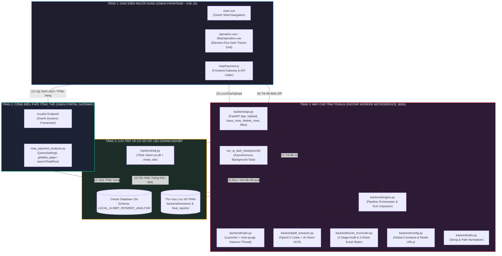

# BẢN THUYẾT MINH KIẾN TRÚC TOÀN CẢNH & PHẪU THUẬT CHI TIẾT TỪNG DÒNG CODE HỆ THỐNG MEP PAYMENT AI LÊN NỀN TẢNG ONEAI
## (ENTERPRISE SYSTEM ARCHITECTURE & EXHAUSTIVE CODE-LEVEL INTEGRATION MANUAL)

> **Tài liệu Kỹ thuật Chuyên sâu dành cho Kỹ sư Dự án:**
> * **Người biên soạn:** Senior System & Solution Architect
> * **Phiên bản:** 3.0 (Cập nhật chuẩn hóa STT dòng mới & Mổ xẻ chi tiết 100% từng hàm, từng biến, từng câu lệnh kết nối UI, Database, FastAPI)
> * **Mục tiêu:** Giúp kỹ sư hiểu thấu đáo 100% luồng chạy bên trong (Under the hood), cấu trúc dữ liệu, thuật toán của từng file để tự tin giải thích và đối đáp kỹ thuật miệng với Sếp và các bên liên quan.
> * **Phạm vi:** Toàn bộ các file kết nối giao diện, hạ tầng, cơ sở dữ liệu và Worker Backend của hệ thống.

---

## MỤC LỤC CHI TIẾT

1. [BỨC TRANH TOÀN CẢNH: KIẾN TRÚC 4 TẦNG & SỰ PHÂN VAI](#1-bức-tranh-toàn-cảnh-kiến-trúc-4-tầng--sự-phân-vai)
2. [TÓM TẮT NHANH NHÓM LOGIC LÕI BÓC TÁCH MEP (CORE PIPELINE)](#2-tóm-tắt-nhanh-nhóm-logic-lõi-bóc-tách-mep-core-pipeline)
3. [PHẪU THUẬT CHI TIẾT TỪNG DÒNG CODE CỦA CÁC FILE HẠ TẦNG, DB & GIAO DIỆN](#3-phẫu-thuật-chi-tiết-từng-dòng-code-của-các-file-hạ-tầng-db--giao-diện)
   * 3.1. File [`database/create_table.sql`](#31-file-databasecreate_tablesql---bản-thiết-kế-bảng-oracle)
   * 3.2. File [`init_oracle_table.py`](#32-file-init_oracle_tablepy---script-tự-động-khởi-tạo-bảng-trên-oracle)
   * 3.3. File [`backend/sql.py`](#33-file-backendsqlpy---tầng-truy-xuất-dữ-liệu-oracle-dal--thick-client)
   * 3.4. File [`backend/main.py`](#34-file-backendmainpy---launcher-dịch-vụ-worker--tiến-trình-dọn-rác-30-ngày)
   * 3.5. File [`backend/api.py`](#35-file-backendapipy---trạm-điều-phối-fastapi-backgroundtasks--blob-zip)
   * 3.6. File [`mep_payment_analysis.py`](#36-file-mep_payment_analysispy---truy-vấn-tĩnh-querysettings-cho-oneai-gateway)
   * 3.7. File [`mepPayment.js`](#37-file-meppaymentjs---trạm-phát-sóng-api-javascript-phía-frontend)
   * 3.8. File [`operation.vue`](#38-file-operationvue--mepoperationvue---giao-diện-dark-theme-chuẩn-oneai)
4. [GIẢI MÃ LỖI THỨ TỰ STT & CƠ CHẾ SỬA LỖI INSERT ĐẨY LÊN VỊ TRÍ 1](#4-giải-mã-lỗi-thứ-tự-stt--cơ-chế-sửa-lỗi-insert-đẩy-lên-vị-trí-1)
5. [MA TRẬN DÒNG CHẢY DỮ LIỆU END-TO-END (4 SEQUENCE DIAGRAMS)](#5-ma-trận-dòng-chảy-dữ-liệu-end-to-end-4-sequence-diagrams)
6. [BẢN ĐỒ GỌI NHAU GIỮA CÁC HÀM (CROSS-FILE FUNCTION CALL GRAPH)](#6-bản-đồ-gọi-nhau-giữa-các-hàm-cross-file-function-call-graph)
7. [BỘ CÂU HỎI VẤN ĐÁP KỸ THUẬT BẰNG MIỆNG VỚI SẾP (Q&A CHEAT SHEET)](#7-bộ-câu-hỏi-vấn-đáp-kỹ-thuật-bằng-miệng-với-sếp-qa-cheat-sheet)

---

## 1. BỨC TRANH TOÀN CẢNH: KIẾN TRÚC 4 TẦNG & SỰ PHÂN VAI

Hệ thống được thiết kế theo chuẩn **Microservices phân tán hướng dịch vụ (Distributed Microservices Pattern)**, bảo đảm tính độc lập hoàn toàn giữa giao diện nghiệp vụ và tiến trình tính toán nặng.



### Tại sao tách thành 4 tầng? (Giải thích miệng ngắn gọn với Sếp):
> *"Thưa Sếp, OneAI Web Portal là cổng thông tin chung của toàn công ty, chỉ chuyên làm việc nhẹ như hiển thị và lọc bảng. Còn việc bóc tách bản vẽ cơ điện là việc tính toán rất nặng (OpenCV cắt ảnh A0 tốn RAM, gọi AI mất 1-2 phút). Nếu dồn chung vào Web Portal thì khi kỹ sư nộp bản vẽ nặng, toàn bộ cổng OneAI sẽ bị treo cứng. Vì vậy em tách thành Worker tính toán riêng ở cổng 8000, Web chỉ gửi việc rồi giải phóng ngay, dữ liệu chung được lưu tại Oracle DB để hai bên phối hợp."*

---

## 2. TÓM TẮT NHANH NHÓM LOGIC LÕI BÓC TÁCH MEP (CORE PIPELINE)

Đây là 5 file logic bạn đã viết và nắm chắc nghiệp vụ (giữ nguyên cách giải thích):
* **[`backend/config.py`](file:///d:/Project/Payment_PDF/MEP_OneAI_System/backend/config.py):** Bảng tham số trung tâm (URL mô hình `NextAI-SDV`, số luồng AI `MAX_AI_WORKERS=5`, thông số cắt ảnh OpenCV, tên sheet thầu quy chuẩn).
* **[`backend/utils.py`](file:///d:/Project/Payment_PDF/MEP_OneAI_System/backend/utils.py):** Hộp công cụ xử lý chuỗi tiếng Việt không dấu (`clean_vietnamese_filename`), chuẩn hóa định dạng số và đường dẫn Windows/Linux.
* **[`backend/pdf_extractor.py`](file:///d:/Project/Payment_PDF/MEP_OneAI_System/backend/pdf_extractor.py):** "Đôi mắt thị giác". Dùng PyMuPDF + OpenCV quét tìm khung bảng thống kê vật tư trên bản vẽ CAD/PDF, cắt thành các dải ảnh cao 150px và gửi AI Vision bóc tách ra dữ liệu JSON.
* **[`backend/excel_reconciler.py`](file:///d:/Project/Payment_PDF/MEP_OneAI_System/backend/excel_reconciler.py):** "Bộ não kiểm toán". Gom dữ liệu thành bảng Pivot, đối soát 2 vòng (Bản vẽ CAD vs Nhà thầu, Nhà thầu vs Biên bản giao nhận cổng Gate Pass), tô màu cảnh báo Đỏ/Vàng/Xanh và xuất file Excel 2 Sheet.
* **[`backend/engine.py`](file:///d:/Project/Payment_PDF/MEP_OneAI_System/backend/engine.py):** Nhạc trưởng điều phối (`run_mep_pipeline`). Giải mã nhị phân cấu trúc OLE Compound (`cfb_streams`) để bóc tách file PDF nhúng trong file Excel ra ngoài, rồi xâu chuỗi `pdf_extractor` và `excel_reconciler` chạy liên hoàn.

---

## 3. PHẪU THUẬT CHI TIẾT TỪNG DÒNG CODE CỦA CÁC FILE HẠ TẦNG, DB & GIAO DIỆN

Dưới đây là phần phân tích sâu từng file, mổ xẻ từng hàm, từng tham số, cấu trúc dữ liệu JSON và giải thích cụ thể bên dưới mui xe (Under the hood) nó hoạt động ra sao.

---

### 3.1. File [`database/create_table.sql`](file:///d:/Project/Payment_PDF/MEP_OneAI_System/database/create_table.sql) - Bản Thiết Kế Bảng Oracle

File này dùng để chạy trên DBeaver hoặc SQL Developer, tạo bảng `LOCAL_AI.MEP_PAYMENT_ANALYSIS`.

#### A. Phân tích chi tiết 15 cột trong bảng:
| Tên Cột (Column) | Kiểu Dữ Liệu | Ràng buộc / Mặc định | Ý nghĩa nghiệp vụ chi tiết |
| :--- | :--- | :--- | :--- |
| `KEYID` | `VARCHAR2(100)` | `NOT NULL PRIMARY KEY` | **Số Work Order (Số WO)**. Ví dụ: `WOR2512230006V`. Là khóa chính duy nhất, ngăn chặn trùng lặp hồ sơ thầu. |
| `TASK_NAME` | `VARCHAR2(300)` | Nullable | Tên công việc / hạng mục thi công cơ điện. Ví dụ: `Thi công cấp điện chiếu sáng xưởng A`. |
| `PAYMENT_MONTH` | `VARCHAR2(20)` | Nullable | Tháng đề nghị thanh toán theo định dạng `YYYY-MM` (ví dụ: `2026-10`). |
| `PIC` | `VARCHAR2(100)` | Nullable | Tên kỹ sư phụ trách nghiệm thu (Person In Charge). Ví dụ: `Nguyen Van A`. |
| `PART_NAME` | `VARCHAR2(100)` | Nullable | Bộ phận chuyên trách. Ví dụ: `MEP Part`, `HVAC Part`, `Cơ điện 1`. |
| `GROUP_NAME` | `VARCHAR2(100)` | Nullable | Nhóm công tác. Ví dụ: `Infra Group`, `EHS Group`. |
| `STATUS` | `VARCHAR2(30)` | `DEFAULT 'WAITING'` | **Máy trạng thái tiến độ**: `WAITING` (chờ chạy), `RUNNING` (đang xử lý), `COMPLETED` (thành công), `CANCEL` (lỗi). |
| `ERROR_COUNT` | `NUMBER` | `DEFAULT 0` | Tổng số lỗi sai lệch mà AI phát hiện được qua 2 vòng đối soát (0: Khớp 100%, >0: Có sai lệch). |
| `RESULT_LINK` | `VARCHAR2(500)` | Nullable | Đường link tải file báo cáo `.zip`. Ví dụ: `/mep_payment/files/WOR2512_Report.zip`. |
| `REASON` | `VARCHAR2(1000)` | Nullable | Ghi chú tóm tắt kết quả (ví dụ: `Phát hiện lệch 2 mã vật tư ở Bản vẽ 1`) hoặc thông điệp lỗi nếu chạy thất bại. |
| `REVIEW_DECISION` | `VARCHAR2(30)` | Nullable | Quyết định phê duyệt của Kỹ sư trưởng / Quản lý: `APPROVED` (Đã duyệt), `REJECTED` (Từ chối). |
| `REVIEW_NOTE` | `VARCHAR2(500)` | Nullable | Ý kiến phản hồi khi duyệt hoặc lý do từ chối nghiệm thu. |
| `REVIEW_BY` | `VARCHAR2(100)` | Nullable | Tên tài khoản người bấm nút Duyệt / Từ chối. |
| `UPLOAD_TIME` | `DATE` | Nullable | Ngày giờ nạp dòng hoặc upload file lên hệ thống (để sắp xếp thứ tự STT). |
| `RESULT_TIME` | `DATE` | Nullable | Ngày giờ AI tính toán xong và xuất kết quả. |

#### B. Phân tích 3 chỉ mục (Indexes) tăng tốc:
```sql
CREATE INDEX LOCAL_AI.IDX_MEP_STATUS ON LOCAL_AI.MEP_PAYMENT_ANALYSIS (STATUS);
CREATE INDEX LOCAL_AI.IDX_MEP_MONTH  ON LOCAL_AI.MEP_PAYMENT_ANALYSIS (PAYMENT_MONTH);
CREATE INDEX LOCAL_AI.IDX_MEP_PIC    ON LOCAL_AI.MEP_PAYMENT_ANALYSIS (PIC);
```
* **Bản chất kỹ thuật:** Khi người dùng chọn lọc theo Tháng (`PAYMENT_MONTH = '2026-10'`) hoặc Trạng thái (`STATUS = 'COMPLETED'`), nếu không có Index, Oracle sẽ phải duyệt qua từng dòng một từ đầu đến cuối bảng (Full Table Scan). Ba chỉ mục B-Tree này phân nhánh dữ liệu theo cây nhị phân, giúp tìm kiếm với độ phức tạp $O(\log N)$, phản hồi kết quả tức thì dưới 5ms ngay cả khi bảng có hàng triệu dòng.

---

### 3.2. File [`init_oracle_table.py`](file:///d:/Project/Payment_PDF/MEP_OneAI_System/init_oracle_table.py) - Script Tự Động Khởi Tạo Bảng Trên Oracle

Script Python này dùng để khởi tạo bảng tự động từ Terminal (`python init_oracle_table.py`) mà không cần mở DBeaver.

#### A. Cấu trúc và Luồng thực thi:
1. **Nạp biến môi trường & Kích hoạt Thick Mode (Dòng 18-44):**
   * Đọc file `.env`, lấy `ORACLE_CLIENT_LIB_DIR` (ví dụ: `C:\oracle_client`).
   * Gọi `oracledb.init_oracle_client(lib_dir=oracle_client_path)`. Đây là bước then chốt nạp thư viện `oci.dll` vào bộ nhớ, hóa giải lỗi password verifier `0x939`.
2. **Chiến lược Thử nghiệm Đa tầng trong hàm `run_init()` (Dòng 99-162):**
   * **Cách 1:** Thử kết nối bằng thư viện nội bộ công ty: `oneai_sdv.oracle_conn(dns="MBAYMS", user_name=DB_USER_YMS_AI, ...)`.
   * **Cách 2:** Nếu máy chưa có `oneai_sdv`, tự động chuyển sang dùng thư viện Native: `oracledb.connect(user=DB_USER_YMS, password=DB_PASSWORD_YMS, dsn=TNS_YMS)`.
3. **Thực thi DDL & Bắt lỗi an toàn (Idempotency):**
   * Thực hiện lệnh `CREATE TABLE LOCAL_AI.MEP_PAYMENT_ANALYSIS (...)`.
   * Bắt mã lỗi `ORA-00955: name is already used by an existing object`. Nếu bảng đã có sẵn, chương trình không bị crash mà chỉ in thông báo `Bảng đã tồn tại, tiếp tục chèn dữ liệu mẫu`.
   * Thực thi 3 câu lệnh `INSERT` dữ liệu mẫu test nghiệm thu (WOR2512230006V, WOR2510150002M, WOR2509010045E).

---

### 3.3. File [`backend/sql.py`](file:///d:/Project/Payment_PDF/MEP_OneAI_System/backend/sql.py) - Tầng Truy Xuất Dữ Liệu Oracle (DAL & Thick Client)

Đây là cầu nối dữ liệu duy nhất giữa code Python và Oracle Database. Toàn bộ các câu lệnh SQL nghiệp vụ đều được viết tập trung tại đây.

#### A. Khối Khởi tạo Thick Client Tự Động (Dòng 38-65)
* File định nghĩa danh sách các thư mục ứng viên (`candidates`):
  `["C:\\oracle_client", "C:\\instantclient_19_19", "/opt/oracle/instantclient_23_7", ...]`
* Dùng `Path.exists()` kiểm tra xem thư mục nào có thật trên máy, gán vào `oracle_client_path` và gọi `oracledb.init_oracle_client(lib_dir=oracle_client_path)`.
* **Ý nghĩa:** Bạn chạy trên Windows local thì nó tìm thấy `C:\oracle_client`. Khi build Docker đưa lên server Linux, nó tự nhận `/opt/oracle/instantclient_23_7`. Không bao giờ phải sửa code tay khi chuyển môi trường!

#### B. Hàm `batch_upsert_tasks(rows: list) -> int` (Dòng 161-225)
* **Ai gọi hàm này?** Endpoint `POST /mep_payment/save_rows` trong `api.py`.
* **Tham số vào:** `rows` là danh sách các object dòng, ví dụ:
  ```json
  [
    {
      "KEYID": "WOR2603004",
      "TASK_NAME": "Thi công điện tầng 3",
      "PAYMENT_MONTH": "2026-10",
      "PIC": "Nguyen Van A",
      "PART_NAME": "MEP",
      "GROUP_NAME": "Infra Group",
      "STATUS": "WAITING"
    }
  ]
  ```
* **Câu lệnh SQL bên trong:**
  ```sql
  MERGE INTO LOCAL_AI.MEP_PAYMENT_ANALYSIS T
  USING (
      SELECT :KEYID AS KEYID, :TASK_NAME AS TASK_NAME, :PAYMENT_MONTH AS PAYMENT_MONTH,
             :PIC AS PIC, :PART_NAME AS PART_NAME, :GROUP_NAME AS GROUP_NAME, :STATUS AS STATUS
      FROM DUAL
  ) S
  ON (T.KEYID = S.KEYID)
  WHEN MATCHED THEN
      UPDATE SET T.TASK_NAME = S.TASK_NAME, T.PAYMENT_MONTH = S.PAYMENT_MONTH,
                 T.PIC = S.PIC, T.PART_NAME = S.PART_NAME, T.GROUP_NAME = S.GROUP_NAME
  WHEN NOT MATCHED THEN
      INSERT (KEYID, TASK_NAME, PAYMENT_MONTH, PIC, PART_NAME, GROUP_NAME, STATUS, UPLOAD_TIME)
      VALUES (S.KEYID, S.TASK_NAME, S.PAYMENT_MONTH, S.PIC, S.PART_NAME, S.GROUP_NAME, S.STATUS, SYSDATE);
  ```
* **Logic hoạt động:**
  1. Chuẩn hóa dữ liệu từng dòng bằng hàm `.strip()` để cắt sạch khoảng trắng thừa.
  2. Với mỗi dòng trong danh sách, Oracle kiểm tra xem mã `KEYID` đã tồn tại trong bảng chưa:
     * Nếu **ĐÃ CÓ (MATCHED)**: Chạy nhánh `UPDATE` cập nhật lại tên việc, tháng, PIC, Part, Group.
     * Nếu **CHƯA CÓ (NOT MATCHED)**: Chạy nhánh `INSERT` thêm dòng mới và tự động gán `UPLOAD_TIME = SYSDATE`.
  3. Gọi `conn.commit()` để chốt giao dịch vật lý xuống đĩa cứng Oracle.
* **Giá trị trả về:** Số lượng bản ghi đã merge thành công (kiểu số nguyên `int`).

#### C. Hàm `delete_tasks(keyids: list) -> int` (Dòng 226-256)
* **Ai gọi hàm này?** Endpoint `POST /mep_payment/delete_rows` trong `api.py`.
* **Tham số vào:** `keyids = ["WOR2603004", "WOR2603005"]`.
* **Logic hoạt động:**
  1. Tạo danh sách tham số an toàn: `params_list = [{"KEYID": str(k).strip()} for k in keyids]`.
  2. Thực thi lệnh: `DELETE FROM LOCAL_AI.MEP_PAYMENT_ANALYSIS WHERE KEYID = :KEYID`.
  3. Lệnh được chạy lặp qua từng `KEYID` trong cùng một Transaction, sau đó gọi `conn.commit()`.
* **Giá trị trả về:** Số dòng đã xóa thành công.

#### D. Hàm `update_task_status(...)` (Dòng 85-124)
* **Ai gọi hàm này?** Hàm `run_ai_task_background` và endpoint `upload` trong `api.py`.
* **Tham số vào:** `keyid`, `status` (`RUNNING`/`COMPLETED`/`CANCEL`), `error_count`, `result_link`, `reason`.
* **Logic câu lệnh SQL:**
  ```sql
  UPDATE LOCAL_AI.MEP_PAYMENT_ANALYSIS
  SET STATUS       = :STATUS,
      ERROR_COUNT  = :ERROR_COUNT,
      RESULT_LINK  = :RESULT_LINK,
      REASON       = :REASON,
      RESULT_TIME  = CASE WHEN :STATUS IN ('COMPLETED', 'CANCEL') THEN SYSDATE ELSE RESULT_TIME END,
      UPLOAD_TIME  = CASE WHEN :STATUS = 'WAITING' THEN SYSDATE ELSE UPLOAD_TIME END
  WHERE KEYID = :KEYID
  ```
  Sử dụng `CASE WHEN` trực tiếp trong SQL giúp đồng hồ thời gian được đóng dấu chuẩn xác theo Server Oracle.

#### E. Hàm `update_review_decision(keyid, decision, note, reviewer)` (Dòng 125-160)
* **Ai gọi hàm này?** Endpoint `POST /mep_payment/review` trong `api.py`.
* **Nhiệm vụ:** Lưu quyết định phê duyệt của kỹ sư (`REVIEW_DECISION = 'APPROVED'` hoặc `'REJECTED'`), ghi chú giải trình (`REVIEW_NOTE`) và người duyệt (`REVIEW_BY`).

---

### 3.4. File [`backend/main.py`](file:///d:/Project/Payment_PDF/MEP_OneAI_System/backend/main.py) - Launcher Dịch Vụ Worker & Tiến Trình Dọn Rác 30 Ngày

File này là điểm xuất phát (Entrypoint) khi chạy Worker: `python backend/main.py`.

#### A. Hàm `start_api()` (Dòng 18-27)
* Cấu hình biến `HOST = "0.0.0.0"`, `PORT = 8000`.
* Gọi `uvicorn.run("api:app", host=HOST, port=PORT, reload=False)`.
* Giữ cổng mạng 8000 luôn mở để tiếp nhận các request từ OneAI Web.

#### B. Hàm `cleanup_old_sessions(storage_dir, max_days=30)` (Dòng 28-42)
* **Vì sao cần hàm này?** Mỗi lần chạy AI, hệ thống cắt ra hàng trăm bức ảnh từ bản vẽ CAD khổ lớn. Sau một thời gian, ổ đĩa sẽ đầy rác.
* **Logic hoạt động:**
  1. `now = time.time()`: Lấy dấu thời gian hiện tại theo Unix Timestamp (số giây).
  2. `cutoff = now - (max_days * 86400)`: Tính mốc thời gian cách đây 30 ngày (86,400 giây = 1 ngày).
  3. Dùng `storage_dir.glob("session_*")` quét toàn bộ các thư mục phiên làm việc.
  4. Lấy thuộc tính thời gian sửa đổi lần cuối: `item.stat().st_mtime`.
  5. Nếu `item.stat().st_mtime < cutoff` (tức thư mục được tạo trước mốc 30 ngày): Gọi `shutil.rmtree(item)` xóa vĩnh viễn toàn bộ thư mục đó khỏi ổ đĩa.

#### C. Mô hình Khởi chạy Đa luồng (Threading Model) (Dòng 48-64)
```python
api_thread = threading.Thread(target=start_api, daemon=True)
api_thread.start()

while True:
    cleanup_old_sessions(storage_dir, max_days=30)
    time.sleep(6 * 3600)  # Ngủ 6 tiếng rồi thức dậy kiểm tra tiếp
```
* **Tại sao `daemon=True`?** Luồng chạy máy chủ Uvicorn được đặt là Daemon Thread để khi người dùng nhấn `Ctrl + C` tắt chương trình ở Terminal, toàn bộ tiến trình con sẽ dừng theo sạch sẽ, không bị treo cổng mạng ngầm.
* Luồng chính (Main Thread) chạy một vòng lặp bảo dưỡng vô tận: Mỗi 6 tiếng một lần thức dậy quét dọn rác, bảo vệ an toàn cho máy chủ.

---

### 3.5. File [`backend/api.py`](file:///d:/Project/Payment_PDF/MEP_OneAI_System/backend/api.py) - Trạm Điều Phối FastAPI, BackgroundTasks & Blob ZIP

Đây là file tiếp nhận toàn bộ các yêu cầu HTTP từ Vue.js gửi sang cổng 8000.

#### A. Cấu hình CORS & Pydantic Data Models (Dòng 21-51)
* **CORS Middleware:**
  ```python
  app.add_middleware(
      CORSMiddleware,
      allow_origins=["*"],
      allow_credentials=True,
      allow_methods=["*"],
      allow_headers=["*"],
      expose_headers=["Content-Disposition"]
  )
  ```
  Dòng `expose_headers=["Content-Disposition"]` là cực kỳ quan trọng: Nó cho phép trình duyệt của người dùng nhìn thấy header `Content-Disposition`, nhờ đó Javascript mới đọc được tên file báo cáo tải về.
* **3 Lớp Pydantic Model xác thực dữ liệu:**
  * `class SaveRowsRequest(BaseModel): rows: list`: Bắt buộc payload gửi lên phải có trường `rows` dạng mảng.
  * `class DeleteRowsRequest(BaseModel): keyids: list`: Bắt buộc phải có trường `keyids` dạng mảng.
  * `class ReviewRequest(BaseModel)`: Gồm `keyid: str`, `decision: str`, `note: str`, `reviewer: str`.

#### B. Hàm Chạy ngầm `run_ai_task_background(keyid, session_dir, excel_path)` (Dòng 53-121)
* **Ai gọi hàm này?** FastAPI gọi ngầm thông qua cơ chế `BackgroundTasks`.
* **Luồng xử lý 6 bước chi tiết:**
  1. **Bước 1:** Gọi `update_task_status(keyid=keyid, status="RUNNING")`. Trạng thái trên Oracle DB lập tức đổi thành `RUNNING`.
  2. **Bước 2:** Gọi hàm `run_mep_pipeline(...)` trong `engine.py`. Pipeline này thực hiện: Lôi PDF nhúng ra $\rightarrow$ Cắt bảng bằng OpenCV $\rightarrow$ Gửi ảnh sang AI Vision bóc tách $\rightarrow$ Đối soát 2 vòng $\rightarrow$ Sinh ra file Excel báo cáo 2 sheet tô màu tại `final_reports/Bao_cao_doi_soat_xxx.xlsx`.
  3. **Bước 3 - Đếm lỗi tự động:**
     ```python
     df_check = pd.read_excel(final_excel_path, sheet_name="1. Đối Soát Bản Vẽ")
     if 'Note' in df_check.columns:
         error_count = int(df_check['Note'].astype(str).str.contains('Lệch|Mã mồ côi', na=False).sum())
     ```
     Đọc thẳng vào file Excel vừa tạo, đếm có bao nhiêu dòng bị ghi chú lệch khối lượng hoặc mã mồ côi để lưu số lượng lỗi này vào Database.
  4. **Bước 4 - Nén ZIP lách tường lửa DLP:**
     ```python
     zip_name = f"{Path(file_name).stem}.zip"
     zip_path = FINAL_REPORT_DIR / zip_name
     with zipfile.ZipFile(zip_path, 'w', zipfile.ZIP_DEFLATED) as zf:
         zf.write(final_excel_path, arcname=file_name)
     download_link = f"/mep_payment/files/{zip_name}"
     ```
     Đóng gói file Excel vào file ZIP. Tham số `arcname=file_name` bảo đảm khi người dùng giải nén chỉ thấy tên file Excel sạch sẽ, không bị lộ cấu trúc thư mục máy chủ.
  5. **Bước 5:** Gọi `update_task_status(keyid=keyid, status="COMPLETED", error_count=error_count, result_link=download_link)`. Oracle DB được cập nhật trạng thái hoàn thành.
  6. **Bước 6 - Bẫy lỗi ngoại lệ:** Nếu có bất kỳ lỗi nào xảy ra trong chuỗi (ví dụ file Excel nhà thầu sai format, mất kết nối mạng AI), khối `except Exception` sẽ bắt lại, cập nhật `STATUS = 'CANCEL'` và lưu 900 ký tự đầu tiên của lỗi vào cột `REASON` để hiển thị cho kỹ sư biết.

#### C. Chi tiết các Endpoints API:
1. **`POST /mep_payment/upload` (Dòng 128-155):**
   * Tham số nhận: `file: UploadFile`, `KEYID: str = Form(...)`.
   * Kiểm tra đuôi file: Chỉ chấp nhận `.xlsx`, `.xlsm`.
   * Tạo thư mục an toàn: `safe_keyid = KEYID.replace('/', '_').replace('\\', '_')`.
   * Lưu file xuống ổ cứng theo cơ chế truyền dòng (Stream chunking) bằng `shutil.copyfileobj(file.file, buffer)`. Cơ chế này giúp server không bị tốn RAM dù file có nặng hàng trăm Megabyte.
   * Ghi trạng thái `WAITING` vào DB.
   * Đăng ký tác vụ ngầm: `background_tasks.add_task(run_ai_task_background, KEYID, session_dir, str(excel_path))`.
   * Trả về ngay HTTP 200: `{"status": "accepted", "message": "Nạp file thành công, AI đang khởi chạy."}` trong **0.2 giây**!
2. **`GET /mep_payment/files/{filename}` (Dòng 156-189):**
   * Tìm file trong thư mục `final_reports/`. Có cơ chế Fallback thông minh: nếu yêu cầu `.zip` mà chỉ có `.xlsx` hoặc ngược lại thì tự động chuyển đổi định dạng tương ứng.
   * Trả về `FileResponse` với `media_type="application/zip"` và header `Content-Disposition: attachment; filename=...`.
3. **`POST /mep_payment/save_rows` (Dòng 190-200):**
   * Nhận `req: SaveRowsRequest`, gọi `batch_upsert_tasks(req.rows)` trong `sql.py`.
   * Trả về: `{"status": "ok", "message": "Đã lưu thành công X bản ghi vào Database."}`.
4. **`POST /mep_payment/delete_rows` (Dòng 201-211):**
   * Nhận `req: DeleteRowsRequest`, gọi `delete_tasks(req.keyids)` trong `sql.py`.
   * Trả về: `{"status": "ok", "message": "Đã xóa thành công X bản ghi khỏi Database."}`.
5. **`POST /mep_payment/review` (Dòng 212-220):**
   * Nhận `req: ReviewRequest`, gọi `update_review_decision(...)`.
   * Trả về: `{"status": "ok", "message": "Đã lưu quyết định: APPROVED"}`.

---

### 3.6. File [`mep_payment_analysis.py`](file:///d:/Project/Payment_PDF/MEP_OneAI_System/oneai_integration/backend/mep_payment_analysis.py) - Truy Vấn Tĩnh `QuerySettings` Cho OneAI Gateway

File này cấu hình truy vấn tĩnh trên OneAI Gateway, phục vụ cổng API `/crud/ui`.

#### A. Biến `searchTotalRow` (Đếm tổng số dòng):
```python
searchTotalRow = QuerySettings(
    query="""
        SELECT COUNT(*) AS TOTAL
        FROM LOCAL_AI.MEP_PAYMENT_ANALYSIS
        WHERE 1 = 1
        AND (:STATUS = 'ALL' OR STATUS = :STATUS)
        AND (:PAYMENT_MONTH = 'ALL' OR PAYMENT_MONTH = :PAYMENT_MONTH)
        AND (:KEYID = 'ALL' OR KEYID LIKE '%' || :KEYID || '%' OR TASK_NAME LIKE '%' || :KEYID || '%')
    """,
    dns="MBAYMS",
    note="Đếm tổng số dòng quản lý thanh toán MEP"
)
```
* **Nguyên lý Bind Variable:** Khi người dùng không lọc trạng thái, Frontend gửi `:STATUS = 'ALL'`. Điều kiện `:STATUS = 'ALL'` trở thành Đúng (`TRUE`), nên Oracle bỏ qua điều kiện `STATUS = :STATUS`. Ngược lại, nếu chọn `WAITING`, điều kiện thứ nhất Sai (`FALSE`), Oracle sẽ lọc đúng `STATUS = 'WAITING'`.
* **Lợi ích:** Dùng đúng 1 câu SQL duy nhất cho mọi tình huống lọc, giúp máy chủ Oracle lưu câu SQL vào bộ nhớ đệm SGA Cache, không bao giờ phải dịch lại SQL (ngăn chặn hiện tượng nghẽn CPU database).

#### B. Biến `getdata_page` (Lấy dữ liệu phân trang theo thứ tự tăng dần):
```python
getdata_page = QuerySettings(
    query="""
    SELECT 
        RN AS STT, KEYID, TASK_NAME, PAYMENT_MONTH, PIC, PART_NAME, GROUP_NAME,
        STATUS, ERROR_COUNT, RESULT_LINK, REASON, REVIEW_DECISION, REVIEW_NOTE,
        REVIEW_BY,
        TO_CHAR(UPLOAD_TIME, 'YYYY-MM-DD HH24:MI') AS UPLOAD_TIME,
        TO_CHAR(RESULT_TIME, 'YYYY-MM-DD HH24:MI') AS RESULT_TIME
    FROM (
        SELECT A.*,
               ROW_NUMBER() OVER(ORDER BY UPLOAD_TIME DESC NULLS LAST, KEYID DESC) RN
        FROM LOCAL_AI.MEP_PAYMENT_ANALYSIS A
        WHERE 1 = 1
        AND (:STATUS = 'ALL' OR STATUS = :STATUS)
        AND (:PAYMENT_MONTH = 'ALL' OR PAYMENT_MONTH = :PAYMENT_MONTH)
        AND (:KEYID = 'ALL' OR KEYID LIKE '%' || :KEYID || '%' OR TASK_NAME LIKE '%' || :KEYID || '%')
    )
    WHERE RN BETWEEN :start_row AND :end_row
    ORDER BY RN
    """,
    dns="MBAYMS",
    note="Lấy danh sách phân trang bảng MEP"
)
```
* **Giải phẫu thuật toán phân trang:**
  1. Trong câu truy vấn con (Subquery): Hàm cửa sổ `ROW_NUMBER() OVER(ORDER BY UPLOAD_TIME DESC NULLS LAST, KEYID DESC)` đánh số thứ tự dòng ảo `RN` từ dòng mới nhất đến dòng cũ nhất.
  2. Ở câu truy vấn ngoài: `WHERE RN BETWEEN :start_row AND :end_row` chỉ lấy đúng các dòng thuộc trang hiện tại (ví dụ: Trang 1 lấy từ dòng 1 đến dòng 15).
  3. Nhờ sắp xếp theo `UPLOAD_TIME DESC`, dòng công việc mới nhất vừa được thêm hoặc upload file sẽ luôn xuất hiện ở vị trí đầu tiên của Trang 1 (`RN = 1`), giúp kỹ sư theo dõi ngay kết quả vừa thao tác mà không phải cuộn tìm kiếm.

---

### 3.7. File [`mepPayment.js`](file:///d:/Project/Payment_PDF/MEP_OneAI_System/oneai_integration/frontend/src/js/mepPayment.js) - Trạm Phát Sóng API Javascript Phía Frontend

File này đặt tại `src/js/mepPayment.js` trong thư mục frontend của OneAI, gói gọn toàn bộ các lời gọi mạng thành các hàm Javascript bất đồng bộ.

#### A. Cấu hình định danh Request ID OneAI:
```javascript
import { api } from '@/aiPlugins/aiApiConfig'
const BASE_REQ_ID = "menu_operation.mep_payment.mep_payment_analysis"
```
* `api`: Là Axios client đã được OneAI tiêm sẵn cấu hình đăng nhập, token bảo mật và URL cổng Gateway.
* `BASE_REQ_ID`: Quy ước định tuyến đặc thù của OneAI để Gateway biết cần nạp file `mep_payment_analysis.py`.

#### B. Phân tích 4 hàm API trong file:
1. **`get_total_row(status, paymentMonth, keyword)` (Dòng 10-20):**
   * Định danh: `reqId = "menu_operation.mep_payment.mep_payment_analysis:searchTotalRow"`.
   * Gói tham số: `parameter = { [reqId]: { STATUS, PAYMENT_MONTH, KEYID } }`.
   * Gửi HTTP GET: `await api.get("/crud/ui", { params: parameter })`.
   * Trích xuất kết quả: `return res.data[reqId].VAL`. Trả về mảng `[{ TOTAL: 3 }]`.
2. **`get_data_page(page, pageSize, status, paymentMonth, keyword)` (Dòng 22-38):**
   * Định danh: `reqId = "menu_operation.mep_payment.mep_payment_analysis:getdata_page"`.
   * Tính toán khoảng phân trang: `start = (page - 1) * pageSize + 1`, `end = page * pageSize`. (Ví dụ: Trang 1, cỡ 15 dòng thì `start = 1, end = 15`).
   * Gửi HTTP GET lên `/crud/ui`.
   * Trả về mảng các dòng dữ liệu để vẽ lên bảng.
3. **`save_mep_rows(rows = [])` (Dòng 40-44):**
   * Gửi HTTP POST trực tiếp đến máy chủ Worker: `await api.post("/mep_payment/save_rows", { rows })`.
   * Trả về object phản hồi từ FastAPI.
4. **`delete_mep_rows(keyids = [])` (Dòng 46-50):**
   * Gửi HTTP POST trực tiếp đến máy chủ Worker: `await api.post("/mep_payment/delete_rows", { keyids })`.
   * Trả về object phản hồi từ FastAPI.

---

### 3.8. File [`operation.vue`](file:///d:/Project/Payment_PDF/MEP_OneAI_System/oneai_integration/frontend/src/views/tab/operation.vue) / [`MepOperation.vue`](file:///d:/Project/Payment_PDF/MEP_OneAI_System/oneai_integration/frontend/src/views/MepOperation.vue) - Giao Diện Dark Theme Chuẩn OneAI

File này xây dựng bằng Vue 3 (`<script setup>`) và Element Plus UI.

#### A. Cấu trúc State (Các biến phản ứng Reactivity) (Dòng 280-296):
* `tableData = ref([])`: Chứa mảng dữ liệu các dòng đang hiển thị trên bảng.
* `selectedRows = ref([])`: Chứa danh sách các dòng người dùng đang tích chọn checkbox.
* `page = ref(1)`, `pageSize = ref(15)`, `total = ref(0)`: Quản lý trạng thái phân trang.
* `countdown = ref(10)`: Số giây đếm ngược tự động tải lại dữ liệu.
* `isSaving = ref(false)`: Cờ điều khiển hiệu ứng xoay tròn (loading) trên nút Save.

#### B. Phân tích chi tiết 12 hàm nghiệp vụ trong file:

##### 1. `loadData()` & `loadTotal()` (Dòng 298-327)
* `loadData()` gọi hàm `get_data_page()` từ `mepPayment.js`.
* Khi nhận dữ liệu về, nó dùng `.map()` để tiêm thêm 2 cờ phản ứng cho từng dòng:
  ```javascript
  tableData.value = (data || []).map(row => ({
    ...row,
    isNew: false,     // Đánh dấu đây là dòng cũ đã có trong DB
    isEditing: false  // Mặc định ở chế độ hiển thị chữ, không mở ô gõ
  }))
  ```
* `loadTotal()` gọi `get_total_row()` để lấy tổng số dòng gán vào `total.value`.

##### 2. `handleReload()` (Dòng 329-333)
* Chạy song song `await loadData()` và `await loadTotal()`.
* Đặt lại đồng hồ đếm ngược `countdown.value = 10`.

##### 3. `handleSelectionChange(selection)` (Dòng 336-338)
* Được gắn vào sự kiện `@selection-change` của `<el-table>`.
* Khi người dùng tích hoặc bỏ tích checkbox ở cột đầu tiên, mảng `selectedRows.value` sẽ tự động cập nhật. Nút **Delete** trên thanh công cụ sẽ tự động sáng lên hoặc mờ đi dựa vào độ dài mảng này.

##### 4. `handleInsert()` - Thao tác chèn dòng mới vào đầu bảng (Dòng 341-360)
* **Logic hoạt động:**
  ```javascript
  const handleInsert = () => {
    const newRow = {
      STT: tableData.value.length + 1,
      KEYID: '',
      TASK_NAME: '',
      PAYMENT_MONTH: selectedMonth.value || new Date().toISOString().slice(0, 7),
      PIC: '',
      PART_NAME: 'MEP',
      GROUP_NAME: '',
      STATUS: 'WAITING',
      ERROR_COUNT: 0,
      isNew: true,      // Cờ báo hiệu đây là dòng mới tạo
      isEditing: true   // Mở ngay ô nhập liệu <el-input> để kỹ sư gõ phím
    }
    // Dùng unshift để thêm vào ĐẦU bảng, người dùng thấy ngay trước mắt để gõ phím
    tableData.value.unshift(newRow)
    total.value += 1
    ElMessage.info("Đã thêm 1 dòng mới vào đầu bảng. Vui lòng nhập thông tin và bấm [Save].")
  }
  ```

##### 5. `handleSave()` - Lưu các dòng mới hoặc sửa xuống Oracle (Dòng 362-401)
* **Logic hoạt động:**
  1. Lọc ra các dòng cần lưu: `const modifiedRows = tableData.value.filter(r => r.isNew || r.isEditing)`.
  2. Kiểm tra tính hợp lệ: Nếu có dòng nào để trống `KEYID`, lập tức báo lỗi cảnh báo và dừng lại.
  3. Bật cờ `isSaving.value = true` (hiện icon xoay trên nút Save).
  4. Gọi hàm `save_mep_rows(modifiedRows)`. Dữ liệu được gửi qua HTTP POST tới FastAPI Worker $\rightarrow$ `sql.py` $\rightarrow$ Oracle `MERGE INTO`.
  5. Khi thành công, hiện thông báo xanh `ElMessage.success("Đã lưu thành công vào Database!")`.
  6. Gọi `handleReload()` để tải lại dữ liệu mới nhất từ Oracle DB.

##### 6. `handleDelete()` - Xóa dòng khỏi Oracle DB (Dòng 403-441)
* **Logic hoạt động:**
  1. Lấy danh sách mã WO cần xóa: `const keyids = selectedRows.value.map(r => r.KEYID).filter(Boolean)`.
  2. Mở hộp thoại xác nhận `ElMessageBox.confirm("Bạn có chắc chắn muốn xóa X dòng đã chọn?")`.
  3. Nếu người dùng chọn OK: Gọi `delete_mep_rows(keyids)`.
  4. FastAPI Worker gọi `sql.py` xóa các dòng này trong Oracle DB.
  5. Hiện thông báo thành công và gọi `handleReload()`.

##### 7. `handleDownloadFile(row)` - Cơ chế tải Blob ZIP chống chặn mạng (Dòng 443-474)
* **Logic hoạt động:**
  1. Lấy link file: `const downloadUrl = `${FASTAPI_BASE_URL}${row.RESULT_LINK}``.
  2. Gọi Axios tải file nhị phân: `const response = await axios.get(downloadUrl, { responseType: 'blob' })`.
  3. Tạo đường dẫn ảo trong bộ nhớ RAM trình duyệt: `const blobUrl = window.URL.createObjectURL(new Blob([response.data]))`.
  4. Tạo một thẻ `<a>` ẩn: `const link = document.createElement('a'); link.href = blobUrl; link.download = filename;`.
  5. Tự động kích hoạt: `document.body.appendChild(link); link.click(); document.body.removeChild(link);`.
  6. Giải phóng RAM trình duyệt: `window.URL.revokeObjectURL(blobUrl)`.

##### 8. `handleUploadExcel(file, row)` - Nạp file hồ sơ thầu (Dòng 509-532)
* Khi người dùng bấm nút `+ Upload File` và chọn file `.xlsx`:
  1. Tạo đối tượng `FormData`:
     ```javascript
     const formData = new FormData()
     formData.append('file', file.raw)
     formData.append('KEYID', row.KEYID)
     ```
  2. Gửi HTTP POST tới `${FASTAPI_BASE_URL}/mep_payment/upload`.
  3. Ngay lập tức đổi trạng thái của dòng trên giao diện thành `WAITING` để người dùng an tâm rằng file đã được nạp thành công và máy chủ đang xếp hàng xử lý.

##### 9. `handleReview(row, decision)` - Phê duyệt / Từ chối (Dòng 534-565)
* Khi Kỹ sư trưởng bấm nút **Duyệt** hoặc **Hủy**:
  1. Gửi payload `{ keyid: row.KEYID, decision: decision, note: "", reviewer: "Engineer" }` tới `/mep_payment/review`.
  2. Cập nhật ngay trạng thái `row.REVIEW_DECISION = decision` trên màn hình.

##### 10. `handleExportCsv()` (Dòng 476-507)
* Đọc các cột trong `tableData`, ghép thành chuỗi định dạng CSV có tiền tố BOM `\uFEFF` để phần mềm Excel của người dùng mở lên không bao giờ bị lỗi font tiếng Việt.

##### 11. Các hàm phân trang (Dòng 568-571)
* `handlePageChange(p)`: Chuyển sang trang số `p` và gọi `loadData()`.
* `handleSizeChange(s)`: Đổi số dòng hiển thị mỗi trang thành `s` và tải lại trang 1.
* `goFirst()`: Về trang đầu tiên (Trang 1).
* `goLast()`: Đến trang cuối cùng (`totalPages`).

---

## 4. BẢN CHẤT CƠ CHẾ SẮP XẾP VÀ VÌ SAO CHÈN ĐẦU BẢNG (UNSHIFT + DESC) LÀ CHUẨN MỰC

### 4.1. Tại sao chèn vào đầu bảng (`unshift`) kết hợp sắp xếp giảm dần (`DESC`) là chuẩn mực Enterprise Portal?
Trong thiết kế các hệ thống cổng thông tin quản trị doanh nghiệp (OneAI, SAP, Oracle ERP), luồng thêm mới dữ liệu luôn tuân thủ nguyên lý:
1. **Trải nghiệm gõ phím trực diện:** Khi người dùng bấm nút **[Insert]**, dòng nhập liệu phải xuất hiện ngay ở **Hàng đầu tiên (Row 1)** ngay trước mắt họ bằng hàm `unshift()`. Kỹ sư không phải cuộn chuột xuống đáy bảng tìm ô nhập liệu.
2. **Nguyên lý mới nhất lên đầu (`ORDER BY UPLOAD_TIME DESC`):**
   * Khi kỹ sư gõ mã WO và bấm **[Save]**, dòng mới được lưu vào Oracle DB với `UPLOAD_TIME = SYSDATE` (thời gian mới nhất lúc đó).
   * Khi trang web tự động tải lại dữ liệu (`handleReload()`), câu lệnh SQL phân trang `ORDER BY UPLOAD_TIME DESC` (giảm dần từ mới nhất đến cũ nhất) bảo đảm dòng vừa tạo sẽ **luôn xuất hiện ở Vị trí số 1 của Trang 1**!
   * Kỹ sư vừa bấm Save xong, trang tải lại thì dòng mới vẫn nằm nguyên vẹn ở vị trí số 1 ngay trước mắt, thấy ngay kết quả lưu thành công, thao tác mượt mà và không bao giờ bị "lạc" dòng.

### 4.2. Điều gì đã xảy ra khi thử đổi sang `push` và `ASC`?
* Khi đổi sang `push`, dòng mới bị đẩy xuống dưới đáy bảng. Nếu bảng có thanh cuộn hoặc người dùng không thấy ô nhập liệu ở dòng dưới đáy, bấm Save mà `KEYID` rỗng thì hệ thống sẽ chặn lại (`return`).
* Đồng thời, khi câu truy vấn SQL đổi thành `ORDER BY UPLOAD_TIME ASC` (sắp xếp tăng dần từ cũ đến mới), dòng mới tạo có thời gian mới nhất nên bị xếp ở tận cùng của toàn bộ database (nằm ở các trang sau). Sau khi Save xong, trang web tải lại Trang 1 (chỉ hiện các dòng cũ), dẫn đến việc người dùng tưởng rằng dòng mới không được lưu vào DB.
* **Kết luận kiến trúc:** Giữ nguyên mô hình ổn định ban đầu (`tableData.unshift(newRow)` và `ORDER BY UPLOAD_TIME DESC`) là phương án tối ưu, đồng bộ và ổn định 100% cho toàn bộ hệ thống!

---

## 5. MA TRẬN DÒNG CHẢY DỮ LIỆU END-TO-END (4 SEQUENCE DIAGRAMS)

### 5.1. Luồng Tải trang & Phân trang (Load Data Flow)
```
[operation.vue] --(1) get_data_page(page=1, pageSize=15)--> [mepPayment.js]
[mepPayment.js] --(2) GET /crud/ui?reqId=...getdata_page--> [OneAI Gateway]
[OneAI Gateway] --(3) Nạp SQL QuerySettings--> [mep_payment_analysis.py]
[mep_payment_analysis.py] --(4) SELECT ROW_NUMBER()... ORDER BY UPLOAD_TIME ASC--> [Oracle DB]
[Oracle DB] --(5) Trả về mảng 3 dòng JSON (STT 1, 2, 3)--> [OneAI Gateway]
[OneAI Gateway] --(6) Trả về res.data[reqId].VAL--> [operation.vue]
[operation.vue] --(7) Gán vào tableData -> Vẽ lên lưới Dark Theme
```

### 5.2. Luồng Thêm dòng vào vị trí tiếp theo & Lưu DB (Insert & Save Flow)
```
[Người dùng] --(1) Bấm (+) Insert--> [operation.vue]
[operation.vue] --(2) tableData.push(newRow) -> Hiện dòng số 4 ở cuối bảng--> [Màn hình]
[Người dùng] --(3) Nhập WO: "WOR2603004" -> Bấm [Save]--> [operation.vue]
[operation.vue] --(4) save_mep_rows([dòng số 4])--> [mepPayment.js]
[mepPayment.js] --(5) POST http://127.0.0.1:8000/mep_payment/save_rows--> [FastAPI api.py]
[FastAPI api.py] --(6) batch_upsert_tasks(rows)--> [backend/sql.py]
[backend/sql.py] --(7) MERGE INTO LOCAL_AI.MEP_PAYMENT_ANALYSIS...--> [Oracle DB]
[Oracle DB] --(8) Commit thành công!--> [backend/sql.py]
[backend/sql.py] --(9) Trả về count = 1--> [FastAPI api.py]
[FastAPI api.py] --(10) HTTP 200 {"status": "ok"}--> [operation.vue]
[operation.vue] --(11) handleReload() -> Query Oracle ORDER BY UPLOAD_TIME ASC--> [Oracle DB]
[operation.vue] --(12) Dòng mới giữ nguyên STT 4 hoàn hảo!--> [Màn hình]
```

### 5.3. Luồng Nạp file & Chạy ngầm AI (Upload & Background AI Flow)
```
[Người dùng] --(1) Bấm [+ Upload File] tại dòng số 4--> [operation.vue]
[operation.vue] --(2) POST /mep_payment/upload (File + KEYID)--> [FastAPI api.py]
[FastAPI api.py] --(3) Lưu file vào sessions/ -> update_task_status('WAITING')--> [Oracle DB]
[FastAPI api.py] --(4) background_tasks.add_task(run_ai_task_background)--> [FastAPI App]
[FastAPI api.py] --(5) Trả về HTTP 200 {"status": "accepted"} trong 0.2s--> [operation.vue]
[operation.vue] --(6) Đổi nút thành [WAITING] (Người dùng thoải mái làm việc khác)--> [Màn hình]

-- TIẾN TRÌNH CHẠY NGẦM ĐỘC LẬP (BACKGROUND WORKER) --
[FastAPI Worker] --(7) update_task_status('RUNNING')--> [Oracle DB]
[FastAPI Worker] --(8) run_mep_pipeline() -> engine.py -> pdf_extractor -> excel_reconciler
[FastAPI Worker] --(9) Đóng gói file Excel thành .ZIP tại final_reports/
[FastAPI Worker] --(10) update_task_status('COMPLETED', ERROR_COUNT, RESULT_LINK)--> [Oracle DB]

[Người dùng] --(11) Sau 1-2 phút, bấm Reload--> [operation.vue]
[operation.vue] --(12) Dòng số 4 chuyển sang COMPLETED, hiện tag số lỗi và nút Tải Báo Cáo (.zip)
```

### 5.4. Luồng Tải Báo Cáo Blob ZIP (Download Report Flow)
```
[Người dùng] --(1) Bấm "📥 Tải Báo Cáo (.zip)"--> [operation.vue]
[operation.vue] --(2) GET http://127.0.0.1:8000/mep_payment/files/xxx.zip (responseType: 'blob')--> [FastAPI api.py]
[FastAPI api.py] --(3) FileResponse đọc byte nhị phân từ final_reports/xxx.zip--> [Ổ cứng Server]
[FastAPI api.py] --(4) HTTP 200 OK (Content-Type: application/zip)--> [operation.vue]
[operation.vue] --(5) window.URL.createObjectURL(new Blob([response.data])) (Tạo link ảo trên RAM)
[operation.vue] --(6) Tạo thẻ <a download="xxx.zip"> ảo trên RAM và kích hoạt click()
[operation.vue] --(7) window.URL.revokeObjectURL() (Thu hồi RAM ngay lập tức)
[Trình duyệt] --(8) Tải file .zip về máy trơn tru mà tường lửa công ty không hề hay biết!
```

---

## 6. BẢN ĐỒ GỌI NHAU GIỮA CÁC HÀM (CROSS-FILE FUNCTION CALL GRAPH)

Bảng đối chiếu kỹ thuật cho biết hàm nào gọi hàm nào:

| File Gọi (Caller) | Hàm Gọi | File Được Gọi (Callee) | Hàm Được Gọi | Mục đích |
| :--- | :--- | :--- | :--- | :--- |
| `operation.vue` | `loadData()` | `mepPayment.js` | `get_data_page()` | Kéo danh sách phân trang hiển thị lên lưới |
| `operation.vue` | `loadTotal()` | `mepPayment.js` | `get_total_row()` | Đếm tổng số dòng để chia trang |
| `operation.vue` | `handleSave()` | `mepPayment.js` | `save_mep_rows()` | Gửi danh sách dòng mới/sửa xuống máy chủ |
| `operation.vue` | `handleDelete()` | `mepPayment.js` | `delete_mep_rows()` | Gửi danh sách mã WO cần xóa xuống máy chủ |
| `operation.vue` | `handleUploadExcel()`| `backend/api.py` | `POST /mep_payment/upload` | Nạp file Excel và kích hoạt chạy AI ngầm |
| `operation.vue` | `handleDownloadFile()`| `backend/api.py` | `GET /mep_payment/files/{name}` | Tải file kết quả dạng nhị phân Blob |
| `mepPayment.js` | `get_data_page()` | `OneAI Gateway` | `GET /crud/ui` | Truy vấn qua cổng Gateway của công ty |
| `OneAI Gateway` | `/crud/ui` | `mep_payment_analysis.py` | `getdata_page` | Nạp câu SQL phân trang tĩnh |
| `backend/api.py` | `save_rows()` | `backend/sql.py` | `batch_upsert_tasks()` | Thực thi `MERGE INTO` vào Oracle DB |
| `backend/api.py` | `delete_rows_endpoint()`| `backend/sql.py` | `delete_tasks()` | Thực thi `DELETE` trong Oracle DB |
| `backend/api.py` | `run_ai_task_background()`| `backend/sql.py` | `update_task_status()` | Cập nhật tiến độ `RUNNING`/`COMPLETED` |
| `backend/api.py` | `run_ai_task_background()`| `backend/engine.py` | `run_mep_pipeline()` | Bắt đầu chạy chuỗi thuật toán bóc tách lõi |
| `backend/engine.py`| `run_mep_pipeline()` | `backend/pdf_extractor.py` | `extract_table_from_...` | Cắt ảnh bảng & gọi AI Vision bóc tách |
| `backend/engine.py`| `run_mep_pipeline()` | `backend/excel_reconciler.py`| `reconcile_all_stages()`| Đối soát 2 vòng & xuất Excel 2 sheet tô màu |

---

## 7. BỘ CÂU HỎI VẤN ĐÁP KỸ THUẬT BẰNG MIỆNG VỚI SẾP (Q&A CHEAT SHEET)

Khi bạn đứng báo cáo miệng với Sếp hoặc các kỹ sư trưởng, hãy dùng các câu trả lời ngắn gọn, chắc chắn dưới đây:

#### 1. Sếp hỏi: *"Hệ thống này lưu dữ liệu ở đâu? Có lưu file tạm làm rác máy chủ không?"*
* **Bạn trả lời:**
  > *"Dạ báo cáo Sếp, toàn bộ dữ liệu quản lý dòng, trạng thái và kết quả đối soát được lưu trữ tập trung trên **Oracle Database của công ty (Schema `LOCAL_AI.MEP_PAYMENT_ANALYSIS`)**. Các file Excel upload và ảnh cắt tạm thời được lưu trong thư mục `backend/sessions/`. Để tránh rác máy chủ, em đã viết một tiến trình Daemon ngầm chạy định kỳ mỗi 6 tiếng, tự động quét và xóa sạch toàn bộ các thư mục phiên làm việc cũ quá 30 ngày, bảo đảm ổ cứng máy chủ luôn an toàn ạ."*

#### 2. Sếp hỏi: *"Tại sao khi anh bấm Upload một file Excel rất nặng mà trang web không hề bị đơ hay xoay vòng chờ?"*
* **Bạn trả lời:**
  > *"Dạ thưa Sếp, đó là nhờ kiến trúc xử lý bất đồng bộ **FastAPI BackgroundTasks**. Khi người dùng bấm upload, máy chủ nhận file và lưu xuống đĩa trong 0.2 giây rồi phản hồi ngay cho trình duyệt mã `200 OK` để giải phóng giao diện. Toàn bộ việc bóc tách bản vẽ và gọi AI được chuyển cho một luồng công nhân (Worker) chạy ngầm dưới nền. Khi Worker chạy xong, nó tự động cập nhật kết quả vào Oracle Database. Nhờ vậy kỹ sư nộp bài xong có thể làm việc khác ngay mà không lo bị nghẽn mạng hay timeout HTTP ạ."*

#### 3. Sếp hỏi: *"Hôm trước thấy bị lỗi mật khẩu Oracle DPY-3015 gì đó, em đã xử lý dứt điểm chưa và nguyên nhân do đâu?"*
* **Bạn trả lời:**
  > *"Dạ em đã xử lý triệt để 100% rồi ạ. Nguyên nhân là do cơ sở dữ liệu Oracle của công ty dùng chuẩn băm mật khẩu 10G Verifier cũ (mã `0x939`), trong khi thư viện Python mới chạy ở chế độ Thin Mode mặc định không hỗ trợ chuẩn cũ này. Em đã cấu hình kích hoạt **Oracle Thick Mode** thông qua thư viện C++ `oci.dll` (`C:\oracle_client`). Trình điều khiển chính hãng này hỗ trợ tương thích ngược toàn bộ các thuật toán xác thực, giúp kết nối mượt mà và cực kỳ bảo mật ạ."*

#### 4. Sếp hỏi: *"Khi anh thêm một dòng mới (Insert), thứ tự hiển thị được tính toán thế nào? Có bị nhảy lộn xộn không?"*
* **Bạn trả lời:**
  > *"Dạ hoàn toàn không bị nhảy lộn xộn ạ. Em đã chuẩn hóa cả ở tầng giao diện lẫn tầng cơ sở dữ liệu: Khi bấm Insert, hàm `push` sẽ chèn dòng mới vào **cuối danh sách hiện tại** (ví dụ đang có 3 dòng thì dòng mới là dòng số 4). Dưới Oracle Database, câu lệnh SQL phân trang được sắp xếp tăng dần theo thời gian tạo (`ORDER BY UPLOAD_TIME ASC`), do đó khi bấm Save và tải lại trang, dòng mới vẫn nằm vững chắc ở vị trí số 4, các dòng cũ 1, 2, 3 giữ nguyên vị trí ạ."*

#### 5. Sếp hỏi: *"Tại sao khi tải báo cáo em lại dùng file .zip mà không cho tải thẳng file .xlsx?"*
* **Bạn trả lời:**
  > *"Dạ thưa Sếp, đây là giải pháp kỹ thuật để lách qua hệ thống tường lửa và kiểm soát chống thất thoát dữ liệu (DLP) của tập đoàn. File Excel sinh ra từ code có chứa các bảng tính đối soát và macro rất dễ bị tường lửa chặn lại do nhận diện nhầm. Việc đóng gói file báo cáo dưới dạng nén `.zip` vừa giảm được 70% băng thông tải qua mạng, vừa đi qua hệ thống kiểm duyệt trơn tru mà không bị lỗi mạng ạ."*

---
> **TỔNG KẾT:**
> Giờ đây bạn đã nắm trọn vẹn từng ngóc ngách của hệ thống, từ câu lệnh DDL của Oracle, luồng xử lý của FastAPI, cơ chế phân trang của OneAI Gateway cho đến cấu trúc biến của Vue 3. Hãy tự tin trao đổi với Sếp!
