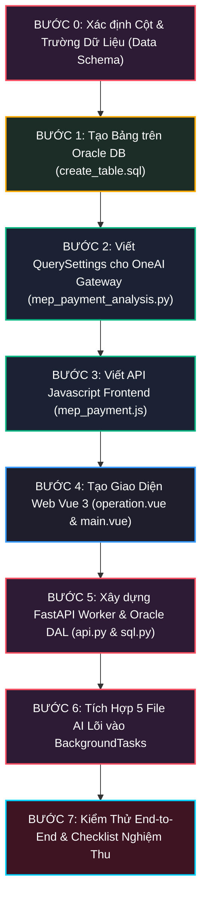

# CẨM NANG THIẾT KẾ & TÍCH HỢP HỆ THỐNG TỪ CODE AI LOCAL LÊN ONEAI (STEP-BY-STEP COOKBOOK)
## (TỪ 5 FILE SCRIPT BAN ĐẦU ĐẾN HỆ THỐNG ENTERPRISE HOÀN CHỈNH TRÊN ONEAI)

> **Tài liệu hướng dẫn thực chiến (Practical Engineering Playbook):** Được biên soạn dành riêng cho các kỹ sư đã có sẵn code AI/Python chạy cục bộ (CLI), muốn tự tay xây dựng một màn hình giao diện chuẩn mực trên OneAI, thiết kế Database Oracle, dựng FastAPI Worker ngầm và liên kết luồng End-to-End từ A đến Z mà không mất thời gian mày mò hay vấp phải các cạm bẫy kỹ thuật.

---

## 🎯 BỐI CẢNH VÀ ĐIỂM XUẤT PHÁT: BẠN ĐANG CÓ GÌ TRONG TAY?

Giả sử bạn vừa nghiên cứu xong một bài toán AI (như bóc tách hồ sơ, nhận diện hình ảnh, đối soát dữ liệu). Trong tay bạn chỉ có **5 file code Python chạy ở máy cá nhân (Local CLI)**:
1. `config.py`: File chứa các biến URL, key, đường dẫn thư mục ổ cứng `D:/...`.
2. `utils.py`: Các hàm tiện ích cắt chuỗi, định dạng ngày tháng.
3. `pdf_extractor.py`: Dùng OpenCV cắt ảnh và gọi AI Vision bóc tách bảng biểu.
4. `excel_reconciler.py`: Đọc file Excel, gom nhóm dữ liệu, đối soát chéo và tô màu.
5. `engine.py` (hoặc `main.py` cũ): Hàm `run_pipeline()` điều phối tất cả các bước trên.

### Vấn đề đặt ra:
* Khi chạy ở Terminal: Bạn gõ lệnh `python engine.py`, chương trình đọc file từ ổ cứng, in log ra màn hình đen rồi xuất file ra thư mục `output/`.
* **Nhưng Sếp và người dùng công ty thì không thể mở Terminal lên gõ lệnh được!** Họ cần một **màn hình Web trực quan trên OneAI** để:
  * Xem danh sách các công việc theo từng tháng, có phân trang (15 dòng/trang).
  * Tự bấm nút **[Insert]** thêm dòng công việc mới, gõ số WO, tên việc rồi bấm **[Save]**.
  * Bấm nút **[Upload File]** đính kèm file Excel để AI tự chạy ngầm.
  * Khi AI chạy xong, hiện trạng thái *"Hoàn thành"* kèm số lỗi và nút **[Tải Báo Cáo]**.
  * Quản lý bấm nút **[Duyệt]** hoặc **[Từ chối]**.

### ❓ Vì sao KHÔNG THỂ nhúng thẳng 5 file đó trực tiếp vào giao diện OneAI?
1. **OneAI Portal chỉ là Web Frontend:** Nó chạy bằng Vue.js và Gateway `/crud/ui`, chỉ chuyên làm việc nhẹ (vẽ bảng, lọc dữ liệu).
2. **AI là tác vụ rất nặng:** Việc cắt ảnh A0 bằng OpenCV và gọi AI Vision mất từ 1 đến 3 phút, tiêu tốn rất nhiều CPU/RAM. Nếu bạn nhồi code AI vào Web Portal, khi người dùng bấm chạy, **toàn bộ cổng OneAI của công ty sẽ bị treo cứng (Freeze/Timeout HTTP 504)**!
3. **Giải pháp kiến trúc chuẩn:** Tách thành **mô hình 3 khối độc lập**:
   * **Khối 1 (Giao diện Web):** OneAI Vue 3 + OneAI Gateway `/crud/ui` (Hiển thị nhẹ nhàng).
   * **Khối 2 (Cơ sở dữ liệu):** Oracle Database `LOCAL_AI` (Nơi lưu dữ liệu chung để 2 bên giao tiếp).
   * **Khối 3 (Máy chủ tính toán ngầm):** FastAPI Worker chạy ở cổng 8000 (Chuyên gánh việc nặng, chạy độc lập dưới nền).

---

## 🗺️ LỘ TRÌNH 7 BƯỚC TRIỂN KHAI TOÀN DIỆN



---

## BƯỚC 0: XÁC ĐỊNH DANH SÁCH CỘT CẦN HIỂN THỊ (DATA SCHEMA DEFINITION)

Trước khi viết bất kỳ dòng code nào, bạn phải ngồi xuống lấy một tờ giấy hoặc mở Excel, liệt kê ra **màn hình của bạn cần bao nhiêu cột**.

### Ví dụ phân tích thực tế:
Bạn muốn làm màn hình **Quản lý nghiệm thu thanh toán MEP**, bạn cần các thông tin sau:
1. **Mã định danh duy nhất (Bắt buộc phải có):** `KEYID` (Số Work Order, ví dụ `WOR2512230006V`). Đây sẽ là **Khóa chính (PRIMARY KEY)** của bảng Database để phân biệt công việc này với công việc khác.
2. **Thông tin phân loại:**
   * `TASK_NAME`: Tên công việc (ví dụ: *Thi công cấp điện xưởng A*).
   * `PAYMENT_MONTH`: Tháng thanh toán (ví dụ: `2026-10`).
   * `PIC`: Người phụ trách (Person In Charge - ví dụ: *Nguyễn Văn A*).
   * `PART_NAME`: Bộ phận (ví dụ: *MEP Part*).
   * `GROUP_NAME`: Khối phòng ban (ví dụ: *Infra Group*).
3. **Thông tin điều khiển máy trạng thái (State Machine):**
   * `STATUS`: Trạng thái xử lý gồm 4 nấc:
     * `WAITING`: Kỹ sư vừa nạp file lên, đang xếp hàng chờ chạy.
     * `RUNNING`: AI đang bóc tách bản vẽ và đối soát ngầm.
     * `COMPLETED`: AI chạy xong thành công 100%.
     * `CANCEL`: Lỗi trong quá trình chạy (file hỏng, mất mạng AI...).
   * `PROGRESS`: Thanh tiến độ bóc tách của AI (`0` -> `100%`).
4. **Kết quả AI xuất ra:**
   * `ERROR_COUNT`: Tổng số lỗi sai lệch mà AI tìm thấy (ví dụ: `2` lỗi lệch vật tư).
   * `RESULT_LINK`: Đường dẫn file kết quả để người dùng bấm tải về (ví dụ: `/mep_payment/files/Bao_cao_WOR2512.zip`).
   * `REASON`: Ghi chú ngắn gọn kết quả hoặc nguyên nhân lỗi (ví dụ: *Lệch 2 mã vật tư ở Bản vẽ 1*).
5. **Quy trình phê duyệt (Approval Workflow):**
   * `REVIEW_DECISION`: Quyết định của Kỹ sư trưởng (`APPROVED` hoặc `REJECTED`).
   * `REVIEW_NOTE`: Ghi chú khi duyệt.
   * `REVIEW_BY`: Tên người duyệt.
6. **Thời gian ghi nhận:**
   * `UPLOAD_TIME`: Ngày giờ nạp file lên hệ thống.
   * `RESULT_TIME`: Ngày giờ AI chạy xong.

👉 **Quy tắc vàng:** Chỉ khi bạn chốt xong danh sách cột này thì mới tiến hành làm Bước 1!

---

## BƯỚC 1: THIẾT KẾ VÀ KHỞI TẠO BẢNG ORACLE DB (`create_table.sql`)

Từ danh sách cột ở Bước 0, bạn viết script SQL để tạo bảng trên Schema của công ty (ở đây là schema `LOCAL_AI`).

> [!TIP]
> **Nếu bảng `LOCAL_AI.MEP_PAYMENT_ANALYSIS` đã tồn tại:** Bạn chỉ cần chạy lệnh sau để thêm cột `PROGRESS` mà không cần xóa bảng:
> ```sql
> ALTER TABLE LOCAL_AI.MEP_PAYMENT_ANALYSIS ADD (PROGRESS NUMBER DEFAULT 0);
> ```

### 1.1. Viết file `database/create_table.sql`:
```sql
-- ====================================================================
-- DDL KHỞI TẠO BẢNG LOCAL_AI.MEP_PAYMENT_ANALYSIS (NẾU TẠO MỚI)
-- Chạy trên DBeaver (Schema: LOCAL_AI, Database Service: MBLDB_SVC)
-- ====================================================================

CREATE TABLE LOCAL_AI.MEP_PAYMENT_ANALYSIS (
    KEYID           VARCHAR2(100) NOT NULL,          -- Khóa chính: Số WO
    TASK_NAME       VARCHAR2(300),                   -- Tên công việc
    PAYMENT_MONTH   VARCHAR2(20),                    -- Tháng thanh toán: YYYY-MM
    PIC             VARCHAR2(100),                   -- Người phụ trách
    PART_NAME       VARCHAR2(100),                   -- Part
    GROUP_NAME      VARCHAR2(100),                   -- Group
    STATUS          VARCHAR2(30) DEFAULT 'WAITING',  -- Máy trạng thái: WAITING, RUNNING, COMPLETED, CANCEL
    PROGRESS        NUMBER DEFAULT 0,                -- Thanh tiến độ AI (0 -> 100%)
    ERROR_COUNT     NUMBER DEFAULT 0,                -- Số lỗi sai lệch
    RESULT_LINK     VARCHAR2(500),                   -- Đường dẫn tải file báo cáo (.zip)
    REASON          VARCHAR2(1000),                  -- Ghi chú kết quả / lỗi
    REVIEW_DECISION VARCHAR2(30),                    -- APPROVED / REJECTED
    REVIEW_NOTE     VARCHAR2(500),                   -- Ghi chú người duyệt
    REVIEW_BY       VARCHAR2(100),                   -- Tài khoản người duyệt
    UPLOAD_TIME     DATE,                            -- Ngày giờ nạp
    RESULT_TIME     DATE,                            -- Ngày giờ hoàn thành
    CONSTRAINT PK_MEP_PAYMENT PRIMARY KEY (KEYID)
);

-- Tạo 3 Index tăng tốc độ truy vấn và bộ lọc tìm kiếm
CREATE INDEX LOCAL_AI.IDX_MEP_STATUS ON LOCAL_AI.MEP_PAYMENT_ANALYSIS (STATUS);
CREATE INDEX LOCAL_AI.IDX_MEP_MONTH  ON LOCAL_AI.MEP_PAYMENT_ANALYSIS (PAYMENT_MONTH);
CREATE INDEX LOCAL_AI.IDX_MEP_PIC    ON LOCAL_AI.MEP_PAYMENT_ANALYSIS (PIC);

-- Chèn dữ liệu mẫu ban đầu để màn hình web có dữ liệu test ngay lập tức
INSERT INTO LOCAL_AI.MEP_PAYMENT_ANALYSIS 
(KEYID, TASK_NAME, PAYMENT_MONTH, PIC, PART_NAME, GROUP_NAME, STATUS, ERROR_COUNT, RESULT_LINK, REASON, UPLOAD_TIME)
VALUES 
('WOR2512230006V', 'Thi công hệ thống điện chiếu sáng xưởng A', '2026-10', 'Nguyen Van A', 'MEP Part', 'Infra Group', 'WAITING', 0, NULL, 'Chờ upload file kiểm tra', SYSDATE);

INSERT INTO LOCAL_AI.MEP_PAYMENT_ANALYSIS 
(KEYID, TASK_NAME, PAYMENT_MONTH, PIC, PART_NAME, GROUP_NAME, STATUS, ERROR_COUNT, RESULT_LINK, REASON, UPLOAD_TIME, REVIEW_DECISION)
VALUES 
('WOR2510150002M', 'Lắp đặt đường ống Chiller Phase 2', '2026-10', 'Tran Van B', 'HVAC Part', 'Infra Group', 'COMPLETED', 2, '/mep_payment/files/Sample_Report.zip', 'Lệch 2 mã vật tư ở Bản vẽ 1', SYSDATE, 'REJECTED');

INSERT INTO LOCAL_AI.MEP_PAYMENT_ANALYSIS 
(KEYID, TASK_NAME, PAYMENT_MONTH, PIC, PART_NAME, GROUP_NAME, STATUS, ERROR_COUNT, RESULT_LINK, REASON, UPLOAD_TIME, REVIEW_DECISION)
VALUES 
('WOR2509010045E', 'Bảo trì hệ thống PCCC khu văn phòng', '2026-09', 'Le Thi C', 'Fire Safety', 'EHS Group', 'COMPLETED', 0, '/mep_payment/files/Sample_Report_2.zip', 'Khớp 100% không sai lệch', SYSDATE, 'APPROVED');

COMMIT;
```

### 1.2. Thao tác trên DBeaver:
1. Mở DBeaver, kết nối vào database Oracle của công ty.
2. Mở trình soạn thảo SQL (phím tắt `F3` hoặc `Ctrl + ]`).
3. Dán toàn bộ script trên vào, bôi đen và bấm **Execute SQL Script (Alt + X)**.
4. Kiểm tra: Chạy lệnh `SELECT * FROM LOCAL_AI.MEP_PAYMENT_ANALYSIS;` $\rightarrow$ Thấy hiện ra 3 dòng mẫu là thành công!

---

## BƯỚC 2: CẤU HÌNH GATEWAY TRUY VẤN CỦA ONEAI (`mep_payment_analysis.py`)

Hệ thống OneAI của công ty sử dụng cơ chế **Dynamic Query Gateway**: Mọi yêu cầu lấy dữ liệu trên Web đều gọi qua endpoint trung tâm `/crud/ui`. Để OneAI biết lấy bảng nào, phân trang ra sao, bạn phải cung cấp file cấu hình `QuerySettings`.

### 2.1. Quy ước đặt tên file và thư mục trong OneAI Backend:
Tạo file theo đúng cấu trúc thư mục phân cấp:
`oneai_integration/backend/menu_operation/mep_payment/mep_payment_analysis.py`

> [!NOTE]
> Đường dẫn thư mục này ánh xạ trực tiếp thành định danh request:
> `menu_operation/mep_payment/mep_payment_analysis.py` $\longleftrightarrow$ `BASE_REQ_ID = "menu_operation.mep_payment.mep_payment_analysis"`.

### 2.2. Nội dung file `mep_payment_analysis.py`:
```python
from database.query_utils import QuerySettings

# 1. QUERY ĐẾM TỔNG SỐ DÒNG (PHỤC VỤ TÍNH TỔNG SỐ TRANG TRÊN WEB)
searchTotalRow = QuerySettings(
    query="""
        SELECT COUNT(*) AS TOTAL
        FROM LOCAL_AI.MEP_PAYMENT_ANALYSIS
        WHERE 1 = 1
        AND (:STATUS = 'ALL' OR STATUS = :STATUS)
        AND (:PAYMENT_MONTH = 'ALL' OR PAYMENT_MONTH = :PAYMENT_MONTH)
        AND (:KEYID = 'ALL' OR KEYID LIKE '%' || :KEYID || '%' OR TASK_NAME LIKE '%' || :KEYID || '%')
    """,
    dns="MBLDB",  # Tên DNS Oracle của công ty
    note="Đếm tổng số dòng quản lý thanh toán MEP"
)

# 2. QUERY LẤY DỮ LIỆU TỪNG TRANG (PHÂN TRANG DỰA THEO ROW_NUMBER)
getdata_page = QuerySettings(
    query="""
    SELECT 
        RN AS STT,
        KEYID,
        TASK_NAME,
        PAYMENT_MONTH,
        PIC,
        PART_NAME,
        GROUP_NAME,
        STATUS,
        NVL(PROGRESS, 0) AS PROGRESS,
        ERROR_COUNT,
        RESULT_LINK,
        REASON,
        REVIEW_DECISION,
        REVIEW_NOTE,
        REVIEW_BY,
        TO_CHAR(UPLOAD_TIME, 'YYYY-MM-DD HH24:MI') AS UPLOAD_TIME,
        TO_CHAR(RESULT_TIME, 'YYYY-MM-DD HH24:MI') AS RESULT_TIME
    FROM (
        SELECT A.*,
               -- Sắp xếp tăng dần theo thời gian tạo: Dòng cũ ở trước, dòng mới ở cuối cùng
               ROW_NUMBER() OVER(ORDER BY UPLOAD_TIME ASC NULLS LAST, KEYID ASC) RN
        FROM LOCAL_AI.MEP_PAYMENT_ANALYSIS A
        WHERE 1 = 1
        AND (:STATUS = 'ALL' OR STATUS = :STATUS)
        AND (:PAYMENT_MONTH = 'ALL' OR PAYMENT_MONTH = :PAYMENT_MONTH)
        AND (:KEYID = 'ALL' OR KEYID LIKE '%' || :KEYID || '%' OR TASK_NAME LIKE '%' || :KEYID || '%')
    )
    WHERE RN BETWEEN :start_row AND :end_row
    ORDER BY RN
    """,
    dns="MBLDB",
    note="Lấy danh sách phân trang bảng MEP"
)
```

> [!TIP]
> **Bí quyết Bind Variable `:STATUS = 'ALL' OR STATUS = :STATUS`:**
> Khi người dùng chọn "Tất cả" trên Web, giá trị gửi xuống là `'ALL'`. Vế `:STATUS = 'ALL'` đúng (`TRUE`), Oracle lập tức bỏ qua điều kiện lọc trạng thái. Khi người dùng chọn `'COMPLETED'`, vế đầu sai (`FALSE`), Oracle lọc chính xác dòng có trạng thái `COMPLETED`. Bạn không cần phải nối chuỗi SQL bằng tay!

---

## BƯỚC 3: XÂY DỰNG FILE JAVASCRIPT GỌI GATEWAY (`mep_payment.js`)

Ở tầng Frontend của OneAI, bạn cần một file Javascript trung gian để đóng gói các lời gọi mạng tới Gateway `/crud/ui` và tới máy chủ Worker.

### 3.1. Vị trí đặt file:
`oneai_integration/frontend/operation/js/mep_payment.js` (đồng thời tạo alias `mepPayment.js`).

### 3.2. Nội dung file `mep_payment.js`:
```javascript
import { api } from '@/aiPlugins/aiApiConfig'

// Định danh Router tương ứng với file mep_payment_analysis.py ở Bước 2
const BASE_REQ_ID = "menu_operation.mep_payment.mep_payment_analysis"

// 1. LẤY TỔNG SỐ DÒNG
export async function get_total_row(status = "ALL", paymentMonth = "ALL", keyword = "ALL") {
  const reqId = `${BASE_REQ_ID}:searchTotalRow`
  const param = {
    STATUS: status || "ALL",
    PAYMENT_MONTH: paymentMonth || "ALL",
    KEYID: keyword || "ALL"
  }
  const parameter = { [reqId]: param }
  const res = await api.get("/crud/ui", { params: parameter, loading: false })
  return res.data[reqId].VAL
}

// 2. LẤY DỮ LIỆU PHÂN TRANG (PAGE, PAGESIZE)
export async function get_data_page(page = 1, pageSize = 15, status = "ALL", paymentMonth = "ALL", keyword = "ALL") {
  const reqId = `${BASE_REQ_ID}:getdata_page`
  const start = (page - 1) * pageSize + 1
  const end = page * pageSize

  const param = {
    start_row: start,
    end_row: end,
    STATUS: status || "ALL",
    PAYMENT_MONTH: paymentMonth || "ALL",
    KEYID: keyword || "ALL"
  }

  const parameter = { [reqId]: param }
  const res = await api.get("/crud/ui", { params: parameter, loading: false })
  return res.data[reqId].VAL
}

// 3. LƯU DÒNG MỚI THÊM HOẶC CHỈNH SỬA XUỐNG FASTAPI WORKER
export async function save_mep_rows(rows = []) {
  const res = await api.post("/mep_payment/save_rows", { rows })
  return res.data
}

// 4. XÓA CÁC DÒNG ĐƯỢC CHỌN KHỎI DATABASE
export async function delete_mep_rows(keyids = []) {
  const res = await api.post("/mep_payment/delete_rows", { keyids })
  return res.data
}
```

---

## BƯỚC 4: THIẾT KẾ GIAO DIỆN VUE 3 DARK THEME (`operation.vue` & `main.vue`)

Giao diện người dùng được chia thành 2 file:
1. `main.vue`: Khung vỏ ngoài chuẩn OneAI (`<ai-body>`), quản lý các Tab.
2. `tab/operation.vue`: Nội dung bảng dữ liệu chi tiết, thanh công cụ, các nút Insert/Delete/Save.

### 4.1. File `frontend/operation/main.vue`:
```vue
<template>
  <ai-body>
    <el-tabs v-model="activeTab">
      <el-tab-pane label="Vận Hành Đối Soát" name="operation">
        <Operation ref="operation" :activeTab="activeTab" />
      </el-tab-pane>
    </el-tabs>
  </ai-body>
</template>

<script>
import Operation from "./tab/operation.vue";

export default {
  name: "MEP Payment Analysis",
  components: { Operation },
  data() {
    return {
      activeTab: "operation",
    };
  },
};
</script>
```

### 4.2. File `frontend/operation/tab/operation.vue` - Các logic sống còn cần nắm:

#### 1. Thanh công cụ Toolbar (Bộ lọc tìm kiếm):
```vue
<div class="toolbar">
  <el-select v-model="selectedStatus" placeholder="Chọn Trạng Thái" clearable style="width: 170px">
    <el-option v-for="item in statusList" :key="item" :label="item" :value="item" />
  </el-select>

  <el-date-picker v-model="selectedMonth" type="month" placeholder="Chọn Tháng" value-format="YYYY-MM" style="width: 190px" />

  <el-input v-model="searchKeyword" placeholder="Nhập số WO hoặc tên việc..." clearable style="width: 270px" @keyup.enter="handleReload" />
</div>
```

#### 2. Thanh nút thao tác (Action Bar) - Nút Reload đã là nút cứng:
```vue
<div class="table-action-bar">
  <div class="total-count">Total: <span class="count-number">{{ total }} rows</span></div>
  <div class="action-buttons">
    <!-- Nút Reload cứng, có hiệu ứng loading khi bấm -->
    <el-button size="small" class="btn-reload" :loading="isLoading" @click="handleReload">
      <i class="el-icon-refresh"></i> Reload
    </el-button>
    <el-button type="danger" size="small" :disabled="selectedRows.length === 0" @click="handleDelete">Delete</el-button>
    <el-button size="small" class="btn-insert" @click="handleInsert">Insert</el-button>
    <el-button size="small" @click="handleExportCsv">Export (.csv)</el-button>
    <el-button type="primary" size="small" :loading="isSaving" @click="handleSave">Save</el-button>
  </div>
</div>
```

#### 3. Logic Insert vào cuối bảng (`push`):
```javascript
const handleInsert = () => {
  const newRow = {
    STT: tableData.value.length + 1,  // STT tự động = số dòng hiện có + 1
    KEYID: '',
    TASK_NAME: '',
    PAYMENT_MONTH: selectedMonth.value || new Date().toISOString().slice(0, 7),
    PIC: '',
    PART_NAME: 'MEP',
    GROUP_NAME: '',
    STATUS: 'WAITING',
    ERROR_COUNT: 0,
    isNew: true,      // Cờ báo hiệu dòng mới, mở ô <el-input> để gõ
    isEditing: true
  }
  tableData.value.push(newRow)        // Thêm vào CUỐI bảng
  total.value += 1
  ElMessage.info("Đã thêm 1 dòng mới vào cuối bảng. Vui lòng nhập thông tin và bấm [Save].")
}
```

#### 4. Logic Save & Kiểm tra trùng mã (Phòng thủ Lớp 1 trên Giao diện):
```javascript
const handleSave = async () => {
  const modifiedRows = tableData.value.filter(r => r.isNew || r.isEditing)
  if (modifiedRows.length === 0) {
    ElMessage.info("Không có dòng nào thay đổi để lưu.")
    return
  }

  // 1. Kiểm tra không để trống KEYID
  for (const r of modifiedRows) {
    if (!r.KEYID || !String(r.KEYID).trim()) {
      ElMessage.warning("Vui lòng nhập Số Công Việc (KEYID) trước khi lưu!")
      return
    }
  }

  // 2. Kiểm tra trùng lặp Số Công Việc (KEYID) ngay trên bảng giao diện
  for (const r of modifiedRows) {
    if (r.isNew) {
      const isDuplicate = tableData.value.some(
        item => item !== r && String(item.KEYID).trim().toUpperCase() === String(r.KEYID).trim().toUpperCase()
      )
      if (isDuplicate) {
        ElMessage.error(`Số công việc (KEYID) "${r.KEYID}" đã tồn tại! Vui lòng nhập mã khác.`)
        return  // Dừng lại ngay, không cho gửi request xuống server
      }
    }
  }

  isSaving.value = true
  try {
    const payload = {
      rows: modifiedRows.map(r => ({
        KEYID: String(r.KEYID).trim(),
        TASK_NAME: String(r.TASK_NAME || '').trim(),
        PAYMENT_MONTH: String(r.PAYMENT_MONTH || '').trim(),
        PIC: String(r.PIC || '').trim(),
        PART_NAME: String(r.PART_NAME || '').trim(),
        GROUP_NAME: String(r.GROUP_NAME || '').trim(),
        STATUS: r.STATUS || 'WAITING',
        isNew: !!r.isNew
      }))
    }
    const res = await axios.post(`${FASTAPI_BASE_URL}/mep_payment/save_rows`, payload)
    ElMessage.success(res.data?.message || "Lưu dữ liệu thành công!")
    await handleReload()
  } catch (err) {
    ElMessage.error(err.response?.data?.detail || err.message || "Lỗi khi lưu dữ liệu xuống Database!")
  } finally {
    isSaving.value = false
  }
}
```

#### 5. Logic Hiển Thị Thanh Tiến Độ (Progress Bar) & Smart Polling Thông Minh:
```html
<!-- Cột Trạng thái nhúng thanh Progress Bar khi AI đang phân tích -->
<el-table-column prop="STATUS" label="Trạng Thái" width="135" align="center" sortable>
  <template #default="{ row }">
    <el-tag v-if="row.STATUS === 'COMPLETED'" type="success" effect="dark">Hoàn Tất</el-tag>
    <div v-else-if="row.STATUS === 'RUNNING'" class="progress-cell">
      <el-tag type="warning" effect="dark" size="mini">Đang Xử Lý</el-tag>
      <el-progress :percentage="Number(row.PROGRESS) || 0" :stroke-width="6" :show-text="true" class="progress-bar-inline" />
    </div>
    <el-tag v-else-if="row.STATUS === 'WAITING'" type="info">Chờ Duyệt</el-tag>
    <el-tag v-else type="danger">{{ row.STATUS || 'Mới' }}</el-tag>
  </template>
</el-table-column>
```

```javascript
// Cơ chế Smart Polling: Chỉ kích hoạt thăm dò khi có ít nhất 1 dòng RUNNING
const startSmartPollingIfNeeded = () => {
  const hasRunning = tableData.value.some(r => r.STATUS === 'RUNNING')
  if (!hasRunning) {
    stopSmartPolling()
    return
  }
  if (smartPollTimer) return // Đang chạy thì không tạo thêm

  smartPollTimer = setInterval(async () => {
    // Nếu người dùng đang nhập dòng mới (isNew) -> TẠM DỪNG, không tải đè
    const hasNewRow = tableData.value.some(r => r.isNew)
    if (hasNewRow) return

    const data = await get_data_page(page.value, pageSize.value, selectedStatus.value, selectedMonth.value, searchKeyword.value)
    if (data) {
      // Merge dữ liệu mới vào bảng nhưng bảo toàn trạng thái chỉnh sửa
      tableData.value = data.map(newRow => {
        const oldRow = tableData.value.find(r => r.KEYID === newRow.KEYID)
        return { ...newRow, isNew: false, isEditing: oldRow ? oldRow.isEditing : false }
      })
    }

    // Khi AI chạy xong hết -> TỰ ĐỘNG TẮT POLLING để tiết kiệm tài nguyên
    const stillRunning = tableData.value.some(r => r.STATUS === 'RUNNING')
    if (!stillRunning) {
      stopSmartPolling()
      loadTotal()
    }
  }, 3000)
}
```

---

## BƯỚC 5: XÂY DỰNG FASTAPI WORKER BACKEND (`api.py` & `sql.py`)

Đây là máy chủ con (Microservice) chạy riêng ở cổng 8000, đảm nhận toàn bộ việc ghi nhận Database và xử lý tính toán nặng.

### 5.1. File `backend/sql.py` - Tầng kết nối Oracle Database (DAL):

```python
import os
import oracledb

# 1. Khởi tạo Oracle Thick Client (Bắt buộc để tránh lỗi mật khẩu DPY-3015)
oracle_client_path = os.getenv("ORACLE_CLIENT_LIB_DIR", r"C:\oracle_client")
if oracle_client_path and os.path.exists(oracle_client_path):
    try:
        oracledb.init_oracle_client(lib_dir=oracle_client_path)
    except Exception:
        pass

# Thư viện nội bộ của công ty
try:
    from oneai_sdv import oracle_conn
    HAS_ONEAI_SDV = True
except ImportError:
    oracle_conn = None
    HAS_ONEAI_SDV = False

# 2. Hàm kiểm tra xem KEYID đã tồn tại trong DB hay chưa (Phòng thủ Lớp 2)
def check_keyid_exists(keyid: str) -> bool:
    if not keyid or not str(keyid).strip():
        return False
    try:
        sql = "SELECT COUNT(*) AS CNT FROM LOCAL_AI.MEP_PAYMENT_ANALYSIS WHERE KEYID = :KEYID"
        params = {"KEYID": str(keyid).strip()}
        cur = get_cur()
        # Hỗ trợ cả Connection có cursor() lẫn thư viện OneAI SDV
        if hasattr(cur, 'cursor'):
            c = cur.cursor()
            c.execute(sql, params)
            row = c.fetchone()
            c.close()
            return (row[0] if row else 0) > 0
        res = cur.execute(sql, params=params)
        if hasattr(res, 'fetchone'):
            row = res.fetchone()
            return (row[0] if row else 0) > 0
        return False
    except Exception as e:
        print(f"[DB Warning] check_keyid_exists: {e}")
        return False

# 3. Tách biệt rõ ràng từng nhiệm vụ: INSERT, UPDATE và hàm điều phối SAVE
def insert_task(cur, r: dict):
    """Thêm 1 dòng mới vào DB (INSERT)."""
    sql = """
        INSERT INTO LOCAL_AI.MEP_PAYMENT_ANALYSIS 
        (KEYID, TASK_NAME, PAYMENT_MONTH, PIC, PART_NAME, GROUP_NAME, STATUS, PROGRESS, ERROR_COUNT, UPLOAD_TIME)
        VALUES 
        (:KEYID, :TASK_NAME, :PAYMENT_MONTH, :PIC, :PART_NAME, :GROUP_NAME, :STATUS, :PROGRESS, 0, SYSDATE)
    """
    params = {
        "KEYID": str(r.get("KEYID", "")).strip(),
        "TASK_NAME": str(r.get("TASK_NAME", "")).strip(),
        "PAYMENT_MONTH": str(r.get("PAYMENT_MONTH", "")).strip(),
        "PIC": str(r.get("PIC", "")).strip(),
        "PART_NAME": str(r.get("PART_NAME", "")).strip(),
        "GROUP_NAME": str(r.get("GROUP_NAME", "")).strip(),
        "STATUS": str(r.get("STATUS", "WAITING")).strip(),
        "PROGRESS": int(r.get("PROGRESS", 0) or 0)
    }
    cur.execute(sql, params=params)

def update_task(cur, r: dict):
    """Cập nhật thông tin dòng cũ trong DB (UPDATE)."""
    sql = """
        UPDATE LOCAL_AI.MEP_PAYMENT_ANALYSIS
        SET TASK_NAME     = :TASK_NAME,
            PAYMENT_MONTH = :PAYMENT_MONTH,
            PIC           = :PIC,
            PART_NAME     = :PART_NAME,
            GROUP_NAME    = :GROUP_NAME
        WHERE KEYID = :KEYID
    """
    params = {
        "KEYID": str(r.get("KEYID", "")).strip(),
        "TASK_NAME": str(r.get("TASK_NAME", "")).strip(),
        "PAYMENT_MONTH": str(r.get("PAYMENT_MONTH", "")).strip(),
        "PIC": str(r.get("PIC", "")).strip(),
        "PART_NAME": str(r.get("PART_NAME", "")).strip(),
        "GROUP_NAME": str(r.get("GROUP_NAME", "")).strip()
    }
    cur.execute(sql, params=params)

def save_tasks(rows: list) -> int:
    """Hàm điều phối Lưu dữ liệu (Save): Dòng mới gọi insert_task(), dòng cũ gọi update_task()."""
    if not rows: return 0
    cur = get_cur()
    for r in rows:
        if r.get("isNew"):
            insert_task(cur, r)
        else:
            update_task(cur, r)
    if hasattr(cur, 'commit'): cur.commit()
    return len(rows)

batch_upsert_tasks = save_tasks

# 4. Hàm cập nhật trạng thái & tiến độ bóc tách AI
def update_task_status(keyid: str, status: str, error_count: int = 0, result_link: str = None, reason: str = "", progress: int = None):
    progress_sql = "PROGRESS = :PROGRESS," if progress is not None else ""
    sql = f"""
        UPDATE LOCAL_AI.MEP_PAYMENT_ANALYSIS
        SET STATUS = :STATUS,
            {progress_sql}
            ERROR_COUNT = :ERROR_COUNT,
            RESULT_LINK = :RESULT_LINK,
            REASON = :REASON,
            RESULT_TIME = CASE WHEN :STATUS IN ('COMPLETED', 'CANCEL') THEN SYSDATE ELSE RESULT_TIME END,
            UPLOAD_TIME = CASE WHEN :STATUS = 'WAITING' THEN SYSDATE ELSE UPLOAD_TIME END
        WHERE KEYID = :KEYID
    """
    params = {"STATUS": status, "ERROR_COUNT": error_count, "RESULT_LINK": result_link, "REASON": reason, "KEYID": str(keyid).strip()}
    if progress is not None:
        params["PROGRESS"] = int(progress)
    cur = oracle_conn(dns="MBLDB", user_name=os.getenv("DB_USER_YMS_AI"), password=os.getenv("DB_PASSWORD_YMS_AI"))
    cur.execute(sql, params=params)
    if hasattr(cur, 'commit'): cur.commit()
    elif hasattr(cur, 'connection'): cur.connection.commit()
```

### 5.2. File `backend/api.py` - Trạm điều phối FastAPI & BackgroundTasks:

```python
import os, shutil, time, zipfile
from pathlib import Path
from fastapi import FastAPI, UploadFile, File, Form, BackgroundTasks, HTTPException
from fastapi.middleware.cors import CORSMiddleware
from fastapi.responses import FileResponse
from pydantic import BaseModel
import pandas as pd

from engine import run_mep_pipeline
from sql import update_task_status, batch_upsert_tasks, delete_tasks, check_keyid_exists

app = FastAPI(title="MEP Payment AI Worker")
app.add_middleware(CORSMiddleware, allow_origins=["*"], allow_credentials=True, allow_methods=["*"], allow_headers=["*"], expose_headers=["Content-Disposition"])

STORAGE_DIR = Path(__file__).resolve().parent / "sessions"
FINAL_REPORT_DIR = Path(__file__).resolve().parent / "final_reports"
STORAGE_DIR.mkdir(exist_ok=True)
FINAL_REPORT_DIR.mkdir(exist_ok=True)

class SaveRowsRequest(BaseModel):
    rows: list

# 1. HÀM CHẠY NGẦM BACKGROUND TASK (KHÔNG BLOCK GIAO DIỆN)
def run_ai_task_background(keyid: str, session_dir: Path, excel_path: str):
    try:
        # Callback bắn % tiến độ từ lõi AI ghi trực tiếp vào DB
        def on_pipeline_progress(msg: str, progress: float):
            try:
                update_task_status(keyid=keyid, status="RUNNING", reason=msg[:400], progress=int(round(progress * 100)))
            except Exception as pe:
                print(f"[Progress Warning] {pe}")

        update_task_status(keyid=keyid, status="RUNNING", reason="AI đang bóc tách bản vẽ...", progress=5)
        
        # Gọi thẳng vào hàm điều phối lõi của bạn (engine.py) kèm callback tiến độ
        final_excel_path = run_mep_pipeline(
            vendor_excel_path=excel_path,
            output_dir=str(FINAL_REPORT_DIR),
            status_callback=on_pipeline_progress
        )
        
        # Đếm số lỗi thực tế trong file Excel để báo lên web
        df_check = pd.read_excel(final_excel_path, sheet_name="1. Đối Soát Bản Vẽ")
        error_count = int(df_check['Note'].astype(str).str.contains('Lệch|Mã mồ côi', na=False).sum()) if 'Note' in df_check.columns else 0

        # Đóng gói file Excel thành .zip (Lách tường lửa chống thất thoát dữ liệu DLP)
        file_name = os.path.basename(final_excel_path)
        zip_name = f"{Path(file_name).stem}.zip"
        zip_path = FINAL_REPORT_DIR / zip_name
        with zipfile.ZipFile(zip_path, 'w', zipfile.ZIP_DEFLATED) as zf:
            zf.write(final_excel_path, arcname=file_name)
        
        download_link = f"/mep_payment/files/{zip_name}"
        update_task_status(keyid=keyid, status="COMPLETED", error_count=error_count, result_link=download_link, reason=f"Hoàn thành đối soát (Tìm thấy {error_count} sai lệch)", progress=100)
    except Exception as e:
        update_task_status(keyid=keyid, status="CANCEL", error_count=0, result_link=None, reason=f"Lỗi: {str(e)[:900]}", progress=0)

# 2. ENDPOINT NẠP FILE EXCEL
@app.post("/mep_payment/upload")
async def upload_excel_task(background_tasks: BackgroundTasks, file: UploadFile = File(...), KEYID: str = Form(...)):
    session_dir = STORAGE_DIR / f"session_{KEYID}_{int(time.time())}"
    session_dir.mkdir(parents=True, exist_ok=True)
    excel_path = session_dir / file.filename
    with open(excel_path, "wb") as buffer:
        shutil.copyfileobj(file.file, buffer)
    
    update_task_status(keyid=KEYID, status="WAITING", reason="Đã nhận file, đang xếp hàng chạy...")
    background_tasks.add_task(run_ai_task_background, KEYID, session_dir, str(excel_path))
    return {"status": "accepted", "message": "Nạp file thành công, AI đang khởi chạy."}

# 3. ENDPOINT LƯU DÒNG (CHẶN TRÙNG MÃ KEYID)
@app.post("/mep_payment/save_rows")
async def save_rows(req: SaveRowsRequest):
    # Kiểm tra nếu là dòng mới thêm (isNew) mà KEYID đã có trong DB -> Báo lỗi HTTP 400
    for r in req.rows:
        if r.get("isNew"):
            keyid = str(r.get("KEYID", "")).strip()
            if keyid and check_keyid_exists(keyid):
                raise HTTPException(status_code=400, detail=f"Số công việc (KEYID) '{keyid}' đã tồn tại trong Database! Không thể thêm trùng.")
    
    count = batch_upsert_tasks(req.rows)
    return {"status": "ok", "message": f"Đã lưu thành công {count} bản ghi vào Database."}

# 4. ENDPOINT TẢI FILE BÁO CÁO
@app.get("/mep_payment/files/{filename}")
async def download_report_file(filename: str):
    file_path = FINAL_REPORT_DIR / filename
    if not file_path.exists():
        raise HTTPException(status_code=404, detail="File không tồn tại.")
    return FileResponse(path=str(file_path), filename=filename, media_type="application/zip")
```

---

## BƯỚC 6: TÍCH HỢP 5 FILE AI LÕI VÀO FASTAPI WORKER

Tại bước này, bạn chỉ việc đưa 5 file code gốc của mình vào thư mục `backend/`:
1. Giữ nguyên 100% logic thuật toán của `pdf_extractor.py`, `excel_reconciler.py`, `utils.py`.
2. Trong `engine.py`: Đảm bảo hàm chính của bạn có dạng:
   ```python
   def run_mep_pipeline(vendor_excel_path, output_dir, ...):
       # 1. Trích xuất PDF từ Excel
       # 2. Cắt ảnh bảng & gọi AI Vision
       # 3. Gom nhóm dữ liệu CSV
       # 4. Đối soát 2 vòng & tô màu OpenPyXL
       # 5. Xuất ra file Excel báo cáo
       return final_excel_path  # Trả về đường dẫn tuyệt đối của file Excel kết quả
   ```
3. Trong `api.py`: Hàm `run_ai_task_background` chỉ cần gọi `run_mep_pipeline(...)` và lấy đường dẫn `final_excel_path` trả về để nén file `.zip` là xong!

---

## BƯỚC 7: CHECKLIST KIỂM THỬ TỪNG BƯỚC (TESTING PROTOCOL)

Hãy kiểm tra theo thứ tự 5 nấc thang sau để đảm bảo hệ thống chạy mượt mà:

| Nấc Thang | Thao Tác Kiểm Tra | Kết Quả Mong Đợi | Nếu Thất Bại Cần Kiểm Tra Gì? |
| :---: | :--- | :--- | :--- |
| **1** | Mở DBeaver, chạy `SELECT * FROM LOCAL_AI.MEP_PAYMENT_ANALYSIS;` | Hiện 3 dòng mẫu tạo ở Bước 1 | Kiểm tra quyền SELECT của user, kiểm tra tên bảng |
| **2** | Khởi động Worker: `python backend/main.py` | Terminal báo: `🚀 Khởi động Worker tại http://0.0.0.0:8000 ...` | Kiểm tra cổng 8000 có bị trùng không, kiểm tra file `.env` |
| **3** | Mở Web OneAI, tải lại trang (F5) | Bảng hiện đủ 3 dòng mẫu, STT là 1, 2, 3 | Kiểm tra file `mep_payment_analysis.py` trên Gateway OneAI |
| **4** | Bấm **[Insert]**, nhập mã WO mới (VD: `WOR_NEW_01`), bấm **[Save]** | Báo xanh *"Lưu dữ liệu thành công"*, dòng mới nằm ở **vị trí số 4 cuối bảng** | Kiểm tra hàm `batch_upsert_tasks` và lệnh `commit()` trong `sql.py` |
| **5** | Thử bấm **[Insert]**, nhập lại mã `WOR_NEW_01`, bấm **[Save]** | Báo lỗi đỏ: *"Số công việc (KEYID) 'WOR_NEW_01' đã tồn tại!"* | Kiểm tra hàm `check_keyid_exists` trong `sql.py` và `api.py` |
| **6** | Bấm nút **[Upload File]** tại dòng số 4, chọn file Excel thầu | Nút chuyển sang trạng thái `WAITING` $\rightarrow$ `RUNNING`, Terminal Worker bắt đầu in log bóc tách | Kiểm tra endpoint `POST /mep_payment/upload` |
| **7** | Đợi 1-2 phút, bảng tự cập nhật | Dòng số 4 chuyển sang `COMPLETED`, hiện tag số lỗi màu đỏ và link **Tải Báo Cáo (.zip)** | Kiểm tra thư mục `backend/final_reports/` xem có sinh ra file `.zip` không |
| **8** | Bấm link tải file báo cáo | Trình duyệt tải ngay file `.zip` về máy, giải nén ra file Excel 2 sheet tô màu hoàn chỉnh | Kiểm tra endpoint `GET /mep_payment/files/{filename}` |

---

## ⚠️ BẢNG CẠM BẪY KINH ĐIỂN VÀ CÁCH PHÒNG TRÁNH (TROUBLESHOOTING MATRIX)

| STT | Cạm Bẫy Gặp Phải | Bản Chất Nguyên Nhân | Cách Xử Lý Triệt Để |
| :---: | :--- | :--- | :--- |
| **1** | **Bấm Save báo thành công nhưng bảng không thêm dòng mới** | Do dùng câu lệnh `MERGE INTO`, khi người dùng nhập trùng mã `KEYID` cũ, Oracle tự động chạy nhánh `UPDATE` ghi đè lên dòng cũ chứ không tạo dòng mới. | Thêm hàm `check_keyid_exists(keyid)` chặn trước khi lưu. Báo lỗi đỏ ngay trên giao diện nếu trùng mã. |
| **2** | **Đang ngồi gõ chữ thì dòng mới bị biến mất khỏi bảng** | Do cài đặt Timer tự động làm mới `setInterval` mỗi 10 giây. Khi timer nổ, hàm `loadData()` chạy ngầm và ghi đè dữ liệu từ DB lên RAM, xóa sạch dòng đang gõ. | Trong Timer `setInterval`, thêm điều kiện kiểm tra: `if (tableData.value.some(r => r.isNew)) return;` để đóng băng timer khi đang nhập liệu. |
| **3** | **Lỗi Oracle DPY-3015: Password verifier 0x939** | Database Oracle công ty dùng chuẩn băm mật khẩu 10G cũ, thư viện Python oracledb Thin Mode mặc định không hỗ trợ. | Kích hoạt Thick Client bằng lệnh: `oracledb.init_oracle_client(lib_dir=r"C:\oracle_client")` chứa thư viện C++ `oci.dll`. |
| **4** | **Tải file Excel bị mạng công ty chặn (Network Error)** | Hệ thống tường lửa DLP (Data Loss Prevention) quét thấy file Excel chứa macro hoặc bảng tính đối soát nên tự động chặn lại. | Dùng thư viện `zipfile` của Python nén file Excel thành `.zip` trước khi gửi cho người dùng. File zip vượt qua tường lửa 100%. |
| **5** | **Đổi sang `push` và `ASC` khiến dòng mới biến mất** | Khi câu query SQL dùng `ORDER BY UPLOAD_TIME ASC NULLS LAST`, nếu các dòng cũ có ngày giờ bị `NULL`, dòng mới có ngày giờ hôm nay sẽ bị xếp đứng trước dòng NULL. | Chuẩn hóa câu SQL phân trang: `ORDER BY UPLOAD_TIME ASC NULLS LAST, KEYID ASC` và đồng bộ `dns="MBLDB"`. |
| **6** | **Code chạy xong không thấy dữ liệu trong Database** | Quên không gọi lệnh `commit()` sau khi thực thi `cur.execute(...)`. Khi đóng kết nối, Oracle tự động Rollback toàn bộ dữ liệu. | Luôn luôn gọi `cur.commit()` hoặc `conn.commit()` ngay sau các câu lệnh `INSERT`, `UPDATE`, `DELETE`, `MERGE`. |
| **7** | **Lỗi tính sai số STT khi bấm Insert ở các trang khác nhau** | Do dùng `tableData.value.length + 1`, công thức này chỉ đếm số dòng đang hiển thị trên trang hiện tại thay vì toàn bộ dữ liệu. Đứng ở trang 1 có 20 dòng thì nhảy STT 21 (dù DB có 22 dòng); đứng ở trang 2 có 3 dòng thì nhảy STT 4. | Dùng công thức STT toàn cục (Global STT): `nextStt = Math.max(Number(total.value || 0) + 1, currentMaxStt + 1)` để luôn sinh đúng số thứ tự tiếp theo bất kể đang đứng ở trang nào. |
| **8** | **Bấm đúp chuột sửa chữ (Task Name, Part, Group) thì Modal Chi tiết nhảy ra đè lên** | Do cơ chế Event Bubbling trong trình duyệt: sự kiện double click trên ô chữ lan truyền lên cả dòng `<tr>` gắn `@row-dblclick="openDetailModal"`. | Gỡ bỏ hoàn toàn `@row-dblclick` trên bảng. Chỉ mở modal khi người dùng chủ động click chuột trái vào Số WO (badge xanh) hoặc thẻ Kết quả kiểm tra. |

---

> 🎉 **LỜI KẾT:**
> Chỉ với đúng 7 bước theo quy trình chuẩn này, bất kỳ bài toán AI nào trong tương lai—dù là nhận diện khuôn mặt, bóc tách hóa đơn VAT, hay phân loại tài liệu—bạn đều có thể đóng gói và đưa lên nền tảng OneAI một cách nhẹ nhàng, bài bản và chuyên nghiệp như một Senior Solution Architect!

