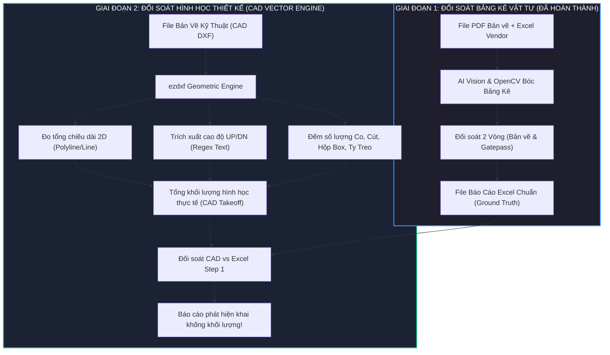
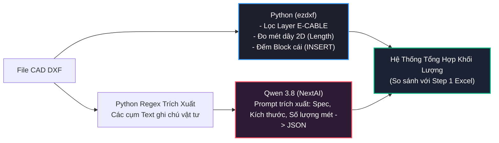
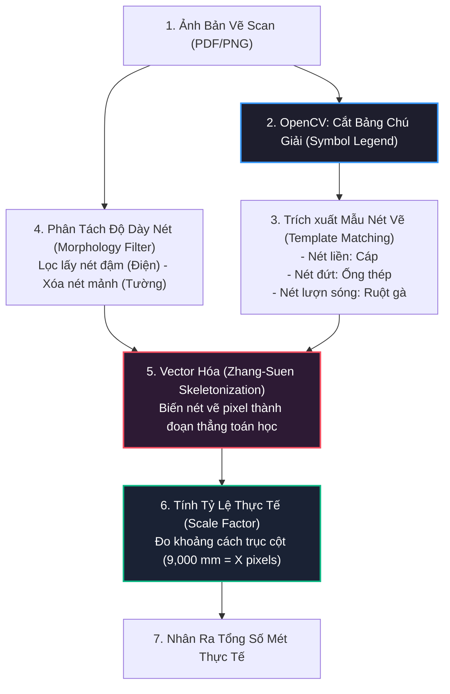

# KIẾN TRÚC & KẾ HOẠCH TRIỂN KHAI STEP 2: MEP CAD VECTOR ENGINE
## ĐỐI SOÁT TỰ ĐỘNG SƠ ĐỒ ĐI DÂY / ĐƯỜNG ỐNG (CAD DXF) VỚI KHỐI LƯỢNG NGHIỆM THU (STEP 1 EXCEL)

---

## 1. TỔNG QUAN VÀ BỐI CẢNH DỰ ÁN (STEP 1 vs STEP 2)



### 1.1. Mục tiêu cốt lõi của Step 2:
* **Bản chất của Step 1:** Kiểm tra xem *“Nhà thầu có kê khai trong file Excel đúng bằng số lượng ghi trong Bảng vẽ ở góc bản vẽ PDF hay không”*.
* **Lỗ hổng thực tế:** Nhà thầu hoàn toàn có thể tự ghi khống vào bảng kê ở góc bản vẽ: ví dụ ghi *Dây điện $67\text{ m}$, Ống ruột gà $11\text{ m}$, Kẹp xà gồ $10\text{ cái}$*, trong khi thực tế trên sơ đồ mặt bằng đi dây chỉ cần $43\text{ m}$ và $6\text{ cái}$ kẹp!
* **Mục tiêu của Step 2:** Đi sâu vào **phần đồ họa kỹ thuật của bản vẽ** để tính toán lại toàn bộ:
  1. Tổng chiều dài mét dây cáp, ống thép, ống luồn thực tế.
  2. Số lượng hộp nối (Junction Box), ổ cắm (Receptacle), kẹp xà gồ (Beam Clamp), co cút (Elbow), ty treo...
  3. So sánh trực tiếp khối lượng bóc tách từ CAD với khối lượng nghiệm thu đã đối soát ở **Step 1 Excel**. Nếu nhà thầu kê khống $\rightarrow$ Hệ thống cảnh báo ngay lập tức!

---

## 2. HIỆN TRẠNG AI THỊ GIÁC ĐỐI VỚI BẢN VẼ KỸ THUẬT MEP (AI STATE-OF-THE-ART)

### 2.1. Đã có AI nào nhìn ảnh bản vẽ mà tự hiểu và bóc tách được chưa?
> [!CAUTION]
> **Sự thật trong ngành AI toàn cầu:** **CHƯA CÓ một mô hình AI thương mại đại trà nào (kể cả GPT-4o, Claude 3.5 Sonnet hay Gemini Pro) có thể nhìn một bức ảnh bản vẽ MEP khổ lớn và tự động bóc tách khối lượng chính xác 100% được.**

#### Tại sao AI thị giác gặp bế tắc khi nhìn ảnh bản vẽ MEP?
1. **Nút thắt độ phân giải Gigapixel (The Gigapixel Resizing Bottleneck):**
   * Bản vẽ in khổ A0 ($841 \times 1189\text{ mm}$), scan chuẩn 300 DPI có kích thước lên tới **$10,000 \times 14,000\text{ pixels}$** (~140 Megapixel).
   * Mọi mô hình Vision-Language Model (VLM) hiện nay đều phải nén nhỏ ảnh (resize về khoảng $768\times 768$ hoặc $1024\times 1024$ px) để vừa với bộ nhớ GPU.
   * Khi bị nén nhỏ hàng chục lần, **các nét đứt, nét lượn sóng và các con số kích thước nhỏ xíu (`1.5M(UP)`, `0.8M(UP, 22C)`) sẽ bị nhòe và đứt gãy thành các chấm mờ**, AI không thể phân biệt nổi.
2. **Nhiễu thị giác cực độ (Visual Clutter & Overlapping Layers):**
   * Trên cùng một mặt bằng phẳng có: đường lưới trục cột (26, 27, 28), nét tường gạch, cửa đi, mũi tên chỉ dẫn, đường dây cáp, đường ống ruột gà... AI nhìn vào ảnh raster không có layer sẽ bị "rối mắt", nhìn nhầm đường tường nhà thành dây điện và hallucinate (đoán mò số liệu).

### 2.2. Các tập đoàn hàng đầu thế giới giải bài toán này như thế nào?
Các phần mềm bóc tách khối lượng xây dựng hàng đầu thế giới (như **Autodesk Takeoff**, **Trimble MEP**, **Cubicost / Glodon TAS/TRB**, **PlanSwift**):
* Họ **KHÔNG dùng AI để nhìn ảnh pixel**!
* Họ dùng **Vector Geometric Engine (Đọc trực tiếp file CAD DWG/DXF hoặc mô hình BIM IFC/Revit)**.
* Máy tính sẽ lọc tách riêng Layer cơ điện ra khỏi mặt bằng kiến trúc, dùng công thức toán học đo chính xác từng đoạn thẳng vector, sau đó mới dùng AI hỗ trợ phân loại tên vật tư.

---

## 3. CHIẾN LƯỢC TRIỂN KHAI VỚI MODEL QWEN 3.8 NỘI BỘ (NEXTAI)

Trong môi trường nội bộ doanh nghiệp bị ngắt internet, việc sở hữu model **Qwen 3.8 (NextAI)** là một lợi thế lớn nếu biết phân công nhiệm vụ đúng sở trường:

| Công cụ | Nhiệm vụ đảm nhiệm | Lý do phân công |
| :--- | :--- | :--- |
| **Python Core (`ezdxf` + `shapely`)** | **100% việc tính toán hình học:** Lọc Layer, đo độ dài đoạn thẳng 2D, đếm số Block cái | Chạy bằng CPU trong 1 giây, **chính xác 100% về mặt toán học**, không sai 1 milimet, tiêu thụ 0% tài nguyên AI. |
| **Qwen 3.8 (NextAI)** | **Đọc hiểu ngữ nghĩa ghi chú kỹ thuật (Semantic Parsing):** Bóc tách các cụm text phức tạp thành JSON | Sở trường lớn nhất của Qwen là Text-to-JSON và trích xuất thực thể (NER). Chạy rất nhanh và không bao giờ hallucinate về hình vẽ. |



#### Ví dụ Prompt thực tế cho Qwen 3.8:
* **Đầu vào trích xuất từ CAD:**
  ```text
  "DUCT 100*100, L=2.1M+0.6M
   H ELBOW + COVER *1EA
   TY 3/8, L=1.0M*5EA+0.6M*1EA
   BEAM CLAMP *6EA"
  ```
* **Prompt gửi tới Qwen 3.8:**
  > *"Bạn là chuyên gia bóc tách vật tư cơ điện MEP. Hãy phân tích đoạn ghi chú sau và trả về duy nhất một mảng JSON chuẩn: [{"item_name": "...", "spec": "...", "quantity": ..., "unit": "..."}]"*
* **Qwen 3.8 phản hồi JSON chuẩn:**
  ```json
  [
    {"item_name": "DUCT", "spec": "100*100", "quantity": 2.7, "unit": "m"},
    {"item_name": "H ELBOW + COVER", "spec": "Standard", "quantity": 1, "unit": "each"},
    {"item_name": "TY", "spec": "3/8", "quantity": 5.6, "unit": "m"},
    {"item_name": "BEAM CLAMP", "spec": "Standard", "quantity": 6, "unit": "each"}
  ]
  ```

---

## 4. QUY CHUẨN KÝ HIỆU ĐƯỜNG NÉT (SYMBOL KEY & LEGEND)

### 4.1. Bảng ký hiệu chuẩn có sẵn trên bản vẽ (`img1.png` & `img2.png`):
Ngay dưới logo **TRÂM ANH MoE** ở góc phải bản vẽ, luôn có một bảng chú giải chuẩn quốc tế:

| Ký hiệu trên bản vẽ | Tên tiếng Anh | Tên kỹ thuật thực tế | Ý nghĩa bóc tách |
| :---: | :--- | :--- | :--- |
| `<--->` | **SPARE CABLE** | Cáp điện dự phòng | Dây cáp cuộn tròn chờ sẵn, tính chiều dài cố định theo quy định (thường là $1.5\text{ m} - 2\text{ m}$). |
| `(---)` | **CABLE LINE UP & DOWN** | Đoạn cáp lên trần / xuống sàn | Đoạn dây đứng vuông góc với mặt bằng 2D, bắt buộc phải cộng bù vào tổng chiều dài. |
| `[---]` | **STEEL CONDUIT** | Ống thép luồn dây | Nét gạch đứt, là tuyến ống cứng bảo vệ dây cáp đi ngầm hoặc trên trần. |
| `{...}` | **FLEXIBLE CONDUIT** | Ống ruột gà đàn hồi | Nét lượn sóng, đoạn ống mềm dẫn từ hộp chia ngả vào trực tiếp thiết bị máy. |
| `ETC.` | **CABLE DUCT & TRAY** | Máng cáp / Thang cáp | Nét liền đậm hai vạch hoặc một vạch đậm, tuyến máng chính chứa nhiều bó cáp. |

### 4.2. Ký hiệu này được thể hiện trong file CAD như thế nào?
1. **Qua thuộc tính Layer:**
   * Dây cáp: Layer `E-CABLE`
   * Ống thép: Layer `E-CONDUIT-STEEL`
   * Ống ruột gà: Layer `E-CONDUIT-FLEX`
   * Máng cáp: Layer `E-TRAY`
2. **Qua thuộc tính Linetype (Kiểu đường nét):**
   * Nét liền (`Continuous`) $\rightarrow$ Dây cáp / Máng cáp.
   * Nét gạch đứt (`DASHED`) $\rightarrow$ Ống thép cứng.
   * Nét lượn sóng (`BATTING` hoặc `ZIGZAG`) $\rightarrow$ Ống ruột gà mềm.
3. **Qua Lineweight & Color:**
   * Dây điện cơ điện luôn được đặt nét đậm ($0.50\text{ mm} - 0.70\text{ mm}$, màu nổi bật), trong khi nét kiến trúc (tường, cột) là nét mảnh ($0.09\text{ mm} - 0.15\text{ mm}$, màu xám/trắng).
4. **Qua Text ghi chú kèm theo:**
   * Ngay cạnh đường ống luôn có Text chỉ dẫn: ví dụ `0.8M(UP, 22C)` $\rightarrow$ Ký hiệu `22C` nghĩa là: *Conduit phi 22mm* (Ống thép luồn dây 22mm)!

---

## 5. GIẢI PHÃU BẢN VẼ MẪU TỪ 2 ẢNH THỰC TẾ (`img1.png` & `img2.png`)

### 5.1. Phân tích `img1.png` - Bản vẽ Concent Hookup (`WOR2512230006V-V3-FAB-1F`):
* **Bảng BOQ (Góc trên bên trái):**
  * `M03-00726710`: Cáp điện `F_CV, 2.5mm2, 3core` $\rightarrow$ Số lượng kê khai: **$67.00\text{ m}$** (Phụ trội $30\%$).
  * `M03-21514297`: Ống ruột gà chống thấm `OD22mm` $\rightarrow$ Số lượng: **$11.00\text{ m}$**.
  * `M02-00728171`: Kẹp xà gồ `C_TYPE_BEAM_CLAMP` $\rightarrow$ Số lượng: **$10\text{ cái}$**.
  * `M03-00726704`: Hộp chia ngả tròn `3WAY_CIRCULAR_BOX` $\rightarrow$ Số lượng: **$1\text{ cái}$**.
* **Sơ đồ đi dây thực tế trên mặt bằng:**
  * Xuất phát từ tủ `K29`: Đoạn đứng `1.5M(UP)`.
  * Đoạn ngang rẽ vuông góc đi qua các trục $28, 27$.
  * Đoạn rẽ xuống hộp nối: `0.6M`, `BOX J R02`, `0.8M(UP, 22C)`.
  * Rẽ sang máy Plasma: `1.5M`, `15.0M PLASMA-R02`, đoạn đứng `5.4M`, `27.8M PLASMA-R01`.
  * Đoạn cuối: `UP+500 1.3M(UP, 22C)`, `4.8M PLASMA-R02`, `0.6M`.
* 👉 **Công thức bóc tách của Step 2:**
  $$\text{Tổng Chiều Dài Cáp} = \sum (\text{Chiều dài ngang 2D}) + \sum (\text{Đoạn đứng UP/DN}) + 30\% \text{ (Phụ trội)}$$
  $$\text{Kiểm tra}: 67.00\text{ m (Excel)} \stackrel{?}{=} \text{Tổng Chiều Dài Cáp (CAD DXF)}$$

### 5.2. Phân tích `img2.png` - Bản vẽ Mini Panel Hookup:
* **Ghi chú cụm vật tư (Text Box tại F10):**
  * `DUCT 100*100, L=2.1M+0.6M` $\rightarrow$ Máng cáp $2.7\text{ m}$.
  * `H ELBOW + COVER * 1EA` $\rightarrow$ 1 Co ngang máng cáp.
  * `TY 3/8, L=1.0M*5EA + 0.6M*1EA` $\rightarrow$ Ty treo: $5.6\text{ m}$.
  * `BEAM CLAMP * 6EA` $\rightarrow$ 6 Kẹp dầm.
  * `ỐC DUCT * 54EA` $\rightarrow$ 54 Ốc vít.
* **Đường trục chính:**
  * Đi từ tủ điện `2PP-11F602-A4(2)`: Đoạn đứng `3.5M(DN)`.
  * Tuyến máng chạy dài: `38.6M`.
  * Rẽ vào vị trí F10: Đoạn thả `1.5M(DN)`.
  * Tổng chiều dài cáp: $38.6 + 3.5 + 1.5 + \dots = 43.6\text{ m}$ (khớp với số kê khai $46.00\text{ m}$ sau khi cộng bù trừ đoạn đầu nối).

---

## 6. KỊCH BẢN DỰ PHÒNG: KHI ĐỐI TÁC CHỈ CÓ ẢNH SCAN / PDF PHẲNG (KHÔNG CÓ CAD)

Nếu nhà thầu không chịu bàn giao file CAD DXF mà chỉ có bản vẽ PDF/Ảnh scan giấy, quy trình Computer Vision được thiết lập theo **5 bước tuần tự**:



1. **Bước 1: Bóc tách Bảng Chú Giải (Symbol Legend):**
   * Dùng OpenCV tìm khung bảng `SYMBOL` ở góc phải.
   * Cắt ra các hình ảnh mẫu (Template) của 4 kiểu nét: nét liền, nét đứt `[---]`, nét lượn sóng `{...}`.
2. **Bước 2: Phân tách lớp nét đậm (Morphological Filtering):**
   * Nét vẽ tường kiến trúc, trục cột luôn là nét mảnh ($1 - 2\text{ pixel}$).
   * Nét vẽ cơ điện luôn là nét đậm ($5 - 10\text{ pixel}$).
   * Dùng thuật toán `cv2.morphologyEx` (phép xói mòn & giãn nở ảnh) để **xóa sạch toàn bộ tường nhà, cột bê tông, chỉ giữ lại duy nhất đường dây điện màu đen**.
3. **Bước 3: Vector hóa thành đoạn thẳng toán học (Skeletonization & Hough Lines):**
   * Biến đường vẽ dày thành "bộ xương" mảnh 1 pixel bằng thuật toán Zhang-Suen.
   * Dùng thuật toán `HoughLinesP` để gom các pixel liên tục thành các đoạn thẳng có điểm đầu $A(x_1, y_1)$ và điểm cuối $B(x_2, y_2)$.
4. **Bước 4: Tính tỷ lệ chuyển đổi từ Pixel sang Mét (Scale Factor):**
   * Nhìn vào trục cột trên cùng: khoảng cách giữa trục 26 và 27 ghi **`9,000`** (tức $9\text{ mét}$).
   * Phần mềm đo khoảng cách pixel giữa 2 trục này: ví dụ đo được $450\text{ pixels}$.
   * $\Rightarrow$ Tỷ lệ tính toán: $\text{Scale} = \frac{9\text{ m}}{450\text{ px}} = 0.02\text{ m/pixel}$.
   * Từ đó, lấy tổng chiều dài pixel của đường dây điện nhân với $0.02\text{ m/pixel}$ $\rightarrow$ Ra chính xác số mét ngoài đời thực!
5. **Bước 5: Dùng Qwen 3.8 bóc số đo 3D (Đoạn đứng):**
   * Cắt các ô chữ chứa số liệu như `1.5M(UP)`, `38.6M`, `3.5M(DN)` đưa cho Qwen 3.8 đọc chữ số và cộng bù vào tổng chiều dài 2D vừa đo được.

---

## 7. MA TRẬN YÊU CẦU: HAI BÊN CẦN CHUẨN BỊ NHỮNG GÌ?

### 7.1. Yêu cầu bắt buộc đối với BÊN ĐỐI TÁC / NHÀ THẦU CAD:
> [!IMPORTANT]
> Dữ liệu CAD muốn đọc tự động bằng code thì **bắt buộc phải có chuẩn hóa (CAD Standards)**. Cần ban hành văn bản quy chuẩn trước khi triển khai:

1. **Chuẩn hóa Layer (Bắt buộc 100%):**
   * Dây cáp điện lực: `E-CABLE-POWER`.
   * Đường ống luồn dây: `E-CONDUIT`.
   * Máng cáp / Thang cáp: `E-TRAY-DUCT`.
   * Text kích thước, số đo, ghi chú cao độ `UP/DN`: `E-DIM-TEXT`.
   * Các khối ký hiệu ổ cắm, tủ điện, hộp box: `E-DEVICE-BLOCK`.
   * Mặt bằng tường, cột, lưới trục kiến trúc: `A-WALL`, `A-COLUMN`, `A-GRID` (để hệ thống lọc bỏ, không đo nhầm vào dây điện).
2. **Không được phá khối (Không dùng lệnh EXPLODE):**
   * Các phụ kiện như Cút, Tê, Hộp Box, Kẹp Xà Gồ, Ổ Cắm phải chèn dưới dạng **AutoCAD Block (`INSERT`)** với tên Block thống nhất (ví dụ: `BLK_BEAM_CLAMP`, `BLK_BOX_3WAY`). Không được nổ block thành các nét rời.
3. **Quy chuẩn Text ghi độ cao thẳng đứng (Riser/Drop):**
   * Vì bản vẽ 2D không có trục cao độ $Z$, các đoạn dây đi lên trần hoặc xuống sàn bắt buộc phải ghi rõ Text theo định dạng Regex chuẩn:
     * `[Số mét]M(UP)` ví dụ: `1.5M(UP)`, `0.8M(UP, 22C)`.
     * `[Số mét]M(DN)` ví dụ: `3.5M(DN)`, `1.0M(DN)`.
4. **Định dạng file nộp:**
   * Xuất file **AutoCAD DXF (ASCII DXF)** phiên bản 2013 hoặc 2018.

---

### 7.2. Chuẩn bị của PHÍA ĐỘI NGŨ CHÚNG TA (DEVELOPER):
1. **Môi trường & Thư viện Python:**
   * Cài đặt thư viện `ezdxf` (bóc tách vector CAD).
   * Thư viện `shapely` & `networkx` (tính toán khoảng cách và kết nối topo đường đi).
   * Tích hợp API gọi **Qwen 3.8 nội bộ NextAI** để xử lý ngữ nghĩa text ghi chú.
2. **Viết 4 Module xử lý Step 2:**
   * **Module 1 (DXF Validator):** Kiểm tra file CAD tải lên có đúng chuẩn Layer không. Nếu sai quy chuẩn $\rightarrow$ Từ chối ngay, không xử lý file rác.
   * **Module 2 (2D Length Extractor):** Lọc các đối tượng `LINE`, `LWPOLYLINE` thuộc layer dây/máng và cộng tổng độ dài hình học.
   * **Module 3 (3D Height Extractor):** Quét các Text `UP/DN` nằm gần đường dây bằng Regex để cộng bù chiều dài đứng.
   * **Module 4 (Step 2 Reconciler):** So khớp $\text{Tổng CAD} \times (1 + \% \text{Phụ trội})$ với $\text{Khối lượng Excel Step 1}$. Nếu sai số vượt ngưỡng $\pm 5\%$ thì đánh dấu **LỆCH KHỐI LƯỢNG THIẾT KẾ**.

---

## 8. THIẾT KẾ THUẬT TOÁN BÓC TÁCH CAD VECTOR (PYTHON EZDXF)

```python
import ezdxf
import re

def parse_mep_dxf(dxf_file_path):
    """
    Thuật toán bóc tách hình học vector từ file CAD DXF:
    1. Đo chiều dài 2D các đoạn dây/máng cáp theo Layer
    2. Quét Text bóc chiều dài đoạn đứng UP/DN
    3. Đếm số lượng Block thiết bị phụ kiện
    """
    doc = ezdxf.readfile(dxf_file_path)
    msp = doc.modelspace()
    
    total_cable_length_2d = 0.0
    total_cable_height_3d = 0.0
    equipment_counts = {}
    
    # 1. BÓC ĐỘ DÀI 2D TỪ LAYER DÂY ĐIỆN (LINE / POLYLINE)
    for entity in msp.query('LINE LWPOLYLINE[layer=="E-CABLE-POWER"]'):
        if entity.dxftype() == 'LINE':
            total_cable_length_2d += entity.dxf.start.distance(entity.dxf.end)
        elif entity.dxftype() == 'LWPOLYLINE':
            total_cable_length_2d += entity.length
            
    # 2. BÓC ĐOẠN ĐỨNG (UP / DN) BẰNG REGEX TỪ TEXT / MTEXT
    pattern_up_dn = re.compile(r'(\d+(?:\.\d+)?)\s*M\s*\((UP|DN)', re.IGNORECASE)
    for text_entity in msp.query('TEXT MTEXT'):
        text_content = text_entity.dxf.text if text_entity.dxftype() == 'TEXT' else text_entity.text
        matches = pattern_up_dn.findall(text_content)
        for val, direction in matches:
            total_cable_height_3d += float(val)
            
    # 3. ĐẾM THIẾT BỊ / PHỤ KIỆN TỪ BLOCK (INSERT)
    for block in msp.query('INSERT'):
        block_name = block.dxf.name
        equipment_counts[block_name] = equipment_counts.get(block_name, 0) + 1
        
    return {
        "cable_length_2d": round(total_cable_length_2d, 2),
        "cable_height_3d": round(total_cable_height_3d, 2),
        "total_calculated": round(total_cable_length_2d + total_cable_height_3d, 2),
        "equipment_counts": equipment_counts
    }
```

---

## 9. LỘ TRÌNH TRIỂN KHAI STEP 2 (ROADMAP 4 TUẦN)

| Tuần | Giai đoạn | Công việc chi tiết |
| :---: | :--- | :--- |
| **Tuần 1** | **Chuẩn Hóa Tiêu Chuẩn CAD** | Ban hành bảng mã quy chuẩn Layer & Block với nhà thầu. Tiếp nhận 3-5 file mẫu `.dxf` để khảo sát cấu trúc thực tế. |
| **Tuần 2** | **Xây Dựng CAD Parser Core** | Viết module `cad_engine.py` dùng `ezdxf` bóc tách 2D Polyline, Text UP/DN và đếm Block phụ kiện. Tích hợp Qwen 3.8 bóc text ghi chú. |
| **Tuần 3** | **Tích Hợp Đối Soát Step 1** | Ghép kết quả bóc tách CAD với Báo cáo Excel của Step 1. Tự động tính chênh lệch $\%$ và phát hiện gian lận kê khống. |
| **Tuần 4** | **Nâng Cấp Giao Diện OneAI** | Bổ sung tab kiểm tra CAD trên màn hình OneAI, hiển thị cảnh báo sai lệch giữa Thiết Kế (CAD) và Nghiệm Thu (Step 1 Excel). |
