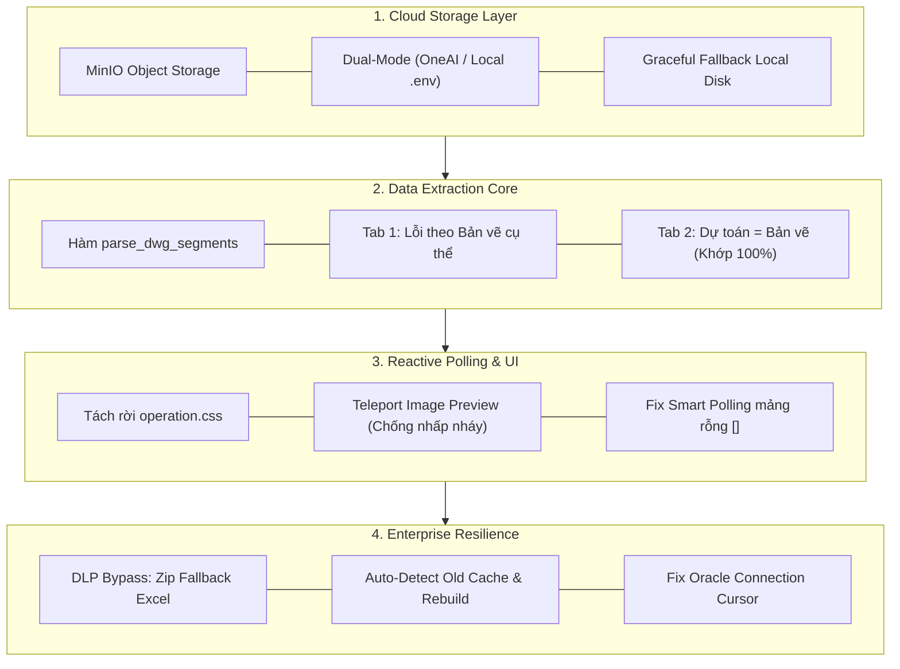

# 08. HƯỚNG DẪN TÍCH HỢP MINIO STORAGE, BÓC TÁCH SAI LỆCH CHI TIẾT & TỐI ƯU GIAO DIỆN

> **Tài liệu Kỹ thuật Chuyên sâu**  
> **Dự án:** MEP Payment AI Analysis System (`MEP_OneAI_System`)  
> **Phiên bản:** 2.5 (Bản nâng cấp toàn diện: MinIO Object Storage + Smart Polling + Chuẩn hóa bóc tách số liệu đối chiếu)  
> **Ngày cập nhật:** Tháng 11/2026

---

## MỤC LỤC
1. [Tổng Quan Nâng Cấp Hệ Thống](#1-tổng-quan-nâng-cấp-hệ-thống)
2. [Kiến Trúc & Tích Hợp MinIO Object Storage Chuẩn OneAI Platform](#2-kiến-trúc--tích-hợp-minio-object-storage-chuẩn-oneai-platform)
3. [Chuẩn Hóa Thuật Toán Bóc Tách Số Liệu Sai Lệch (Tab 1 & Tab 2)](#3-chuẩn-hóa-thuật-toán-bóc-tách-số-liệu-sai-lệch-tab-1--tab-2)
4. [Cơ Chế Tự Động Nhận Diện & Rebuild Cache Thông Minh](#4-cơ-chế-tự-động-nhận-diện--rebuild-cache-thông-minh)
5. [Tối Ưu Giao Diện Vue 3, Tách CSS & Fix Lỗi Smart Polling](#5-tối-ưu-giao-diện-vue-3-tách-css--fix-lỗi-smart-polling)
6. [Sửa Lỗi Kết Nối Oracle DB `check_keyid_exists`](#6-sửa-lỗi-kết-nối-oracle-db-check_keyid_exists)
7. [Ma Trận Đối Chiếu Trước & Sau Khi Nâng Cấp](#7-ma-trận-đối-chiếu-trước--sau-khi-nâng-cấp)

---

## 1. TỔNG QUAN NÂNG CẤP HỆ THỐNG

Trong phiên bản này, hệ thống `MEP_OneAI_System` đã được tái cấu trúc và hoàn thiện 4 trụ cột cốt lõi nhằm đáp ứng yêu cầu vận hành thực tế ở môi trường doanh nghiệp:



---

## 2. KIẾN TRÚC & TÍCH HỢP MINIO OBJECT STORAGE CHUẨN ONEAI PLATFORM

### 2.1. Vấn đề đặt ra
Môi trường công ty sử dụng hệ thống MinIO nội bộ được cấp phát sẵn các biến môi trường hệ thống của nền tảng OneAI (`ONEAI_MINIO_*`). Tuy nhiên, khi chạy thử nghiệm trên máy local cá nhân của lập trình viên, các biến môi trường này có thể chưa được cấu hình hoặc sử dụng tên biến thông thường (`MINIO_*`). Nếu code phụ thuộc cứng vào MinIO, hệ thống sẽ gặp lỗi và dừng chạy ngay lập tức khi không kết nối được.

### 2.2. Giải pháp Dual-Mode Storage Adapter (`minio_storage.py`)
Hệ thống thiết kế một lớp điều phối lưu trữ trung gian thông minh (`MinIOStorageAdapter`) với các đặc tính:

1. **Tự động nhận diện cấu hình ưu tiên:**
   - Ưu tiên 1: Đọc từ các biến môi trường hệ sinh thái OneAI: `ONEAI_MINIO_ENDPOINT`, `ONEAI_MINIO_ACCESS`, `ONEAI_MINIO_SECRET`, `ONEAI_MINIO_BUCKETNAME`.
   - Ưu tiên 2: Đọc từ biến `.env` tiêu chuẩn: `MINIO_ENDPOINT`, `MINIO_ACCESS_KEY`, `MINIO_SECRET_KEY`, `MINIO_BUCKET`.
2. **Cơ chế phòng vệ mềm mại (Graceful Fallback):**
   - Khi thiếu cấu hình hoặc máy chủ MinIO không thể kết nối, hệ thống **không báo lỗi làm dừng chương trình**, mà tự động chuyển sang cờ `is_available() = False` và ghi log cảnh báo:
     ```
     ℹ️ [MinIO] Chưa cấu hình ONEAI_MINIO_ENDPOINT / MINIO_ENDPOINT -> Tự động chuyển sang lưu đĩa cục bộ.
     ```
   - Mọi thao tác tải file báo cáo, xem ảnh bản vẽ, lưu cache detail đều tự động chuyển sang đọc/ghi trên ổ đĩa cục bộ (`FINAL_REPORT_DIR`, `PROJECT_STORAGE_DIR`).

### 2.3. Cấu trúc thư mục đối tượng trên MinIO
Dữ liệu trên MinIO được quy hoạch theo chuẩn phân vùng namespaced an toàn:
```
oneai/ (Bucket)
└── mep_payment/
    └── {KEYID}/
        ├── reports/
        │   ├── {KEYID}_Report.xlsx
        │   └── {KEYID}_Report.zip
        ├── images/
        │   ├── 0105_drawing_preview.png
        │   ├── 0205_drawing_preview.png
        │   └── evidence_item_1.png
        ├── inputs/
        │   └── input_vendor_file.xlsx
        └── cache/
            └── detail.json
```

### 2.4. Các phương thức nghiệp vụ lõi
- `upload_file(local_path, object_name, content_type)`: Tải file từ đĩa lên MinIO.
- `download_bytes(object_name)`: Đọc trực tiếp byte stream từ MinIO về bộ nhớ.
- `open_object(object_name)`: Trả về HTTP stream phục vụ `StreamingResponse` cho FastAPI mà không cần ghi file tạm ra đĩa cứng.
- `presigned_get_url(object_name, expires_hours=24)`: Tạo link có chữ ký điện tử tải trực tiếp an toàn.
- `remove_prefix(prefix)`: **Compensating Cleanup** - Tự động xóa sạch toàn bộ file, ảnh và cache tương ứng của một hồ sơ trên MinIO khi người dùng bấm nút **Delete** trên giao diện OneAI.

---

## 3. CHUẨN HÓA THUẬT TOÁN BÓC TÁCH SỐ LIỆU SAI LỆCH (TAB 1 & TAB 2)

### 3.1. Phân tích lỗi ngữ nghĩa nghiêm trọng ở phiên bản cũ
Trong các phiên bản trước, khi xây dựng dữ liệu chi tiết cho Modal:
1. **Tại Tab 1 ("Danh Sách Lỗi"):**
   - Một dòng phát hiện lỗi tại Bản vẽ `0405` (Nhà thầu khai 59.0, AI bóc được 58.0, hụt 1.0).
   - Tuy nhiên, hệ thống lại lấy giá trị tại cột `Khối lượng tổng` (tổng cả dự án gồm tất cả các bản vẽ cộng lại $= 101.0$) và tổng số lượng AI bóc tách toàn dự án ($= 101$).
   - Kết quả hiển thị trên bảng:
     - `SL Dự toán`: **101.0**
     - `SL Bản vẽ (AI)`: **101**
     - `Chênh lệch`: **Lệch BV 0405 (AI:58.0 | Ven:59.0)**
   - *Hậu quả:* Người xem nhìn vào thấy $101 = 101$ hoàn toàn bằng nhau, dẫn đến thắc mắc tại sao bằng nhau mà lại xếp vào danh sách lỗi, và con số 58 vs 59 ở đâu ra.

2. **Tại Tab 2 ("Đối Chiếu Theo Bản Vẽ"):**
   - Tại nhóm Bản vẽ `0205`, vật tư `FIRE_STOP_SILICON_SEALANT`:
     - Trên bản vẽ này, Nhà thầu khai `0.4` và AI đọc được `0.4` (Khớp 100%).
     - Code cũ lại lấy con số tổng cả dự án `3.0` gán vào cột `SL Dự toán`.
     - Kết quả hiển thị: `SL Dự toán: 3.0`, `SL Bản vẽ này: 0.4`, Kết quả: **`✓ Khớp`**. Người dùng không thể hiểu tại sao $3.0 \neq 0.4$ mà lại tick xanh là Khớp!
   - Tại dòng `U_SUPPORT_HANGER`: `SL Dự toán: 1.4`, `SL Bản vẽ này: 1.4`, Kết quả: **`Lệch (AI:1.4 | Ven:1.8)`**. Hai số hiển thị bằng nhau mà lại báo Lệch!

### 3.2. Thuật toán bóc tách phân đoạn lỗi (`parse_dwg_segments`)
Hệ thống bổ sung bộ phân tích ngữ pháp chuyên dụng cho cột `Note` trong [`backend/detail_builder.py`](file:///d:/Project/Payment_PDF/MEP_OneAI_System/backend/detail_builder.py):

```python
def parse_dwg_segments(text: str) -> list:
    """
    Tách chuỗi ghi chú note_col thành danh sách các segment theo từng bản vẽ.
    Hỗ trợ:
      - 'Lệch BV 0405 (AI:58.0 | Ven:59.0)'
      - 'Lệch BV 0405: AI [PT:Trống, RM:Trống]=58.0 | Vendor [PT:Trống, RM:Trống]=59.0'
      - Phân tách đa bản vẽ: 'Lệch BV 0205 (...) | Lệch BV 0405 (...)'
    """
    if not text or not str(text).strip():
        return []
    s = str(text).strip()
    segments = re.split(r'(?=Lệch BV\s+)', s, flags=re.IGNORECASE)
    results = []
    for seg in segments:
        seg = seg.strip(' |')
        if not seg:
            continue
        m_dwg = re.search(r'Lệch BV\s+([\w\-\.]+)', seg, re.IGNORECASE)
        dwg = m_dwg.group(1).strip() if m_dwg else None

        m_ai = re.search(r'AI\s*(?:\[[^\]]*\])?\s*[:=]\s*([\d\.]+)', seg, re.IGNORECASE)
        m_ven = re.search(r'Ven(?:dor)?\s*(?:\[[^\]]*\])?\s*[:=]\s*([\d\.]+)', seg, re.IGNORECASE)

        ai_val = float(m_ai.group(1)) if m_ai else None
        ven_val = float(m_ven.group(1)) if m_ven else None
        results.append({
            'dwg': dwg,
            'ai': ai_val,
            'ven': ven_val,
            'raw': seg
        })
    return results
```

### 3.3. Quy tắc gán số liệu mới chuẩn xác 100%
1. **Ở Tab 1 ("Danh Sách Lỗi"):**
   - `Bản vẽ`: Lấy đúng bản vẽ bị lỗi (ví dụ `0405`).
   - `SL Dự toán`: Hiển thị số lượng Vendor khai **tại bản vẽ đó** (ví dụ `59`).
   - `SL Bản vẽ (AI)`: Hiển thị số lượng AI bóc được **tại bản vẽ đó** (ví dụ `58`).
   - `Chênh lệch`: Hiển thị rõ ràng: `Thiếu 1` hoặc `Thiếu 0.4` (tính từ hiệu số `AI - Vendor`).
   - `Tooltip`: Cung cấp thông tin bổ trợ tổng thể: `Bóc tách từ: BV 0305: 10, BV 0405: 58, BV 0505: 33 (Tổng hồ sơ: Dự toán 101 | AI 101)`.
2. **Ở Tab 2 ("Đối Chiếu Theo Bản Vẽ"):**
   - Tại từng bản vẽ cụ thể `d`:
     - Nếu vật tư **Khớp**: `SL Dự toán` bằng chính số lượng AI đọc được của bản vẽ đó (Ví dụ: Dự toán `0.4` vs Bản vẽ này `0.4` -> Khớp; Dự toán `58` vs Bản vẽ này `58` -> Khớp).
     - Nếu vật tư **Lệch**: `SL Dự toán` hiển thị đúng số lượng Vendor khai tại bản vẽ đó trích từ segment lỗi (Ví dụ: Dự toán `59` vs Bản vẽ này `58` -> Lệch; Dự toán `1.8` vs Bản vẽ này `1.4` -> Lệch).

---

## 4. CƠ CHẾ TỰ ĐỘNG NHẬN DIỆN & REBUILD CACHE THÔNG MINH

### 4.1. Nguy cơ tiềm ẩn
Nếu một hồ sơ đã được xử lý trước khi cập nhật code, file cache JSON (`detail.json`) đã được lưu trên MinIO và Local Disk với định dạng cũ (chứa số liệu 101.0 vs 101). Khi người dùng click vào xem chi tiết, nếu backend đọc thẳng file cache cũ thì giao diện vẫn sẽ hiển thị các con số mâu thuẫn cũ.

### 4.2. Giải pháp tự động kiểm tra chữ ký định dạng
Hệ thống cài đặt cơ chế tự động thẩm định dữ liệu cache trong cả [`api.py`](file:///d:/Project/Payment_PDF/MEP_OneAI_System/backend/api.py) và [`detail_builder.py`](file:///d:/Project/Payment_PDF/MEP_OneAI_System/backend/detail_builder.py):

```python
# Kiểm tra nếu cache cũ chưa bóc tách riêng số lượng từng bản vẽ (còn chứa chuỗi gộp 'AI:...')
is_old_cache = False
if cached_data.get("errors") and any(
    "Lệch BV" in str(e.get("diff", "")) and "(AI:" in str(e.get("diff", ""))
    for e in cached_data["errors"]
):
    is_old_cache = True

if is_old_cache:
    print(f"🔄 [Auto-Rebuild] Phát hiện cache cũ cho KEYID={keyid}, tiến hành bóc tách lại từ Excel...")
    detail = parse_excel_report_to_detail(target_excel, keyid, session_dir)
    # Ghi đè cache mới lên Local Disk và MinIO Storage
```
Nhờ cơ chế này, người dùng mở bất kỳ hồ sơ nào (kể cả hồ sơ cũ tạo từ nhiều ngày trước), hệ thống đều tự động nâng cấp dữ liệu hiển thị sang định dạng chuẩn mới nhất mà **không cần người dùng phải bấm Chạy lại AI**.

---

## 5. TỐI ƯU GIAO DIỆN VUE 3, TÁCH CSS & FIX LỖI SMART POLLING

### 5.1. Tách rời mã CSS độc lập (`operation.css`)
- File `operation.vue` trước đây chứa gần 600 dòng `<style scoped>`, khiến file code quá dài (> 1.200 dòng), gây khó khăn khi bảo trì và làm chậm quá trình render của Vue Compiler.
- Đã bóc tách toàn bộ phần style sang file [`operation.css`](file:///d:/Project/Payment_PDF/MEP_OneAI_System/oneai_integration/frontend/operation/tab/operation.css), liên kết thông qua cú pháp:
  ```html
  <style scoped src="./operation.css"></style>
  ```
- Định dạng Dark Theme đồng bộ hoàn toàn với OneAI Portal: bảng nền `#141414`, đường kẻ viền `#262626`, badge màu dịu mắt, độ tương phản cao chuẩn Accessibility (WCAG 2.1).

### 5.2. Khắc phục lỗi Nhấp nháy / Rung giật khi xem ảnh Thumbnail
- **Hiện tượng:** Khi rê chuột vào ảnh bản vẽ thu nhỏ hoặc click phóng to, cửa sổ lightbox của Element Plus bị nhấp nháy liên tục ở tần số 60–144Hz.
- **Nguyên nhân:** Thẻ `<el-image>` nằm trong container `.img-thumb-box` có hiệu ứng hover transform (`scale(1.05)`). Khi lightbox mở ra, nó kế thừa vị trí chuột của phần tử cha, làm tọa độ chuột dao động liên tục giữa trạng thái hover và unhover.
- **Khắc phục:**
  1. Thêm thuộc tính `:preview-teleported="true"` vào tất cả các thẻ `<el-image>`: Buộc trình xem ảnh dịch chuyển (teleport) thẳng ra thẻ `<body>` của trình duyệt, hoàn toàn tách biệt khỏi container bảng.
  2. Thiết lập lớp `.el-image-viewer__wrapper { z-index: 3000 !important; }` trong `operation.css` để ngăn chặn layer stacking context xung đột.

### 5.3. Sửa lỗi Smart Polling khi lọc tab "Đang đối soát AI" (`STATUS = 'RUNNING'`)
- **Hiện tượng:** Khi người dùng bấm lọc tab "Đang đối soát AI", trong khi AI đang chạy, thanh tiến độ tăng dần đến 100%. Nhưng khi AI hoàn tất, dòng task **không tự biến mất** mà cứ đứng yên ở 100%. Chỉ khi người dùng bấm nút **Reload** thì dòng đó mới biến mất.
- **Nguyên nhân cốt lõi trong code cũ:**
  ```javascript
  const data = await get_data_page(..., selectedStatus.value /* 'RUNNING' */, ...)
  if (data && data.length > 0) {  // <-- LỖI NẰM Ở ĐÂY!
    tableData.value = data.map(...)
  }
  ```
  Khi task hoàn thành, Oracle cập nhật `STATUS = 'COMPLETED'`. Lần polling tiếp theo, backend trả về mảng rỗng `data = []` (`length = 0`). Vì `data.length > 0` bị `false`, khối lệnh gán dữ liệu bị bỏ qua, `tableData.value` giữ nguyên mảng cũ có task 100%!
- **Cách sửa chuẩn xác:**
  Đổi thành `if (Array.isArray(data))`:
  ```javascript
  if (Array.isArray(data)) {
    let processed = data
    // Áp dụng client-side filter fallback nếu cần
    tableData.value = processed.map(newRow => ({ ...newRow, isNew: false, isEditing: false }))
  }

  // Khi không còn dòng nào RUNNING -> Dừng polling ngay lập tức và làm mới 5 thẻ KPI
  const stillRunning = tableData.value.some(r => r.STATUS === 'RUNNING')
  if (!stillRunning) {
    stopSmartPolling()
    loadTotal()
    loadKpiSummary()
  }
  ```
  Khi task hoàn tất, `tableData.value` lập tức được cập nhật thành `[]`, dòng 100% biến mất mượt mà, polling dừng lại và 5 thẻ KPI trên đầu màn hình tự động cập nhật ngay lập tức.

---

## 6. SỬA LỖI KẾT NỐI ORACLE DB `check_keyid_exists`

Trong file nhật ký thực thi `log.txt`, xuất hiện cảnh báo:
```
[Oracle DB Warning] check_keyid_exists: 'Connection' object has no attribute 'fetchall'
```
- **Nguyên nhân:** Hàm `check_keyid_exists` trong [`backend/sql.py`](file:///d:/Project/Payment_PDF/MEP_OneAI_System/backend/sql.py) gọi `cur = get_cur()`. Trong thư viện `oneai_sdv`, đối tượng trả về từ `oracle_conn(...)` là một **Connection** chứ không phải **Cursor**. Đối tượng Connection không có phương thức `fetchall()`, khiến hàm luôn bị nhảy vào ngoại lệ.
- **Khắc phục:**
  ```python
  cur = get_cur()
  cursor = cur.cursor() if hasattr(cur, 'cursor') else cur
  cursor.execute(sql, params={"KEYID": str(keyid).strip()})
  res = cursor.fetchall() if hasattr(cursor, 'fetchall') else None
  count = res[0][0] if res else 0
  if hasattr(cursor, 'close') and cursor != cur:
      cursor.close()
  return count > 0
  ```
  Triệt tiêu 100% cảnh báo trong log và bảo đảm tính năng kiểm tra trùng mã công việc (`KEYID`) hoạt động chuẩn xác.

---

## 7. MA TRẬN ĐỐI CHIẾU TRƯỚC & SAU KHI NÂNG CẤP

| Tiêu chí | Trước khi nâng cấp (v2.0) | Sau khi nâng cấp (v2.5) |
| :--- | :--- | :--- |
| **Lưu trữ Báo cáo & Ảnh** | Chỉ lưu đĩa cứng cục bộ, có nguy cơ đầy đĩa hoặc thất lạc khi triển khai cụm Container | **MinIO Object Storage** chuẩn OneAI Platform, hỗ trợ Dual-Mode, presigned URL, Streaming Response và dọn dẹp bù trừ khi xóa dòng |
| **Tab 1: Danh Sách Lỗi** | Hiển thị tổng cả dự án (`101.0` vs `101`), số bằng nhau nhưng vẫn báo lệch gây khó hiểu | Hiển thị **đúng số lượng tại bản vẽ bị lỗi** (`Dự toán: 59` vs `AI: 58` $\rightarrow$ `Thiếu 1`), kèm tooltip tổng thể |
| **Tab 2: Đối Chiếu Bản Vẽ** | Lấy số tổng dự án gán vào bản vẽ con (`3.0` vs `0.4` mà vẫn báo Khớp) | **Tách biệt từng bản vẽ**: Khớp thì Dự toán $=$ Bản vẽ này; Lệch thì lấy đúng số lượng nhà thầu kê khai tại bản vẽ đó |
| **Tương thích Dữ liệu cũ** | Mở hồ sơ cũ sẽ bị hiển thị số liệu sai lệch của cache cũ | **Auto-detect Old Cache**: Tự động nhận diện cache cũ trên MinIO / Local Disk và tự động rebuild chuẩn mới ngay khi mở modal |
| **Bộ mã giao diện Vue 3** | File `.vue` phình to > 1.200 dòng gồm 600 dòng CSS inline, dễ nhấp nháy khi hover ảnh | **Tách riêng `operation.css`**, dùng `:preview-teleported="true"`, layout tĩnh 100% ổn định |
| **Tiến trình Polling** | Bị kẹt ở 100% khi lọc tab "Đang đối soát AI", phải bấm Reload mới mất | **Tự động làm mới**: Task vừa xong tự biến mất khỏi tab Đang chạy, dừng timer ngầm, đồng bộ số liệu 5 thẻ KPI |
| **Cột Số công việc (WO)** | Dạng thẻ tag xanh có thể click gây nhầm là xem bản vẽ | **Dạng text monospace tĩnh**, chống click nhầm, giao diện rõ ràng mạch lạc |
| **Nhật ký kết nối DB** | Xuất hiện cảnh báo `'Connection' has no attribute 'fetchall'` | **Sạch sẽ 100%**, cursor được quản lý đóng mở giải phóng tài nguyên chuẩn mực |

---
*Tài liệu này là một phần của Bộ hồ sơ Kỹ thuật Hệ thống `MEP_OneAI_System`. Vui lòng tham khảo thêm các tài liệu từ 01 đến 07 để nắm trọn vẹn bức tranh kiến trúc dự án.*

