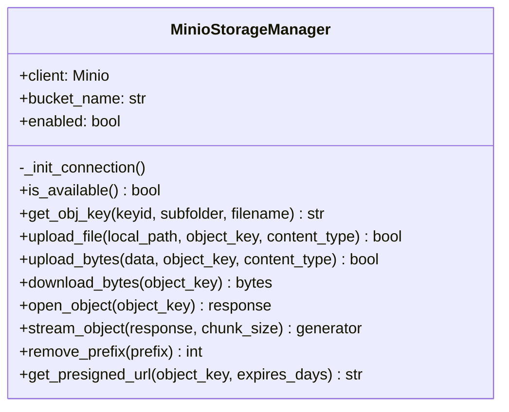
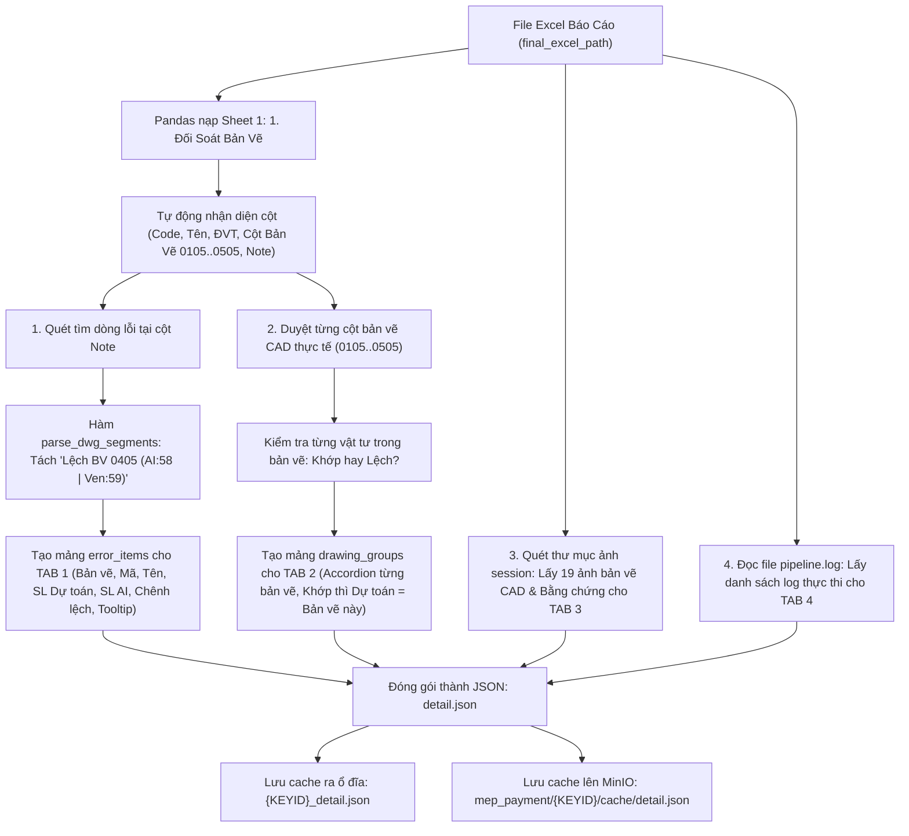
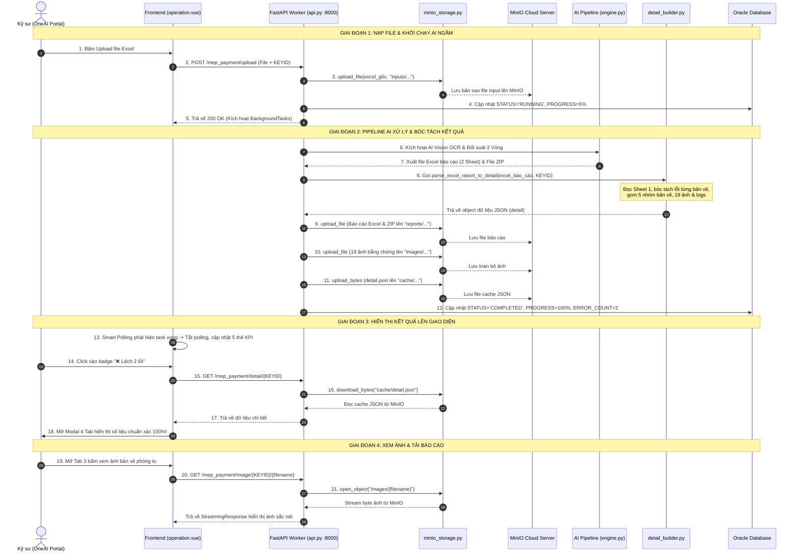

# 10. GIẢI MÃ TOÀN DIỆN VỀ MINIO_STORAGE.PY & DETAIL_BUILDER.PY: BẢN CHẤT, LUỒNG HOẠT ĐỘNG VÀ VỊ TRÍ ĐẶT FILE

> **Tài liệu Kỹ thuật Chuyên sâu (Core Mechanics Guide)**  
> **Dự án:** MEP Payment AI Analysis System (`MEP_OneAI_System`)  
> **Chủ đề:** Giải thích cặn kẽ bản chất, lý do tồn tại, luồng hoạt động từng bước và vị trí triển khai của 2 module then chốt: `minio_storage.py` và `detail_builder.py`.  
> **Ngày lập:** Tháng 11/2026

---

## MỤC LỤC
1. [Trả Lời Trực Diện: Đặt 2 File Này Ở Đâu? (OneAI Hay Prj Gốc?)](#1-trả-lời-trực-diện-đặt-2-file-này-ở-đâu-oneai-hay-prj-gốc)
2. [Tại Sao Bắt Buộc Phải Dùng 2 File Này? (Nếu Không Có Thì Sao?)](#2-tại-sao-bắt-buộc-phải-dùng-2-file-này-nếu-không-có-thì-sao)
3. [Giải Mã Module 1: `minio_storage.py` (Cloud Storage Adapter)](#3-giải-mã-module-1-minio_storagepy-cloud-storage-adapter)
4. [Giải Mã Module 2: `detail_builder.py` (Data Reconcile Compiler)](#4-giải-mã-module-2-detail_builderpy-data-reconcile-compiler)
5. [Toàn Cảnh Luồng Hoạt Động Từng Bước (Step-by-Step Lifecycle)](#5-toàn-cảnh-luồng-hoạt-động-từng-bước-step-by-step-lifecycle)
6. [Sơ Đồ Kết Nối & Tương Tác Giữa Các Thành Phần Hệ Thống](#6-sơ-đồ-kết-nối--tương-tác-giữa-các-thành-phần-hệ-thống)
7. [Checklist Triển Khai & Kiểm Thử Dành Cho Kỹ Sư](#7-checklist-triển-khai--kiểm-thử-dành-cho-kỹ-sư)

---

## 1. TRẢ LỜI TRỰC DIỆN: ĐẶT 2 FILE NÀY Ở ĐÂU? (ONEAI HAY PRJ GỐC?)

> [!IMPORTANT]
> **CÂU TRẢ LỜI DỨT KHOÁT:**  
> **CẢ 2 FILE `minio_storage.py` VÀ `detail_builder.py` BẮT BUỘC PHẢI ĐẶT TRONG DỰ ÁN GỐC CỦA BẠN (TỨC LÀ THƯ MỤC `backend/` CỦA FASTAPI WORKER SERVICE `MEP_OneAI_System`).**  
> **TUYỆT ĐỐI KHÔNG ĐẶT 2 FILE NÀY VÀO TRONG DỰ ÁN ONEAI CORE PLATFORM!**

### Tại sao lại như vậy? Hãy hiểu rõ bản chất kiến trúc:

Hệ thống của bạn thực chất gồm **2 Project hoàn toàn tách biệt** nhau:

```
┌────────────────────────────────────────────────────────────────────────┐
│  PROJECT 1: ONEAI PLATFORM (PORTAL GIAO DIỆN & GATEWAY)                │
│  - Chức năng: Chỉ hiển thị Web (Vue 3) và làm Gateway phân trang SQL   │
│  - Công nghệ: Vue 3 + Element Plus + Gateway Framework (/crud/ui)      │
│  - Các file thuộc về OneAI:                                            │
│    + operation.vue, operation.css                                      │
│    + mep_payment.js                                                    │
│    + mep_payment_analysis.py (Chỉ chứa câu lệnh SELECT SQL tĩnh)       │
└───────────────────────────────────┬────────────────────────────────────┘
                                    │ (Gọi HTTP qua cổng :8000)
                                    ▼
┌────────────────────────────────────────────────────────────────────────┐
│  PROJECT 2: MEP_ONEAI_SYSTEM (FASTAPI WORKER SERVICE / PRJ GỐC CỦA BẠN)│
│  - Chức năng: Gánh toàn bộ tải nặng (AI Vision, bóc tách PDF, MinIO)   │
│  - Công nghệ: Python 3.11 + FastAPI + OpenCV + Qwen AI + MinIO S3 SDK  │
│  - Chạy ngầm tại: http://localhost:8000                                │
│  - Các file thuộc về Prj Gốc:                                          │
│    + main.py, api.py, sql.py                                           │
│    + engine.py, pdf_extractor.py, excel_reconciler.py                  │
│    + ⭐ minio_storage.py (Quản lý tải/xóa file trên MinIO)            │
│    + ⭐ detail_builder.py (Bóc tách dữ liệu Excel ra JSON Modal)        │
└────────────────────────────────────────────────────────────────────────┘
```

* File `api.py` (trái tim của FastAPI Worker) trực tiếp import 2 file này:
  ```python
  from minio_storage import minio_storage
  from detail_builder import build_or_load_task_detail, parse_excel_report_to_detail
  ```
* OneAI Gateway (`mep_payment_analysis.py`) **hoàn toàn không chạy được Python runtime nặng**, nó chỉ là file khai báo câu lệnh SQL cho OneAI Gateway đọc. Vì vậy, đặt 2 file này vào OneAI là sai kiến trúc và OneAI sẽ không biết dùng chúng vào việc gì.

---

## 2. TẠI SAO BẮT BUỘC PHẢI DÙNG 2 FILE NÀY? (NẾU KHÔNG CÓ THÌ SAO?)

### 2.1. Nếu KHÔNG CÓ `detail_builder.py` thì sao?
* **Thực trạng dữ liệu đầu ra:** Sau khi AI chạy xong, kết quả đối soát được xuất ra một file Excel phức tạp (`Sample 3. False_Report_5.xlsx`) gồm hàng trăm dòng, 15–20 cột, và cột `Note` chứa các chuỗi văn bản dài dạng `Lệch BV 0405 (AI:58.0 | Ven:59.0)`.
* **Hậu quả nếu không có file này:**
  1. Trình duyệt người dùng (Vue 3 Frontend) **không thể tự mở và giải mã file Excel `.xlsx` nhị phân** dung lượng hàng chục MB để lấy dữ liệu vẽ lên màn hình (sẽ làm đơ trình duyệt và bảo mật kém).
  2. Không có ai bóc tách chuỗi ghi chú `Note` thành từng trường cụ thể: Số lượng Vendor khai tại bản vẽ 0405 là bao nhiêu? Số lượng AI đếm là bao nhiêu? Chênh lệch bao nhiêu?
  3. Màn hình Popup Modal 4 Tab sẽ hoàn toàn trống trơn, không có dữ liệu để hiển thị.
* 👉 **Vai trò của `detail_builder.py`:** Nó là một **"Bộ biên dịch dữ liệu" (Data Reconcile Compiler)**. Nó nhận file Excel báo cáo thô, dùng thuật toán regex bóc tách chi tiết từng bản vẽ, tính toán chênh lệch, gom nhóm danh sách lỗi, gom 19 ảnh bằng chứng và toàn bộ nhật ký AI, rồi đóng gói thành một file JSON siêu nhẹ (`detail.json`). Frontend Vue 3 chỉ việc tải file JSON này về và hiển thị lên màn hình trong **0.05 giây**!

---

### 2.2. Nếu KHÔNG CÓ `minio_storage.py` thì sao?
* **Thực trạng môi trường doanh nghiệp:**
  - Hệ thống OneAI của công ty triển khai trên cụm máy chủ Docker / Kubernetes phân tán gồm nhiều máy chủ khác nhau.
  - Mỗi máy chủ có thể khởi động lại hoặc tạo mới bất kỳ lúc nào.
* **Hậu quả nếu không có file này:**
  1. Nếu Worker lưu file báo cáo Excel, file ZIP và ảnh bằng chứng vào ổ đĩa `D:\` của một máy cục bộ: Khi người dùng ở máy khác truy cập OneAI Portal để bấm tải file hoặc xem ảnh, họ sẽ bị lỗi **404 Not Found** vì file nằm ở ổ đĩa của máy khác!
  2. Khi xóa một dòng công việc (Delete row) trên Web, file rác trên ổ cứng không được dọn dẹp, lâu ngày sẽ làm tràn ổ đĩa cứng server.
  3. Nếu code kết nối cứng vào MinIO mà không có lớp bảo vệ: Khi mang code về máy tính cá nhân để lập trình (nơi không có mạng nội bộ MinIO của công ty), toàn bộ chương trình sẽ bị văng lỗi (Crash) ngay khi khởi động.
* 👉 **Vai trò của `minio_storage.py`:** Nó là một **"Bộ điều phối lưu trữ đám mây thông minh" (Cloud Storage Adapter)**:
  1. **Tập trung hóa:** Đưa toàn bộ Báo cáo, Ảnh bản vẽ và Cache JSON lên cụm MinIO S3 Server dùng chung cho toàn bộ tập đoàn.
  2. **Dual-Mode & Graceful Fallback:** Tự động nhận diện cấu hình OneAI hoặc cấu hình `.env` cục bộ. Nếu MinIO tắt hoặc offline, hệ thống tự động chuyển sang lưu ổ cứng cục bộ mà **không bao giờ bị sập**.
  3. **Streaming & Dọn dẹp:** Phục vụ xem ảnh/tải file tốc độ cao qua stream và tự động dọn sạch MinIO khi xóa task trong Oracle.

---

## 3. GIẢI MÃ MODULE 1: `minio_storage.py` (CLOUD STORAGE ADAPTER)

Module này được thiết kế theo mô hình **Singleton Pattern** (chỉ tạo 1 instance duy nhất `minio_storage` dùng chung cho toàn bộ Worker).

### 3.1. Các thành phần logic chính bên trong:



1. **Khởi tạo kết nối thông minh (`_init_connection`):**
   - Kiểm tra biến môi trường `ONEAI_MINIO_ENDPOINT`, `ONEAI_MINIO_ACCESS`, `ONEAI_MINIO_SECRET`, `ONEAI_MINIO_BUCKETNAME`.
   - Nếu tìm thấy thư viện `minio_object` của OneAI Server, nó dùng lại kết nối có sẵn. Nếu không, nó tự khởi tạo `Minio(endpoint, access_key, secret_key)`.
   - Nếu thất bại, nó chuyển cờ `self.enabled = False` và in log: `Fallback sang lưu đĩa`.
2. **Quy chuẩn đặt tên khóa Object (`get_obj_key`):**
   - Đảm bảo dữ liệu của từng hồ sơ nằm trong thư mục riêng biệt:
     `mep_payment/{KEYID}/reports/{filename}`
     `mep_payment/{KEYID}/images/{filename}`
     `mep_payment/{KEYID}/cache/detail.json`
3. **Phục vụ tải file và xem ảnh tốc độ cao (`open_object` & `stream_object`):**
   - Không cần tải toàn bộ file 50MB về đĩa cứng của Worker rồi mới gửi cho trình duyệt.
   - Nó mở đường truyền stream từng đoạn nhỏ (`32KB chunk`) từ MinIO truyền thẳng tới trình duyệt người dùng qua FastAPI `StreamingResponse`. Khi truyền xong, nó tự giải phóng kết nối (`release_conn`).
4. **Dọn dẹp bù trừ khi xóa task (`remove_prefix`):**
   - Khi kỹ sư bấm xóa task `WO123` trên OneAI, hàm `remove_prefix("mep_payment/WO123/")` quét toàn bộ file liên quan trên MinIO và xóa sạch trong 1 lệnh gọi.

---

## 4. GIẢI MÃ MODULE 2: `detail_builder.py` (DATA RECONCILE COMPILER)

Module này chịu trách nhiệm "đọc hiểu" file Excel kết quả đối soát và tạo ra cấu trúc dữ liệu cho Modal Popup 4 Tab.

### 4.1. Luồng xử lý chi tiết bên trong hàm `parse_excel_report_to_detail`:



### 4.2. Trái tim của giải thuật: Hàm `parse_dwg_segments`
File này sở hữu bộ phân tích cú pháp regex để bóc tách triệt để các ghi chú phức tạp của Reconciler:
* **Đầu vào chuỗi Note:** `Lệch BV 0405 (AI:58.0 | Ven:59.0)`
* **Kết quả phân tích:**
  - `dwg`: `"0405"` (Đúng bản vẽ phát sinh lỗi).
  - `ai`: `58.0` (Số lượng AI đếm trên bản vẽ này).
  - `ven`: `59.0` (Số lượng Nhà thầu khai trên bản vẽ này).
  - $\Delta$: $58.0 - 59.0 = -1.0 \rightarrow$ Nhãn: `Thiếu 1.0`.
* **Khắc phục lỗi cũ:** Nhờ hàm này, Tab 1 hiển thị đúng Dự toán 59 vs AI 58 (Thiếu 1), không còn tình trạng lấy số tổng cả dự án $101.0$ vs $101$ gây hiểu lầm.

---

## 5. TOÀN CẢNH LUỒNG HOẠT ĐỘNG TỪNG BƯỚC (STEP-BY-STEP LIFECYCLE)

Dưới đây là vòng đời hoàn chỉnh từ khi kỹ sư tải file lên cho đến khi xem kết quả trên giao diện:



---

## 6. SƠ ĐỒ KẾT NỐI & TƯƠNG TÁC GIỮA CÁC THÀNH PHẦN HỆ THỐNG

Sơ đồ thể hiện rõ đường truyền mạng, giao thức và cổng kết nối giữa các module:

```
┌────────────────────────────────────────────────────────────────────────┐
│                        TRÌNH DUYỆT NGƯỜI DÙNG                          │
│                     OneAI Portal (Vue 3 Frontend)                      │
└───────────────┬────────────────────────────────────────┬───────────────┘
                │ HTTP POST /crud/ui                     │ HTTP (:8000)
                │ (Tải bảng, Phân trang, KPI)            │ (Upload, Modal, Ảnh, ZIP)
                ▼                                        ▼
┌───────────────────────────────┐        ┌───────────────────────────────┐
│     ONEAI PLATFORM CORE       │        │     FASTAPI WORKER SERVICE    │
│    API Gateway (:3000/...)    │        │       (Prj Gốc của bạn)       │
│  - mep_payment_analysis.py    │        │  - main.py, api.py, sql.py    │
└───────────────┬───────────────┘        │  - ⭐ minio_storage.py        │
                │ Oracle Net8            │  - ⭐ detail_builder.py       │
                │ (:1621 / :1521)        └───────┬───────────────┬───────┘
                │                                │               │
                ▼                                │               │ S3 Protocol
┌───────────────────────────────┐                │               │ (:31800)
│      ORACLE DATABASE 19c      │◄───────────────┘               ▼
│  Bảng: MEP_PAYMENT_ANALYSIS   │  SQL Cập nhật tiến độ  ┌───────────────┐
│  - Trạng thái, Tiến độ %, Lỗi │  STATUS, PROGRESS,     │ MINIO SERVER  │
│  - Quyết định Phê duyệt       │  REVIEW_DECISION       │ Bucket: oneai │
└───────────────────────────────┘                        └───────────────┘
```

---

## 7. CHECKLIST TRIỂN KHAI & KIỂM THỬ DÀNH CHO KỸ SƯ

Khi triển khai hệ thống lên máy chủ mới hoặc chuyển giao dự án, hãy kiểm tra danh sách sau:

- [x] **Vị trí file:** Đảm bảo `minio_storage.py` và `detail_builder.py` nằm trong thư mục `backend/` của FastAPI Worker.
- [x] **Thư viện Python:** Trong môi trường của Worker, đã cài đặt `minio` (`pip install minio==7.2.20`) và `pandas`, `openpyxl`.
- [x] **Cấu hình `.env`:** 
  - Nếu chạy trên OneAI Server: Hệ thống tự động nhận `ONEAI_MINIO_*`.
  - Nếu chạy trên máy local cá nhân: Điền thông số vào file `backend/.env`. Nếu không có MinIO, hệ thống tự động lưu vào ổ đĩa mà không báo lỗi.
- [x] **Kiểm tra kết nối khi khởi động Worker:**
  Khi gõ `python main.py`, console xuất hiện dòng:
  `📦 [MinIO] Đã kết nối MinIO Server (...)` hoặc `ℹ️ [MinIO] Tự động chuyển sang lưu đĩa.`
- [x] **Kiểm thử Modal:** Nạp 1 file Excel nghiệm thu, đợi chạy xong 100%, click vào badge lỗi kiểm tra xem Tab 1 và Tab 2 có hiển thị đúng số lượng riêng của từng bản vẽ hay không.

---
*Tài liệu này được biên soạn chuẩn xác theo cấu trúc mã nguồn thực tế của hệ thống `MEP_OneAI_System`. Vui lòng giữ nguyên cấu trúc ánh xạ này khi tiến hành nâng cấp hoặc bàn giao cho các kỹ sư mới tham gia dự án.*

