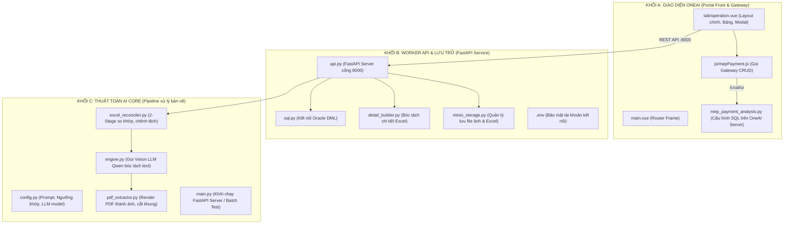
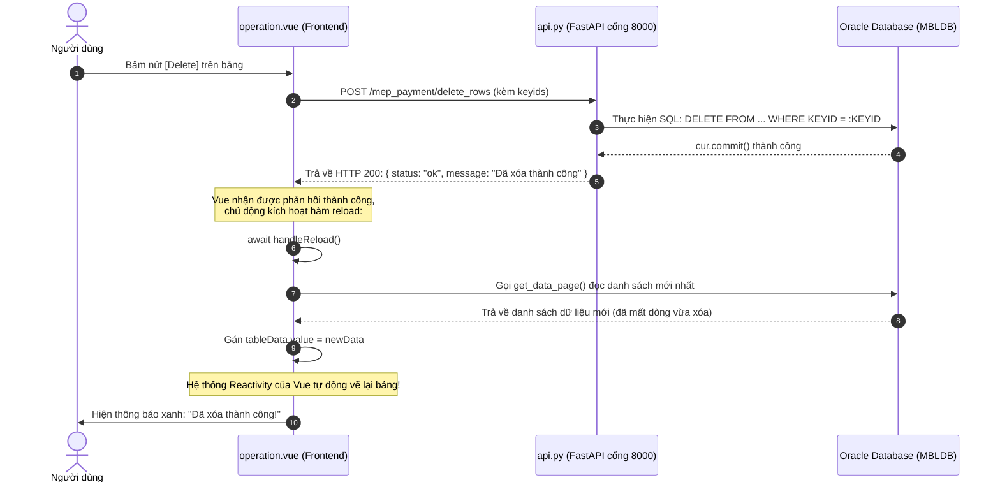

# 📘 TÀI LIỆU SỐ 12: GIẢI MÃ TOÀN DIỆN KIẾN TRÚC, LUỒNG DỮ LIỆU & BẢN CHẤT LIÊN KẾT GIỮA ONEAI VÀ WORKER ENGINE

> **Dành cho:** Kỹ sư phát triển phần mềm, Kỹ sư AI & Quản trị hệ thống OneAI  
> **Mục tiêu:** Giải đáp toàn bộ các thắc mắc về luồng code, bản chất kết nối giữa Frontend Vue.js, Gateway OneAI, FastAPI Worker, MinIO và Oracle Database; so sánh trực quan với mô hình Android RecyclerView.

---

## MỤC LỤC
1. [Tổng Quan 3 Khối Mã Nguồn Trong Dự Án](#1-tổng-quan-3-khối-mã-nguồn-trong-dự-án)
2. [Bí Ẩn: Tại Sao Sai Pass DB Ở Code Chính Mà OneAI Vẫn Load Được Dữ Liệu?](#2-bí-ẩn-tại-sao-sai-pass-db-ở-code-chính-mà-oneai-vẫn-load-được-dữ-liệu)
3. [Bản Chất Của `mepPayment.js` Và Biến `BASE_REQ_ID`](#3-bản-chất-của-meppaymentjs-và-biến-base_req_id)
4. [Ảo Thuật Mạng: `0.0.0.0:8000` vs `127.0.0.1:8000` Kết Nối Với Nhau Như Thế Nào?](#4-ảo-thuật-mạng-00008000-vs-1270018000-kết-nối-với-nhau-như-thế-nào)
5. [Đường Dẫn Endpoint: `/mep_payment/delete_rows` Hay Đổi Tên Thành `delete_rows_abc`?](#5-đường-dẫn-endpoint-mep_paymentdelete_rows-hay-đổi-tên-thành-delete_rows_abc)
6. [Cơ Chế Đồng Bộ: Vue.js Nhận Biết DB Thay Đổi Bằng Cách Nào?](#6-cơ-chế-đồng-bộ-vuejs-nhận-biết-db-thay-đổi-bằng-cách-nào)
7. [So Sánh Cơ Chế Hiển Thị: Vue.js Data Binding vs Android RecyclerView](#7-so-sánh-cơ-chế-hiển-thị-vuejs-data-binding-vs-android-recyclerview)
8. [Bản Chất Của `detail_builder.py`: Đọc Gì, Trả Về Gì Và Hiển Thị Modal Ra Sao?](#8-bản-chất-của-detail_builderpy-đọc-gì-trả-về-gì-và-hiển-thị-modal-ra-sao)
9. [Sơ Đồ Luồng Tổng Thể Từ Click Đến Database](#9-sơ-đồ-luồng-tổng-thể-từ-click-đến-database)

---

## 1. TỔNG QUAN 3 KHỐI MÃ NGUỒN TRONG DỰ ÁN

Hệ thống được tổ chức thành 3 khối phân tầng rất rõ ràng:



### Chi tiết vai trò:
1. **Khối C (AI Core):** `config.py`, `pdf_extractor.py`, `engine.py`, `excel_reconciler.py`, `main.py`.  
   - Đây là **"bộ não tính toán offline"**: Chịu trách nhiệm biến file PDF bản vẽ thành dữ liệu bảng vật tư số và so khớp với file Excel dự toán của nhà thầu.
2. **Khối A (OneAI Platform):** `main.vue`, `operation.vue`, `operation.css`, `mepPayment.js`, `mep_payment_analysis.py`.  
   - `main.vue`: Khung vỏ ngoài tích hợp vào hệ thống OneAI của công ty.
   - `operation.vue`: Màn hình giao diện nghiệp vụ thực tế (chứa bảng, 5 thẻ KPI, nút upload, modal soi bản vẽ).
   - `mepPayment.js` & `mep_payment_analysis.py`: Cầu nối query dữ liệu qua cổng Gateway của OneAI.
3. **Khối B (Backend Worker FastAPI):** `api.py`, `sql.py`, `detail_builder.py`, `minio_storage.py`, `.env`.  
   - Cung cấp dịch vụ nền chạy ngầm (Background Worker) trên cổng 8000 để tiếp nhận file upload dung lượng lớn, xử lý AI nặng, đọc chi tiết lỗi và dọn dẹp bộ nhớ MinIO.

---

## 2. BÍ ẨN: TẠI SAO SAI PASS DB Ở CODE CHÍNH MÀ ONEAI VẪN LOAD ĐƯỢC DỮ LIỆU?

> **Hiện tượng bạn quan sát:** Khi cố tình điền sai mật khẩu/tên đăng nhập Oracle trong file `.env` hoặc `sql.py` của dự án chính, mở giao diện OneAI lên **bảng dữ liệu vẫn load ra bình thường!**

### Giải mã nguyên nhân:
Hệ thống có **2 ĐƯỜNG KẾT NỐI VÀO DATABASE HOÀN TOÀN TÁCH BIỆT NHAU**:

```
ĐƯỜNG 1 (Hiển thị bảng OneAI):
Trình duyệt OneAI -> /crud/ui -> Server OneAI Gateway (chạy file mep_payment_analysis.py) -> DNS="MBLDB" -> Oracle DB

ĐƯỜNG 2 (Worker AI tác vụ nặng):
Trình duyệt OneAI -> http://127.0.0.1:8000 (api.py) -> sql.py (đọc mật khẩu từ .env) -> Oracle DB
```

1. **Khi hiển thị bảng (Đường 1):**  
   - Giao diện `operation.vue` gọi hàm `get_data_page()` trong `mepPayment.js`.  
   - Hàm này gửi HTTP GET tới đường dẫn nội bộ OneAI: `/crud/ui`.  
   - Yêu cầu này được xử lý bởi **Hệ thống Gateway Server của OneAI**, chạy file `mep_payment_analysis.py`.  
   - Trong file đó có cấu hình `dns="MBLDB"`. Mật khẩu và tài khoản của DNS `MBLDB` đã được cấu hình cố định trong **Server nội bộ OneAI của công ty** (hoặc DBeaver của OneAI Server).  
   - 👉 **Hệ thống OneAI Gateway HOÀN TOÀN KHÔNG ĐỌC file `.env` hay `sql.py` trên máy tính cục bộ của bạn.** Do đó, bạn sửa sai file `.env` thì bảng OneAI vẫn kết nối bằng cấu hình nội bộ của nó và lấy dữ liệu lên bình thường!

2. **Khi nào file `.env` và `sql.py` mới có tác dụng? (Đường 2):**  
   - Chỉ khi bạn thực hiện các thao tác gọi về máy cục bộ cổng 8000:
     - Bấm nút **Upload file Excel** (đẩy file lên AI).
     - Bấm **Chạy lại AI** (`handleRerun`).
     - Bấm **Save** (`handleSave`) cập nhật dòng.
     - Bấm **Delete** (`handleDelete`) xóa dòng và dọn dẹp MinIO.
   - Lúc này, `api.py` nhận lệnh và gọi hàm trong `sql.py` $\rightarrow$ `sql.py` mới đọc tài khoản, mật khẩu trong file `.env`. Nếu file `.env` sai mật khẩu, các nút Save/Delete/Upload sẽ báo lỗi ngay lập tức!

---

## 3. BẢN CHẤT CỦA `mepPayment.js` VÀ BIẾN `BASE_REQ_ID`

Trong `mepPayment.js`, bạn thấy đoạn code:
```javascript
const BASE_REQ_ID = "menu_operation.mep_payment.mep_payment_analysis"

export async function get_data_page(page = 1, pageSize = 50, status = "ALL", paymentMonth = "ALL", keyword = "ALL") {
  const reqId = `${BASE_REQ_ID}:getdata_page`
  const param = { start_row: 1, end_row: 50, STATUS: status, PAYMENT_MONTH: paymentMonth, KEYID: keyword }
  const parameter = { [reqId]: param }
  const res = await api.get(`/crud/ui?_t=${Date.now()}`, { params: parameter, loading: false })
  return res.data[reqId].VAL
}
```

### Tại sao lại viết như vậy? Cơ chế hoạt động là gì?
1. **`BASE_REQ_ID` là gì?**  
   - Đây là **tọa độ đường dẫn file Python** trên Server OneAI Platform:  
     `menu_operation.mep_payment.mep_payment_analysis` chính là đường dẫn thư mục:  
     `oneai_integration/backend/menu_operation/mep_payment/mep_payment_analysis.py` (dấu chấm thay cho dấu `/`).
2. **`reqId = "${BASE_REQ_ID}:getdata_page"` là gì?**  
   - Dấu hai chấm `:` chỉ định tên biến `QuerySettings` cụ thể nằm bên trong file Python đó.  
   - Cụ thể ở đây là biến `getdata_page = QuerySettings(...)`.
3. **Gateway OneAI nhận và trả về cái gì?**  
   - Khi bạn gửi request tới `/crud/ui`, Gateway OneAI sẽ:
     1. Tìm tới file `mep_payment_analysis.py`.
     2. Lấy câu query trong biến `getdata_page`.
     3. Ráp các biến trong `param` (`start_row`, `end_row`, `STATUS`, `KEYID`) vào các vị trí `:start_row`, `:end_row`, v.v. trong câu SQL.
     4. Chạy câu lệnh SQL trên Oracle DB (DNS MBLDB).
     5. Đóng gói kết quả dưới dạng JSON:
        ```json
        {
          "menu_operation.mep_payment.mep_payment_analysis:getdata_page": {
            "VAL": [
              { "STT": 1, "KEYID": "WOR2510150002", "TASK_NAME": "Lắp ống Chiller", "STATUS": "COMPLETED", "ERROR_COUNT": 2, "PIC": "Nguyễn Văn Hùng", ... },
              { "STT": 2, "KEYID": "WOR2510150003", "TASK_NAME": "Điện nước tầng 1", "STATUS": "WAITING", ... }
            ]
          }
        }
        ```
   - Câu lệnh `return res.data[reqId].VAL` chính là **bóc tách mảng danh sách các dòng dữ liệu** (Array of Objects) gửi về cho Vue gán vào `tableData.value`!

---

## 4. ẢO THUẬT MẠNG: `0.0.0.0:8000` vs `127.0.0.1:8000` KẾT NỐI VỚI NHAU NHƯ THẾ NÀO?

> **Bạn thắc mắc:** Ở bên code Python chạy host `0.0.0.0`, port `8000`, trong khi bên OneAI Vue lại gọi tới `http://127.0.0.1:8000`. Tại sao 2 IP khác nhau hoàn toàn mà vẫn kết nối được với nhau?

### Lời giải thích đơn giản:
Trong mạng máy tính (Networking):
- **`0.0.0.0` KHÔNG PHẢI là một địa chỉ IP thật của một máy nào cả!**
- Khi một Server (FastAPI) cấu hình `host="0.0.0.0"`, nó đang ra lệnh cho hệ điều hành Windows:  
  👉 *"Hãy mở cổng 8000 và chấp nhận kết nối từ **MỌI ĐƯỜNG DẪN MẠNG** trên máy tính này!"*
  - Đường nội bộ (Loopback): `127.0.0.1` hoặc `localhost`
  - Đường mạng LAN/Wifi: `192.168.1.15`
  - Đường mạng công ty / VPN: `10.x.x.x`
- Do đó:
  - Khi Server lắng nghe ở `0.0.0.0:8000`, nó tự động lắng nghe luôn cả trên `127.0.0.1:8000`.
  - Trình duyệt chạy Vue.js gọi tới `http://127.0.0.1:8000` (nghĩa là gọi chính máy tính của mình qua card mạng ảo Loopback).
  - Gói tin đi thẳng vào cổng 8000 mà FastAPI đang đợi sẵn!
- **Tại sao phải cấu hình `0.0.0.0`?**  
  Nếu cấu hình `host="127.0.0.1"`, chỉ có máy tính của bạn mới gọi được; khi đưa code lên máy chủ nội bộ hoặc Kubernetes (K8s), các máy khác trong mạng sẽ không thể truy cập vào được. Cấu hình `0.0.0.0` giúp mã nguồn chạy mượt mà ở cả môi trường Local và Production.

---

## 5. ĐƯỜNG DẪN ENDPOINT: `/mep_payment/delete_rows` HAY ĐỔI TÊN THÀNH `delete_rows_abc`?

> **Bạn thắc mắc:** Có phải `/mep_payment/delete_rows` chỉ là một cái tên để gọi không? Nếu đổi thành `delete_rows_abc` thì có chạy được không?

### Câu trả lời: **CHÍNH XÁC 100%!**
- Endpoint HTTP chỉ đơn thuần là một **tên định danh đường dẫn (Route URL)**.
- Giống như việc bạn dán một nhãn tên lên hộp thư. Miễn là **người gửi** và **người nhận** đồng nhất cùng một tên nhãn thì thư sẽ đến đúng nơi:

```python
# Trong backend/api.py:
@app.post("/delete_rows_abc")
async def xoa_dong(req: DeleteRowsRequest):
    ...
```
```javascript
// Trong operation.vue:
const res = await axios.post("http://127.0.0.1:8000/delete_rows_abc", { keyids: dbKeys })
```
Hai đoạn code trên hoạt động **hoàn toàn chính xác và giống hệt nhau**!

### Vậy tại sao mọi người thường đặt có chữ `/mep_payment/` ở đầu?
- Đây là **Quy chuẩn kiến trúc RESTful API (API Namespacing)**:  
  Khi hệ thống mở rộng, trên một server sẽ có nhiều chức năng khác nhau như `/user/delete`, `/ai_bill/delete`, `/mep_payment/delete`. Thêm tiền tố `/mep_payment/` giúp phân loại rõ ràng tính năng thuộc về dự án nào và tránh xung đột đường dẫn giữa các đội phát triển.

---

## 6. CƠ CHẾ ĐỒNG BỘ: VUE.JS NHẬN BIẾT DB THAY ĐỔI BẰNG CÁCH NÀO?

> **Bạn thắc mắc:** Có phải Vue có cơ chế tự động biết DB thay đổi để gọi `handleReload` không?

### Câu trả lời: **VUE KHÔNG THỂ TỰ BIẾT DB THAY ĐỔI NẾU KHÔNG ĐƯỢC CHỈ ĐỊNH!**
Oracle Database nằm ở một máy chủ cơ sở dữ liệu độc lập. Khi một dòng bị xóa trong DB, DB **không tự gửi tín hiệu nào** về trình duyệt web cả.

Hệ thống hoạt động trơn tru là nhờ **Quy trình điều khiển tuần tự (Imperative Control Flow)** do lập trình viên thiết lập:



Tất cả các hành động khác (**Insert, Save, Upload, Rerun**) đều đi theo đúng mô hình 5 bước này:
1. **Thao tác** $\rightarrow$ 
2. **Gọi Worker API** $\rightarrow$ 
3. **Thực hiện câu lệnh SQL & Commit** $\rightarrow$ 
4. **Nhận kết quả phản hồi OK** $\rightarrow$ 
5. **Chủ động gọi `handleReload()`** để lấy bản sao dữ liệu mới nhất hiển thị lên UI.

---

## 7. SO SÁNH CƠ CHẾ HIỂN THỊ: VUE.JS DATA BINDING vs ANDROID RECYCLERVIEW

So sánh của bạn với **RecyclerView trên Android** là cực kỳ chuẩn xác! Hai nền tảng tuy khác ngôn ngữ nhưng cùng chia sẻ triết lý thiết kế (Design Pattern):

| Khái niệm | Trong Android (Java / Kotlin) | Trong Vue.js (Element Plus Table) |
| :--- | :--- | :--- |
| **Data Source (Nguồn dữ liệu)** | `List<MepItem> dataList` | `const tableData = ref([])` (Mảng JavaScript Objects) |
| **Thẻ hiển thị danh sách** | `<androidx.recyclerview.widget.RecyclerView>` | `<el-table :data="tableData">` |
| **Item Layout (Khuôn của từng dòng)** | `item_mep_row.xml` | Mỗi dòng của `<el-table>` tự lặp qua mảng dữ liệu |
| **ViewHolder / Bind dữ liệu** | `holder.tvWo.setText(item.getKeyId())` | `<el-table-column prop="KEYID" label="SỐ CÔNG VIỆC" />` |
| **Custom ô dữ liệu (Badge, Button)** | `holder.btnDelete.setOnClickListener(...)` | `<template #default="{ row }"><el-button @click="handleDelete(row)" /></template>` |
| **Làm mới danh sách** | `adapter.notifyDataSetChanged()` | Chỉ cần gán: `tableData.value = newData` (Vue tự động re-render) |

### Ví dụ dữ liệu thực tế truyền đi và nhận về:
1. **API trả về cho Vue:**
```json
[
  {
    "STT": 1,
    "KEYID": "WOR2510150004",
    "TASK_NAME": "Lắp đặt ống Chiller Phase 2",
    "PAYMENT_MONTH": "2026-11",
    "PIC": "Nguyễn Văn Hùng",
    "STATUS": "COMPLETED",
    "ERROR_COUNT": 2
  }
]
```
2. **Vue render vào từng ô bảng thông qua thuộc tính `prop`:**
   - `<el-table-column prop="KEYID" />` $\rightarrow$ Tự động đọc thuộc tính `"KEYID"` và in ra `"WOR2510150004"`.
   - `<el-table-column prop="PIC" />` $\rightarrow$ Tự động đọc thuộc tính `"PIC"` và in ra `"Nguyễn Văn Hùng"`.
   - `<template #default="{ row }">`: Biến `{ row }` chính là **đối tượng item tại vị trí dòng đó**, tương đương với `dataList.get(position)` trong hàm `onBindViewHolder` của Android!

---

## 8. BẢN CHẤT CỦA `detail_builder.py`: ĐỌC GÌ, TRẢ VỀ GÌ VÀ HIỂN THỊ MODAL RA SAO?

> **Bạn thắc mắc:** File `detail_builder.py` đọc kiểu gì? Khi bấm vào lỗi thì API trả kết quả gì và giao diện modal hiển thị lên như thế nào?

### Luồng xử lý chi tiết từng bước:
1. **Người dùng click vào badge kết quả kiểm tra:**  
   Ví dụ click vào: `<el-tag>❌ Lệch 2 lỗi</el-tag>` của dòng `WOR2510150004`.
2. **Vue gọi hàm `openDetailModal(row)`:**
   ```javascript
   const res = await axios.get(`http://127.0.0.1:8000/mep_payment/detail/WOR2510150004`)
   ```
3. **Phía Server FastAPI gọi hàm `build_task_detail()` trong `detail_builder.py`:**
   - `detail_builder.py` tìm file Excel báo cáo đối soát tại thư mục:  
     `output/reconcile_WOR2510150004.xlsx` (hoặc tải từ MinIO Storage nếu chạy server).
   - Mở sheet `1. Đối Soát Bản Vẽ` bằng thư viện `openpyxl`.
   - **Cách đọc từng dòng:**
     - Duyệt từng hàng vật tư từ trên xuống dưới.
     - Kiểm tra ô ở cột **`Note`**:  
       - Nếu cột `Note` trống $\rightarrow$ Vật tư khớp 100%, bỏ qua.
       - Nếu cột `Note` có chữ (Ví dụ: `"Lệch BV 0205 (AI:10.0 | Ven:20.0)"` hoặc `"Chỉ có ở bản vẽ"`):  
         $\rightarrow$ Đọc Mã SDAC, Tên vật tư, Đơn vị tính, Khối lượng thanh toán, Khối lượng AI đo đạc.  
         $\rightarrow$ Đóng gói thành 1 phần tử trong mảng `errors`.
     - Quét các cột bản vẽ (`0105`, `0205`, `0305`,...):  
       $\rightarrow$ Đóng gói thành mảng nhóm `groups` phục vụ hiển thị chi tiết theo bản vẽ.
     - Lấy danh sách link ảnh crop bản vẽ từ MinIO / ổ đĩa:  
       $\rightarrow$ Đóng gói thành mảng `images`.
4. **`detail_builder.py` đóng gói thành 1 cục JSON duy nhất trả về:**
```json
{
  "keyid": "WOR2510150004",
  "error_count": 2,
  "total_items": 66,
  "drawings_count": 5,
  "match_rate": "78.8%",
  "errors": [
    {
      "id": 1,
      "type": "Lệch KL & Phụ trội",
      "dwg": "0205",
      "code": "M03-07190434",
      "name": "RECEPTACLE EXPOSED BOX",
      "unit": "each",
      "vendor_qty": 20.0,
      "ai_qty": 10.0,
      "diff": "Thiếu 10.0 (Lệch PT)",
      "msg": "Lệch BV 0205: AI [PT:30%] | Vendor [PT:20%]"
    }
  ],
  "images": [
    { "url": "/mep_payment/image/WOR2510150004/0205_crop.png", "title": "Bản vẽ 0205" }
  ]
}
```
5. **Giao diện Modal Vue.js (`operation.vue`) nhận dữ liệu và hiển thị:**
   - **4 thẻ thống kê ở đầu modal:** Lấy từ `error_count`, `drawings_count`, `total_items`, `match_rate`.
   - **Tab 1: Danh Sách Lỗi:** Dùng `<el-table :data="currentDetail.errors">` hiển thị danh sách các lỗi đã bóc tách. Cột chênh lệch có tag màu đỏ/vàng tùy mức độ lệch.
   - **Tab 2: Đối Chiếu Theo Bản Vẽ:** Hiển thị Accordion dạng cây theo mảng `groups`.
   - **Tab 3: Soi Bản Vẽ:** Đọc mảng `currentDetail.images`, hiển thị dải thumbnail ảnh, bấm vào ảnh sẽ phóng to toàn màn hình để kỹ sư đối chiếu trực tiếp.

---

## 9. SƠ ĐỒ LUỒNG TỔNG THỂ TỪ CLICK ĐẾN DATABASE

```
[ NGƯỜI DÙNG TƯƠNG TÁC TRÊN TRÌNH DUYỆT ]
      │
      ├─► 1. Xem bảng / Phân trang / Tìm kiếm (Read-only)
      │     └─► Gọi mepPayment.js (get_data_page)
      │           └─► OneAI Gateway (/crud/ui)
      │                 └─► mep_payment_analysis.py (chạy SQL trên Oracle qua DNS MBLDB)
      │                       └─► Trả mảng JSON -> Vue hiển thị lên Table Grid
      │
      ├─► 2. Upload file Excel nghiệm thu / Chạy AI (Heavy Processing)
      │     └─► Gọi FastAPI Worker (:8000/mep_payment/upload)
      │           ├─► MinIO: Lưu trữ file gốc
      │           ├─► Thuật toán AI Core (engine.py + excel_reconciler.py) bóc tách & so khớp
      │           └─► sql.py: Cập nhật STATUS='COMPLETED', ERROR_COUNT, PIC vào Oracle DB
      │
      ├─► 3. Bấm xem chi tiết lỗi (Modal)
      │     └─► Gọi FastAPI Worker (:8000/mep_payment/detail/{id})
      │           └─► detail_builder.py: Mở file Excel kết quả, bóc tách dòng lỗi
      │                 └─► Trả về JSON chi tiết lỗi & ảnh bản vẽ cho Modal hiển thị
      │
      └─► 4. Double-click sửa WO / Sửa Tháng KT / Xóa dòng (DML Write)
            └─► Gọi FastAPI Worker (:8000/mep_payment/save_rows hoặc delete_rows)
                  ├─► sql.py: Chạy UPDATE / DELETE và thực hiện cur.commit()
                  ├─► MinIO: Xóa sạch folder tài liệu liên quan
                  └─► Trả về { status: "ok" } -> Vue gọi handleReload() làm mới bảng
```

---

## 10. TỔNG KẾT
1. **Giao diện và Backend tách bạch hoàn toàn:** Vue.js đóng vai trò hiển thị và gửi lệnh (Client), FastAPI đóng vai trò phục vụ tính toán nặng và file nhị phân (Worker), còn OneAI Gateway phục vụ truy vấn hiển thị bảng tức thời (Gateway).
2. **Không có gì là "ảo":** `0.0.0.0` là lắng nghe đa giao diện; các đường dẫn endpoint là tên hàm được ánh xạ qua HTTP Route; dữ liệu nhận về là mảng JSON thuần túy được Vue tự động map vào các ô hiển thị tương tự cơ chế Adapter của RecyclerView.
3. **Mọi thao tác thay đổi dữ liệu** đều tuân thủ nguyên tắc: Gửi yêu cầu $\rightarrow$ Backend cập nhật DB $\rightarrow$ Báo thành công $\rightarrow$ Frontend chủ động gọi hàm nạp lại dữ liệu mới.


---

## 11. GIẢI MÃ CÂU HỎI CHUYÊN SÂU (DEEP DIVE 4 VẤN ĐỀ CỐT LÕI)

### 11.1. TẠI SAO TRẢ VỀ 200 THÌ VUE TỰ RELOAD? NẾU TRẢ VỀ 400, 500 HAY STATUS 'COMPLETED' THÌ SAO?

#### A. Đoạn code thực tế quyết định hành vi này:
Mở file `operation.vue`, tìm đến hàm `handleDelete`:

```javascript
// TRONG operation.vue (Dòng ~1270):
const handleDelete = async () => {
  try {
    // 1. GỬI REQUEST XÓA XUỐNG FASTAPI
    const res = await axios.post(`${FASTAPI_BASE_URL}/mep_payment/delete_rows`, { keyids: dbKeys })
    
    // 2. NẾU MỌI THỨ OK (HTTP STATUS 200) -> CODE CHẠY TIẾP ĐẾN ĐÂY:
    ElMessage.success(res.data?.message || `Đã xóa ${dbKeys.length} dòng thành công!`)
    await handleReload() // <<<< ĐÂY CHÍNH LÀ NƠI GỌI RELOAD!
    
  } catch (err) {
    // 3. NẾU SERVER TRẢ VỀ LỖI (HTTP STATUS 400, 500, HOẶC MẤT MẠNG):
    // DÒNG await handleReload() Ở TRÊN BỊ BỎ QUA NGAY LẬP TỨC!
    console.error("Lỗi xóa dòng:", err)
    ElMessage.error(err.response?.data?.detail || err.message || "Không thể xóa dòng đã chọn!")
  }
}
```

Và phía FastAPI `backend/api.py`:
```python
# TRONG backend/api.py (Dòng ~521):
@app.post("/mep_payment/delete_rows")
async def delete_rows_endpoint(req: DeleteRowsRequest):
    if not req.keyids:
        # TRẢ VỀ MÃ 400 (BAD REQUEST)
        raise HTTPException(status_code=400, detail="Vui lòng chọn ít nhất 1 dòng để xóa.")
    try:
        deleted_count = delete_tasks(req.keyids)
        # NẾU THÀNH CÔNG -> MẶC ĐỊNH FASTAPI TRẢ VỀ HTTP STATUS 200
        return {"status": "ok", "message": f"Đã xóa {deleted_count} dòng thành công!"}
    except Exception as e:
        # GẶP LỖI DATABASE CRASH -> TRẢ VỀ MÃ 500 (INTERNAL SERVER ERROR)
        raise HTTPException(status_code=500, detail=f"Lỗi khi xóa trong Database: {str(e)}")
```

#### B. Phân biệt cực kỳ quan trọng: HTTP Status Code vs Business Status (Trạng thái nghiệp vụ)
Nhiều lập trình viên mới hay bị nhầm lẫn giữa 2 loại status này:

| Loại Status | Ví dụ | Do ai quy định? | Ý nghĩa |
| :--- | :--- | :--- | :--- |
| **HTTP Status Code** | `200`, `400`, `404`, `500` | Chuẩn giao thức mạng Internet toàn cầu | Báo cho thư viện `axios` biết đường truyền mạng và server có khỏe mạnh không. |
| **Business Status** | `COMPLETED`, `RUNNING`, `WAITING`, `CANCEL` | Bạn tự định nghĩa trong bảng Oracle | Thể hiện hồ sơ thanh toán đó AI đã chạy xong chưa, hay đang xử lý ngầm. |

- **Nếu FastAPI trả về `200`:** Thư viện `axios` coi như thành công $\rightarrow$ Code chạy tiếp xuống dòng `await handleReload()`.
- **Nếu FastAPI trả về `400` hoặc `500`:** Thư viện `axios` lập tức **ném ra lỗi (throw Exception)** $\rightarrow$ Nhảy thẳng vào khối `catch (err)` $\rightarrow$ Hiện thông báo đỏ `ElMessage.error(...)` $\rightarrow$ **KHÔNG HỀ GỌI `handleReload()`**, màn hình giữ nguyên!
- **Còn Business Status `COMPLETED` thì sao?**  
  Nó là một giá trị chữ nằm trong JSON kết quả của Database (ví dụ: `row.STATUS = 'COMPLETED'`). Khi `handleReload()` kéo mảng dữ liệu về, Vue thấy `STATUS === 'COMPLETED'` thì nó đổi màu nhãn thành màu xanh lá cây (`<el-tag type="success">Hoàn Tất</el-tag>`), hoàn toàn không ảnh hưởng tới mã lỗi HTTP 200/400/500 của Web server!

---

### 11.2. `tableData.value = newData` LÀ GÌ? CÓ GIỐNG OBSERVER TRONG ANDROID KHÔNG?

#### CÂU TRẢ LỜI LÀ: **GIỐNG HỆT 100% CƠ CHẾ OBSERVER / LIVEDATA TRONG ANDROID!**

Hãy xem sự tương đồng kỳ diệu giữa 2 nền tảng:

```
[ ANDROID JETPACK ]                            [ VUE.JS 3 ]
val tableData = MutableLiveData<List<Item>>()   const tableData = ref([])
         │                                              │
tableData.observe(this) { newData ->           <el-table :data="tableData">
    adapter.submitList(newData)                 (Vue tự động đăng ký observer ngầm)
}                                                       │
         │                                              │
tableData.value = newData                       tableData.value = newData
         │                                              │
(LiveData thông báo cho observer)              (Proxy Setter kích hoạt reactivity)
         │                                              │
RecyclerView tự vẽ lại các ViewHolder!          Màn hình Web tự vẽ lại các dòng!
```

#### Bản chất bên dưới của Vue:
1. Khi bạn khai báo `const tableData = ref([])`, Vue bọc mảng đó trong một đối tượng theo dõi gọi là **JavaScript Proxy**.
2. Khi trong template bạn viết `<el-table :data="tableData">`, Vue tự động đăng ký thẻ bảng này làm **Observer** (người theo dõi) của `tableData`.
3. Khi hàm `loadData()` chạy câu lệnh:
   ```javascript
   tableData.value = processed // <<<< ĐÂY LÀ HÀNH ĐỘNG PHÁT TÍN HIỆU (NOTIFY)
   ```
   Hàm Setter ngầm của Proxy lập tức thức tỉnh, gửi thông báo tới Observer: *"Dữ liệu đã có mảng mới! Hãy tính lại Virtual DOM và vẽ lại màn hình!"*.
4. Bạn không cần phải gọi `adapter.notifyDataSetChanged()` như Android, Vue tự động làm việc đó ở tầng thấp nhất.

---

### 11.3. VÍ DỤ CỤ THỂ CHI TIẾT TỪNG BƯỚC: TRUYỀN DỮ LIỆU ĐI VÀ NHẬN VỀ (BẤM LƯU DÒNG SỬA)

Hãy theo dõi một kịch bản có thật: **Bạn sửa tên WO từ `WOR_CU` thành `WOR2510150004` rồi bấm nút [Save]**.

```
[BƯỚC 1: TRÊN MÀN HÌNH]
Bạn gõ vào ô Số Công Việc: "WOR2510150004", Tên CV: "Lắp ống Chiller", Tháng: "2026-11".
Biến dòng đó mang cờ: row.isEditing = true, row.old_keyid = "WOR_CU".
Bấm nút [Save] trên Action Bar.

          │
          ▼
[BƯỚC 2: HÀM handleSave TRONG operation.vue ĐÓNG GÓI JSON GỬI ĐI]
Code thực thi:
const payload = {
  rows: [
    {
      "KEYID": "WOR2510150004",
      "OLD_KEYID": "WOR_CU",
      "TASK_NAME": "Lắp ống Chiller",
      "PAYMENT_MONTH": "2026-11",
      "PIC": "Nguyễn Văn Hùng",
      "isNew": false
    }
  ]
}
Gửi HTTP POST: axios.post("http://127.0.0.1:8000/mep_payment/save_rows", payload)

          │
          ▼
[BƯỚC 3: MẠNG INTERNET / CỔNG 8000 TRUYỀN ĐI GÓI HTTP REQUEST]
POST /mep_payment/save_rows HTTP/1.1
Host: 127.0.0.1:8000
Content-Type: application/json

{"rows":[{"KEYID":"WOR2510150004","OLD_KEYID":"WOR_CU","TASK_NAME":"Lắp ống Chiller","PAYMENT_MONTH":"2026-11","PIC":"Nguyễn Văn Hùng","isNew":false}]}

          │
          ▼
[BƯỚC 4: FASTAPI backend/api.py NHẬN VÀ XỬ LÝ]
FastAPI tự động chuyển chuỗi JSON thành đối tượng Python `req.rows`:
Trong sql.py, câu SQL được thực thi:
UPDATE LOCAL_AI.MEP_PAYMENT_ANALYSIS
SET KEYID = 'WOR2510150004', TASK_NAME = 'Lắp ống Chiller', PAYMENT_MONTH = '2026-11'
WHERE KEYID = 'WOR_CU';
cur.commit()  <-- Lưu chặt vào ổ đĩa Oracle!

          │
          ▼
[BƯỚC 5: FASTAPI TRẢ VỀ GÓI HTTP RESPONSE 200 OK]
HTTP/1.1 200 OK
Content-Type: application/json

{"status": "ok", "message": "Đã lưu thành công 1 bản ghi vào Database."}

          │
          ▼
[BƯỚC 6: VUE NHẬN PHẢN HỒI VÀ THỰC THI RELOAD]
const res = await axios.post(...)
res.data chính là: {"status": "ok", "message": "Đã lưu thành công 1 bản ghi vào Database."}
ElMessage.success("Lưu dữ liệu thành công!")
await handleReload() // <<<< Kéo dữ liệu mới nhất về

          │
          ▼
[BƯỚC 7: handleReload GỌI get_data_page KÉO MẢNG MỚI TỪ DB]
Gateway trả về mảng JSON mới:
[
  { "STT": 1, "KEYID": "WOR2510150004", "TASK_NAME": "Lắp ống Chiller", "PAYMENT_MONTH": "2026-11", ... }
]
Gán: tableData.value = processed
Màn hình vẽ lại ô WO hiển thị "WOR2510150004"!
```

---

### 11.4. VÍ DỤ MINH HỌA CHI TIẾT: API TRẢ KẾT QUẢ DETAIL VÀ OPERATION NHẬN HIỂN THỊ LÊN MODAL NHƯ THẾ NÀO?

Hãy theo dõi chính xác từng dòng code khi bạn click vào: **`❌ Lệch 2 lỗi`** của hồ sơ `WOR2510150004`.

#### Bước 1: Nơi phát sinh sự kiện click trên bảng (`operation.vue`)
```html
<!-- Cột KẾT QUẢ KIỂM TRA trong operation.vue (Dòng ~220) -->
<el-table-column label="KẾT QUẢ KIỂM TRA" width="150" align="center">
  <template #default="{ row }">
    <el-tag 
      type="danger" 
      class="cursor-pointer result-tag-badge" 
      @click="openDetailModal(row)"
    >
      ❌ Lệch 2 lỗi
    </el-tag>
  </template>
</el-table-column>
```

#### Bước 2: Hàm `openDetailModal(row)` kích hoạt và gửi request
```javascript
// TRONG operation.vue (Dòng ~1010):
const openDetailModal = async (row) => {
  currentTask.value = row               // Lưu dòng đang chọn
  showDetailDialog.value = true         // Bật modal popup lên màn hình
  detailLoading.value = true            // Hiện icon quay tròn xoay xoay đang tải...
  
  // Gửi request GET xuống FastAPI Worker:
  const res = await axios.get(`http://127.0.0.1:8000/mep_payment/detail/${row.KEYID}`)
  
  // Gán kết quả nhận được vào biến phản ứng currentDetail:
  currentDetail.value = res.data
  detailLoading.value = false           // Tắt icon quay tròn, hiển thị dữ liệu thật!
}
```

#### Bước 3: Phía FastAPI `api.py` và `detail_builder.py` xử lý
```python
# TRONG backend/api.py (Dòng ~403):
@app.get("/mep_payment/detail/{keyid}")
async def get_task_detail(keyid: str):
    # Gọi hàm build_task_detail trong detail_builder.py:
    detail = build_task_detail(keyid=keyid)
    return detail
```

`detail_builder.py` mở file `output/reconcile_WOR2510150004.xlsx`, bóc tách các dòng bị lệch và trả về **chuỗi JSON thực tế** như sau:

```json
{
  "keyid": "WOR2510150004",
  "mode": "MEP AI Vision (Qwen)",
  "error_count": 2,
  "drawings_count": 5,
  "total_items": 66,
  "match_rate": "78.8%",
  "errors": [
    {
      "id": 1,
      "type": "Lệch KL & Phụ trội",
      "dwg": "0305",
      "code": "M03-07190434",
      "name": "RECEPTACLE EXPOSED BOX",
      "unit": "each",
      "vendor_qty": "5.0",
      "ai_qty": "4.0",
      "diff": "Thiếu 1 (Lệch PT)",
      "msg": "Lệch BV 0305: AI [PT:30%] | Vendor [PT:20%]"
    },
    {
      "id": 2,
      "type": "Chỉ có ở bản vẽ",
      "dwg": "0205",
      "code": "M03-00728302",
      "name": "POWER CABLE F-CV 10mm2",
      "unit": "m",
      "vendor_qty": "0.0",
      "ai_qty": "107.0",
      "diff": "Chỉ có ở bản vẽ",
      "msg": "Mã vật tư chỉ xuất hiện trên bản vẽ thiết kế 0205, không có trong bảng dự toán nhà thầu"
    }
  ],
  "images": [
    { "url": "/mep_payment/image/WOR2510150004/0305_crop.png", "title": "Bản vẽ 0305" }
  ],
  "logs": [
    "[1] Khởi động AI Reconciler cho WOR2510150004",
    "[2] Đã quét 5 bản vẽ, phát hiện 2 vị trí sai lệch"
  ]
}
```

#### Bước 4: Vue Template nhận biến `currentDetail` và map vào giao diện như thế nào?

##### A. Map vào 4 ô Thẻ thống kê đầu Modal:
```html
<!-- Trong operation.vue (Dòng ~330): -->
<div class="m-stat">
  <!-- Vue đọc currentDetail.error_count -> in số 2 màu đỏ -->
  <b class="text-danger">{{ currentDetail.error_count }}</b>
  <span>Số lỗi phát hiện</span>
</div>

<div class="m-stat">
  <!-- Vue đọc currentDetail.drawings_count -> in số 5 -->
  <b>{{ currentDetail.drawings_count }}</b>
  <span>Bản vẽ AI bóc tách</span>
</div>

<div class="m-stat">
  <!-- Vue đọc currentDetail.total_items -> in số 66 -->
  <b>{{ currentDetail.total_items }}</b>
  <span>Dòng vật tư kiểm tra</span>
</div>

<div class="m-stat">
  <!-- Vue đọc currentDetail.match_rate -> in 78.8% -->
  <b>{{ currentDetail.match_rate }}</b>
  <span>Tỷ lệ đạt chuẩn</span>
</div>
```

##### B. Map vào Bảng danh sách lỗi (Tab 1: Danh Sách Lỗi):
```html
<!-- Trong operation.vue (Dòng ~375): -->
<!-- Gán mảng errors vào bảng: :data="currentDetail.errors" -->
<el-table :data="currentDetail.errors" border size="small">
  
  <!-- Cột 1: STT lỗi -> đọc error.id -> in 1, 2 -->
  <el-table-column prop="id" label="#" width="50" align="center" />
  
  <!-- Cột 2: Phân loại lỗi -> đọc error.type -> in tag vàng hoặc đỏ -->
  <el-table-column prop="type" label="Phân loại lỗi" width="165">
    <template #default="{ row }">
      <!-- Nếu là 'Lệch KL & Phụ trội' -> hiện tag vàng warning -->
      <el-tag v-if="row.type.includes('Phụ trội')" type="warning">{{ row.type }}</el-tag>
      <!-- Nếu là 'Chỉ có ở bản vẽ' -> hiện tag đỏ danger -->
      <el-tag v-else-if="row.type.includes('Chỉ có ở bản vẽ')" type="danger">{{ row.type }}</el-tag>
    </template>
  </el-table-column>

  <!-- Cột 3: Bản vẽ -> đọc error.dwg -> in "0305", "0205" -->
  <el-table-column prop="dwg" label="Bản vẽ" width="130" align="center" />

  <!-- Cột 4: Mã SDAC -> đọc error.code -> in "M03-07190434" -->
  <el-table-column prop="code" label="Mã SDAC" width="140" align="center">
    <template #default="{ row }"><b>{{ row.code }}</b></template>
  </el-table-column>

  <!-- Cột 5: Tên vật tư -> đọc error.name -> in "RECEPTACLE EXPOSED BOX" -->
  <el-table-column prop="name" label="Tên vật tư" min-width="180" />

  <!-- Cột 6: KL thanh toán (Vendor) -> đọc error.vendor_qty -> in "5.0" -->
  <el-table-column prop="vendor_qty" label="KL thanh toán" width="115" align="center" />

  <!-- Cột 7: SL Bản vẽ (AI) -> đọc error.ai_qty -> in "4.0" -->
  <el-table-column prop="ai_qty" label="SL Bản vẽ (AI)" width="125" align="center" />

  <!-- Cột 8: Chênh lệch -> đọc error.diff -> in tag đỏ "Thiếu 1 (Lệch PT)" -->
  <el-table-column prop="diff" label="Chênh lệch" width="165" align="center">
    <template #default="{ row }">
      <el-tag type="danger" effect="dark">{{ row.diff }}</el-tag>
    </template>
  </el-table-column>

  <!-- Cột 9: Chi tiết đối chiếu -> đọc error.msg -> in ghi chú chi tiết -->
  <el-table-column prop="msg" label="Chi tiết đối chiếu" min-width="220" />
</el-table>
```

👉 **Kết luận:** Dữ liệu từ file Excel được Python bóc thành **JSON thuần túy**; Vue.js chỉ việc dùng thẻ `<el-table :data="mảng_json">` và từng `<el-table-column prop="tên_thuộc_tính">` là toàn bộ các ô, màu sắc, chữ số sẽ tự động bay vào đúng vị trí trên màn hình!
